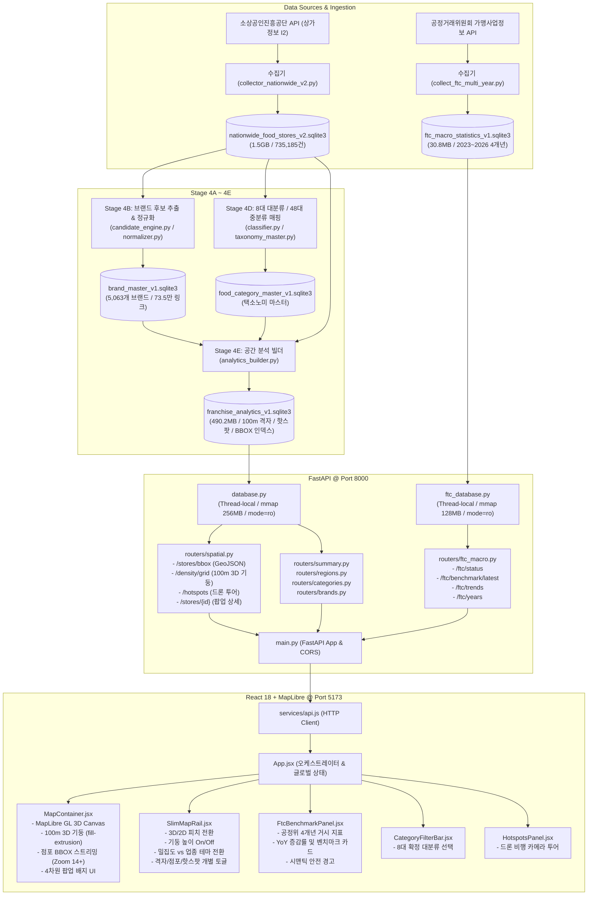

# Context for Argon: Franchise Dashboard System Architecture & Technical Review

본 문서는 **대한민국 외식 프랜차이즈 시장 분석을 위한 3D GIS 인터랙티브 대시보드 (`Franchise Dashboard`)** 프로젝트의 전체 디렉터리 구조, 모듈 간 의존성, 데이터 파이프라인 및 최근 작성된 핵심 파일들의 기술적 요약을 집대성한 문서입니다. 상위 AI 모델(Argon 등)에게 시스템 아키텍처, 성능 최적화, 데이터 무결성 및 시각화 계층에 대한 심층 아키텍처 리뷰를 받기 위해 작성되었습니다.

---

## 1. 프로젝트 개요 및 핵심 명세 (Project Overview)

- **프로젝트 명**: Franchise Dashboard (대한민국 외식 프랜차이즈 시장 분석 3D GIS 대시보드)
- **루트 경로**: `D:/Franchise_Dashboard`
- **현재 마일스톤**: **Phase 6 3D GIS MVP 완료 및 Phase 7 Step 7-1 실행환경 표준화/무결성 전수 통과** (82/82 테스트 PASS, 12개 API 스모크 테스트 100% PASS)
- **핵심 기술 스택**:
  - **백엔드**: Python 3.12.7, [FastAPI](https://fastapi.tiangolo.com/) (비동기 ASGI), Pydantic v2, SQLite3 (스레드 풀링, `mode=ro`, 256MB mmap, 64MB 캐시)
  - **프론트엔드**: React 18, Vite, [MapLibre GL JS](https://maplibre.org/) (3D `fill-extrusion`, GeoJSON 점포 스트리밍), Vanilla CSS 디자인 시스템 (다크 글래스모피즘)
  - **테스트/품질**: Pytest, Httpx (TestClient), CDP(Chrome DevTools Protocol) 기반 브라우저 레이어 실측 자동화
- **데이터 유니버스 (Data Universe)**:
  - 전국 외식업 고유 점포: **735,185개소** 전수 분석
  - 행정 구역: **16개 광역 시도, 256개 시군구**
  - 업종 분류 체계: **확정된 8대 대분류 및 48대 중분류 체계** (임의 신설/변경 엄격 금지)
  - 브랜드 데이터: **5,063개 브랜드 마스터**, 735,208개 점포-브랜드 링크 매핑
  - 공정거래위원회 거시통계: **4개년(2023~2026)** 가맹점 매출, 창업비용(가맹금/인테리어비 등) 시계열 횡단면 데이터
  - 공간 밀집도: **100m 정밀 격자 기둥 (ColumnLayer)** 및 **핵심 상권 핫스팟 (드론 비행 투어)**
- **현재 확정된 MVP 형태**:
  - `100m 헥사곤/격자 3D 기둥(fill-extrusion) + 줌레벨 14+ BBOX 개별 점포 스트리밍 + 공정위 4개년 거시통계 YoY 비교 드로어` 체제로 확정 운영.
  - 외부 3D 건물 레이어는 Phase 6 Step 6-3 평가 결과에 따라 성능/비용 최적화를 위해 차기 고도화 과제로 HOLD 상태 유지.

---

## 2. 전체 디렉터리 트리 구조 (Directory Tree)

```text
D:/Franchise_Dashboard/
├── .venv/                                   # Python 3.12.7 가상환경 (표준 런타임)
├── config/                                  # 시스템 메타데이터 및 택소노미 설정
│   ├── category_ftc_mapping_v1.json        # 8대 대분류 ↔ 공정위 외식업종 매핑 계약
│   ├── food_category_taxonomy_v1.json      # 확정 8대 대분류 / 48대 중분류 택소노미
│   ├── regions.json                        # 16개 시도 및 기초 시군구 메타데이터
│   └── regions_v2.json                     # 전국 통합 행정구역 공간 메타데이터
├── data/                                    # 핵심 SQLite 분석 데이터베이스 군 (읽기 전용 서빙)
│   ├── franchise_analytics_v1.sqlite3      # [핵심] 735,185건 전수 분석 마스터 DB (490.2MB)
│   ├── ftc_macro_statistics_v1.sqlite3      # [핵심] 공정위 4개년(2023~2026) 거시통계 DB (30.8MB)
│   ├── brand_master_v1.sqlite3             # [핵심] 5,063개 브랜드 마스터 및 735,208개 링크 DB (191.6MB)
│   ├── food_category_master_v1.sqlite3     # 8대/48대 업종분류 마스터 DB (410.6MB)
│   ├── nationwide_food_stores_v2.sqlite3   # 전국 외식 점포 1차 수집 원본 DB (1.5GB)
│   └── gangnam_food_stores.sqlite3         # [보호 자산] 강남구 초기 수집 검증 DB (15.1MB, 불변)
├── docs/                                    # 단계별 아키텍처 및 데이터 계약(Data Contracts) 문서
│   └── phase4/                             # Phase 4 파이프라인 단계별 계약 및 핸드오프 명세 (17종)
├── frontend/                                # React 18 + MapLibre GL JS 대시보드 웹 애플리케이션
│   ├── src/
│   │   ├── components/                     # 대시보드 UI 컴포넌트
│   │   │   ├── CategoryFilterBar.jsx       # 8대 대분류 필터 바 (SVG 아이콘 및 테마 연동)
│   │   │   ├── FtcBenchmarkPanel.jsx       # 공정위 창업비용/매출 벤치마크 및 YoY 증감 분석 패널
│   │   │   ├── Header.jsx                  # 글로벌 헤더 (지역 선택, 데이터 기준월, 새로고침)
│   │   │   ├── HotspotsPanel.jsx           # 주요 핵심 상권 핫스팟 순위 및 드론 비행 투어 트리거
│   │   │   ├── MapContainer.jsx            # [핵심] MapLibre 3D GIS 지도 (격자 기둥, 점포 BBOX 스트리밍, 팝업)
│   │   │   ├── MarketSummary.jsx           # 상단 핵심 KPI 요약 카드 (점포수, 프랜차이즈 침투율)
│   │   │   └── SlimMapRail.jsx             # [핵심] 지도 우측 슬림 인터랙션 제어 레일 (3D/2D, 테마, 레이어 토글)
│   │   ├── services/
│   │   │   └── api.js                      # 백엔드 API 통신 클라이언트 (Fetch & AbortController)
│   │   ├── utils/
│   │   │   └── ftcYoyComparison.js         # 공정위 4개년 YoY 증감률 계산 및 시맨틱 안전 포맷터
│   │   ├── App.jsx                         # [핵심] 프론트엔드 최상위 오케스트레이터 및 글로벌 상태
│   │   ├── index.css                       # 프리미엄 다크 테마/글래스모피즘 디자인 시스템 CSS (87KB)
│   │   └── main.jsx                        # React 진입점
│   ├── package.json                        # 프론트엔드 의존성 명세 (MapLibre GL JS v5, React 18)
│   └── vite.config.js                      # Vite 번들러 설정
├── reports/                                 # 단계별 실행 보고서, 품질 검증서 및 회귀 방지 실측 증빙
│   ├── phase7_step1_execution_report.md    # [최신] Phase 7-1 실행환경 표준화 종합 보고서
│   ├── phase7_step1_validation.json        # 82개 테스트 결과, 산출물 실측 바이트 크기, 무결성 JSON
│   ├── phase6_step1~3_reports...           # 3D GIS 렌더링, 레이어 토글, 건물 데이터 평가 보고서
│   └── phase5_reports...                   # 공정위 통합, YoY 계산, 브라우저 스위트 보고서
├── scripts/                                 # 표준 운영, 사전점검 및 자동화 검증 스크립트
│   ├── preflight_check.py                  # [핵심] 원클릭 5단계 환경/DB/해시 사전점검 스크립트
│   ├── smoke_test_api.py                   # [핵심] 12대 핵심 엔드포인트 자동 스모크 테스트 러너
│   ├── run_tests.py                        # [핵심] 82개 단위/통합 테스트 격리 러너 (운영 DB 100% 불변)
│   ├── collect_ftc_multi_year.py           # 공정위 다년도(2023~2026) 거시통계 수집 파이프라인
│   ├── recompute_ftc_r1.py                 # 공정위 거시통계 가공 및 집계 정밀 재계산기
│   ├── check_env.bat / .ps1                # 사전점검 원클릭 래퍼
│   ├── run_backend.bat / .ps1              # FastAPI 백엔드 안전 기동 스크립트
│   ├── run_frontend.bat / .ps1             # Vite 프론트엔드 개발서버 기동 스크립트
│   ├── run_smoke.bat                       # 스모크 테스트 실행 배치
│   └── run_tests.bat                       # 82개 전체 테스트 실행 배치
├── src/                                     # 데이터 파이프라인 및 백엔드 핵심 소스코드
│   ├── stage4a/                            # 소상공인 API 클라이언트 및 FTC 연동 실험 모듈
│   │   ├── ftc_api_client.py               # 공공데이터 API 비동기 클라이언트
│   │   └── schema_stage4a.py               # 1차 수집 스키마
│   ├── stage4b/                            # 브랜드 후보 추출, 상호명 정규화 엔진
│   │   ├── brand_dictionary.py             # 브랜드 사전 및 별칭 관리
│   │   ├── candidate_engine.py             # 전국 10개 이상 점포 클러스터링 후보 추출기
│   │   └── normalizer.py                   # 지점명/특수문자 제거 상호명 정규화기
│   ├── stage4c/                            # 브랜드 마스터 구축 및 탈동기화(Decoupled) 상태 모델
│   │   ├── brand_evidence.py               # 브랜드 검증 증거 수집기
│   │   ├── migration_pipeline.py           # 브랜드 마스터 마이그레이션 파이프라인
│   │   └── review_system.py                # 브랜드 후보 검토 및 판정 시스템
│   ├── stage4d/                            # 8대 대분류 및 48대 중분류 매핑 및 모호 분류 처리
│   │   ├── classifier.py                   # 규칙 기반 업종 분류기
│   │   └── taxonomy_master.py              # 48대 확정 중분류 마스터 관리자
│   └── stage4e/                            # [핵심] 다차원 공간 집계 및 FastAPI 백엔드 서빙 계층
│       ├── analytics_builder.py            # 73.5만 개 점포 공간 인덱스 및 격자 사전 집계기
│       ├── schema_stage4e.py               # 분석 마스터 DB DDL 및 인덱스 정의
│       └── api/                            # FastAPI 웹 서비스 모듈
│           ├── main.py                     # [진입점] FastAPI 앱, CORS 미들웨어, 라우터 통합
│           ├── database.py                 # [핵심] 분석 DB 읽기 전용 풀 (mmap 256MB, 스레드 로컬)
│           ├── ftc_database.py             # [핵심] 공정위 DB 읽기 전용 풀 (mmap 128MB, 독립 풀)
│           ├── schemas.py                  # Pydantic v2 공간/통계 API 응답 모델
│           ├── ftc_schemas.py              # Pydantic v2 공정위 거시통계 응답 모델
│           └── routers/                    # 엔드포인트별 비즈니스 라우터
│               ├── spatial.py              # [핵심] BBOX 점포 검색, 100m 3D 격자 기둥, 팝업, 핫스팟
│               ├── ftc_macro.py            # [핵심] 공정위 4개년 거시통계, 창업비용 벤치마크, 트렌드
│               ├── summary.py              # 전국 총괄 통계 요약 (점포수, 대분류별 비율)
│               ├── regions.py              # 16개 시도 및 256개 시군구 계층 조회
│               ├── categories.py           # 8대/48대 분류 계층 조회
│               └── brands.py               # 5,063개 브랜드 검색 및 경쟁 분석
├── tests/                                   # 82개 전수 통과 단위/통합 테스트 스위트
│   ├── test_phase4_stage4a.py              # 소상공인 API 클라이언트 및 수집 계약 테스트 (10개)
│   ├── test_phase4_stage4b.py              # 브랜드 후보 추출 및 정규화 평가 테스트 (19개)
│   ├── test_phase4_stage4c.py              # 브랜드 마스터 구축 및 분류 테스트 (11개)
│   ├── test_phase4_stage4d.py              # 8대 대분류/48대 중분류 매핑 무결성 테스트 (11개)
│   ├── test_phase4_stage4e.py              # 73.5만 건 점포 및 공간 집계 쿼리 테스트 (15개)
│   ├── test_phase5b_step1.py               # 공정위 거시통계 및 창업비용 API 테스트 (13개)
│   └── test_phase5b_step2_supplement.py     # 연도 선택 및 원자적 폴백 보완 테스트 (3개)
├── AGENTS.md                                # [보안/규칙] AI 에이전트 작업 지침 및 불변 자산 보호 규칙
├── README.md                                # 포괄적인 프로젝트 운영 가이드 및 퀵스타트
├── requirements.txt                         # 최소 필수 Python 의존성 명세
├── collector.py                             # [보변 자산] 초기 강남구 수집기 (SHA-256 검증 대상)
└── run_gangnam.bat                          # [보호 자산] 초기 강남구 배치 파일 (SHA-256 검증 대상)
```

---

## 3. 핵심 모듈 간 의존성 및 아키텍처 다이어그램 (Architecture & Dependencies)

### 3.1 전체 엔드투엔드 데이터 흐름 및 모듈 의존성



### 3.2 핵심 아키텍처 설계 특징 (Design Decisions)

1. **소상공인 공간 데이터와 공정위 재무 데이터의 완전 분리 (Decoupled State Model)**:
   - 소상공인 점포 데이터(73.5만 건, 지번/위경도 물리 점포)와 공정거래위원회 정보공개서 거시통계(브랜드 본사/가맹본부 단위의 연간 매출 및 창업비용)는 원천 데이터의 수집 단위와 갱신 주기가 상이합니다.
   - 따라서 단일 DB에 억지 조인(Join)하지 않고, [franchise_analytics_v1.sqlite3](file:///d:/Franchise_Dashboard/data/franchise_analytics_v1.sqlite3)와 [ftc_macro_statistics_v1.sqlite3](file:///d:/Franchise_Dashboard/data/ftc_macro_statistics_v1.sqlite3)로 물리적 분리했습니다.
   - 공통 분류 기준인 **'8대 대분류' ([category_ftc_mapping_v1.json](file:///d:/Franchise_Dashboard/config/category_ftc_mapping_v1.json))**를 브리지(Bridge)로 삼아 프론트엔드에서 동기화합니다.

2. **브랜드 공식성 4축 상태 모델 (Brand Officiality Taxonomy)**:
   - 일반 개인 음식점(독립점포)이 임의로 프랜차이즈로 분류되는 것을 방지하기 위해 4개 공식성 상태를 엄격히 구분합니다:
     - `FRANCHISE_CONFIRMED`: 공정위 등록 가맹사업 공식 브랜드 (예: 교촌치킨, 이디야 등)
     - `BRAND_CONFIRMED`: 가맹사업은 아니나 직영 중심 공인 대형 브랜드 (예: 스타벅스 코리아 직영점)
     - `UNVERIFIED`: 전국 점포수 10개 이상으로 추출된 프랜차이즈 후보군 (검증 진행 중)
     - `UNMATCHED`: 프랜차이즈가 아닌 일반 독립 자영업 점포

3. **3D GIS 렌더링 최적화 전략 (MapLibre `fill-extrusion` + BBOX Streaming)**:
   - 73.5만 개 점포를 전국 단위에서 한 번에 렌더링하면 브라우저 WebGL 컨텍스트가 즉시 크래시(OOM)됩니다.
   - **광역 시도/시군구 뷰 (Zoom < 14)**: 사전 집계된 `spatial_density_grid_100m` 테이블에서 100m 헥사곤/사각형 격자 데이터를 조회하여 MapLibre `fill-extrusion` 레이어로 3D 입체 기둥 형태로 초고속 렌더링.
   - **상세 골목 뷰 (Zoom >= 14)**: 카메라 시야에 들어오는 현재 화면 경계(`min_lon, min_lat, max_lon, max_lat`)만을 BBOX 파라미터로 백엔드에 요청하여 최대 500~2,000건의 GeoJSON Point만 점 단위로 스트리밍.

4. **운영 DB 100% 읽기 전용 불변 보장 (Zero-Mutation Contract)**:
   - FastAPI 백엔드의 DB 풀([database.py](file:///d:/Franchise_Dashboard/src/stage4e/api/database.py), [ftc_database.py](file:///d:/Franchise_Dashboard/src/stage4e/api/ftc_database.py))은 URI 연결 시 `?mode=ro` 및 `PRAGMA query_only = ON;`을 강제하여 서버 및 API 계층에서의 DB 변조를 원천 차단했습니다.
   - 82개 단위테스트 실행기([run_tests.py](file:///d:/Franchise_Dashboard/scripts/run_tests.py)) 또한 쓰기 테스트 시 `tempfile.NamedTemporaryFile` 복사본 DB를 주입하여 운영 DB에 단 1바이트의 쓰기도 발생하지 않도록 격리했습니다.

---

## 4. 최근 작성 및 핵심 파일 상세 요약 (Core Files Deep Dive)

### 4.1 백엔드 핵심 모듈

#### 1) [main.py](file:///d:/Franchise_Dashboard/src/stage4e/api/main.py) (FastAPI 진입점)
- **역할**: 백엔드 REST API의 중앙 진입점.
- **주요 내용**:
  - FastAPI 인스턴스 생성, CORS 미들웨어 등록(`allow_origins=["*"]`).
  - 6개 핵심 라우터 통합: `summary`, `regions`, `categories`, `brands`, `spatial`, `ftc_macro`.
  - 루트 헬스체크 엔드포인트(`GET /`): 서비스 상태, 버전(`1.1.0`), 데이터 기준월(`2026-07`), 점포 모수(`735,185`) 반환.
  - 전역 예외 핸들러: `ValueError` 발생 시 HTTP 400 JSON 자동 래핑.

#### 2) [database.py](file:///d:/Franchise_Dashboard/src/stage4e/api/database.py) (공간/분석 DB 연결 계층)
- **역할**: [franchise_analytics_v1.sqlite3](file:///d:/Franchise_Dashboard/data/franchise_analytics_v1.sqlite3)에 대한 고성능 읽기 전용 스레드 풀 관리.
- **주요 내용**:
  - `threading.local()` 기반의 스레드별 영속 연결 풀(`get_cached_connection()`).
  - 고속 메모리 매핑 PRAGMA 적용: `PRAGMA mmap_size = 268435456;` (256MB mmap), `PRAGMA cache_size = -64000;` (64MB RAM 캐시).
  - SQL 인젝션 방지를 위한 파라미터화 쿼리 래퍼 `query_one()`, `query_all()` 및 화이트리스트 검증기 `validate_whitelist()`.

#### 3) [ftc_database.py](file:///d:/Franchise_Dashboard/src/stage4e/api/ftc_database.py) (공정위 거시통계 DB 연결 계층)
- **역할**: [ftc_macro_statistics_v1.sqlite3](file:///d:/Franchise_Dashboard/data/ftc_macro_statistics_v1.sqlite3) 전용 읽기 전용 연결 계층.
- **주요 내용**:
  - 공간 분석 DB와의 완전한 연결 분리(Connection Isolation).
  - `PRAGMA query_only = ON;`, `PRAGMA mmap_size = 134217728;` (128MB mmap) 적용.
  - `ftc_query_one()`, `ftc_query_all()`을 통한 안전한 딕셔너리 리스트 반환.

#### 4) [spatial.py](file:///d:/Franchise_Dashboard/src/stage4e/api/routers/spatial.py) (3D GIS 공간 검색 라우터)
- **역할**: 3D 지도 렌더링에 필요한 공간 쿼리 및 GeoJSON 스트리밍 전담.
- **주요 엔드포인트**:
  - `GET /api/v1/spatial/stores/bbox`: 뷰포트 바운딩 박스 내 점포 검색. 인덱싱된 `lon BETWEEN ? AND ? AND lat BETWEEN ? AND ?` 쿼리 수행. 줌레벨에 따른 반환 상한 강제(과부하 방지) 및 고속 GeoJSON `FeatureCollection` 조립.
  - `GET /api/v1/spatial/stores/{bizes_id}`: 개별 점포의 3D 팝업용 상세 정보 및 4차원 UI 배지(공식성 색상, 직영/가맹 구분, 업종 확정 여부, 숍인숍 여부) 반환.
  - `GET /api/v1/spatial/density/grid`: 시군구/시도 단위 100m 밀집도 격자 기둥 데이터(`spatial_density_grid_100m`) 조회. `column_height_m`, 점포수, 대표업종 반환.
  - `GET /api/v1/spatial/hotspots`: 주요 상권 핫스팟 및 3D 드론 비행 카메라 경로(피치, 방위각, 줌레벨, 투어 순서) 목록 반환.

#### 5) [ftc_macro.py](file:///d:/Franchise_Dashboard/src/stage4e/api/routers/ftc_macro.py) (공정위 거시통계 라우터)
- **역할**: 공정위 4개년(2023~2026) 가맹사업 거시통계 및 벤치마크 지표 서빙.
- **주요 내용**:
  - `GET /api/v1/ftc/status`: FTC 데이터 수집 감사 로그 상태 및 최신 동기화 일시 반환.
  - `GET /api/v1/ftc/years`: 수집 완료(`status = 'COMPLETED'`)된 유효 기준연도 목록 동적 추출 (2026, 2025, 2024, 2023).
  - `GET /api/v1/ftc/benchmark/latest`: 선택된 연도/업종의 가맹점 평균/중앙값 매출, 평당 인테리어비용, 가맹금, 보증금 등 창업 벤치마크 지표 반환.
  - `GET /api/v1/ftc/trends`: 8대 대분류별 4개년 시계열 트렌드 및 통계 요약 제공.
  - 시간대 표준화: SQLite UTC 문자열을 한국 표준시(KST, `+09:00`) ISO-8601로 변환하는 `parse_utc_to_kst()` 구현.
  - 1시간 TTL 인메모리 딕셔너리 캐싱(`_CACHE_STORE`) 적용.

---

### 4.2 프론트엔드 핵심 모듈

#### 1) [App.jsx](file:///d:/Franchise_Dashboard/frontend/src/App.jsx) (최상위 대시보드 오케스트레이터)
- **역할**: 프론트엔드 전체 상태 관리, 데이터 페칭 조율 및 하위 컴포넌트 간 이벤트 버스 역할.
- **주요 기능**:
  - **지역 드릴다운 상태**: 광역 시도(`selectedSido`) 및 시군구(`selectedSigungu`) 선택 상태 관리 (기본값: 서울특별시 광진구 `11215`).
  - **업종 및 연도 필터**: 8대 대분류(`selectedCategory`) 및 공정위 연도(`selectedYear`) 상태 관리. URL 쿼리 파라미터(`?category=...&ftc_open=...`)와 양방향 동기화.
  - **비동기 경쟁 상태 방지(Race Condition Prevention)**: `AbortController` 및 요청 순번 Ref(`reqIdRef`)를 도입하여 빠른 연속 조작 시 지연 응답이 최신 상태를 덮어쓰지 않도록 원천 차단.
  - **컴포넌트 조율**: `MapContainer`, `SlimMapRail`, `CategoryFilterBar`, `MarketSummary`, `HotspotsPanel`, `FtcBenchmarkPanel`을 반응형 레이아웃으로 결합.

#### 2) [MapContainer.jsx](file:///d:/Franchise_Dashboard/frontend/src/components/MapContainer.jsx) (3D GIS 시각화 코어)
- **역할**: MapLibre GL JS 기반 3D 지도 인스턴스 라이프사이클 관리 및 WebGL 레이어 렌더링.
- **주요 기능**:
  - **베이스맵**: OpenStreetMap 오픈 타일 래스터 레이어 (`OSM_LIGHT_STYLE`).
  - **3D 밀집도 격자 기둥 레이어 (`density-grid-3d-columns`)**:
    - MapLibre `fill-extrusion` 타입 레이어 활용.
    - 기둥 높이(`fill-extrusion-height`): 격자별 점포수 비례 계산식 적용.
    - 테마별 색상 램프: 밀집도 5단계 색상(Sky Blue -> Crimson Red) 또는 8대 업종별 테마 색상(한식: 에메랄드, 치킨: 오렌지 등) 동적 스위칭.
  - **개별 점포 원형 레이어 (`store-points`)**:
    - 줌레벨 14 이상에서 뷰포트 이동(`moveend`) 시 BBOX 점포 GeoJSON을 페칭하여 Circle 레이어로 시각화.
    - 브랜드 공식성(`brand_officiality`)에 따라 녹색(공인가맹), 파랑(공인직영), 회색(독립점포)으로 차별화.
  - **인터랙티브 3D 팝업 (`maplibregl.Popup`)**: 점포 클릭 시 4차원 배지, 도로명 주소, 숍인숍 여부, 소진공 점포 ID가 담긴 커스텀 HTML 팝업 렌더링.
  - **드론 비행 투어 (`flyTo`)**: 상권 핫스팟 클릭 시 카메라를 해당 좌표로 부드럽게 활강(Glide) 이동하며 피치(45°~60°) 및 방위각 전환.

#### 3) [SlimMapRail.jsx](file:///d:/Franchise_Dashboard/frontend/src/components/SlimMapRail.jsx) (슬림 인터랙션 제어 레일)
- **역할**: 지도 우측에 플로팅되는 고밀도 단축 제어 패널.
- **주요 토글 컨트롤**:
  - **3D / 2D 시점 전환**: 피치(Pitch)를 60°(입체 조감도)와 0°(평면도)로 원클릭 전환.
  - **기둥 높이 On / Off**: `fill-extrusion-height`를 점포수 비례 높이 vs 0m(평면 다각형)로 토글.
  - **색상 테마 전환**: 밀집도 기준(Density Ramp) vs 업종 기준(Category Theme) 전환.
  - **레이어 Visibility 토글**: 3대 레이어(`격자`, `개별 점포`, `상권 핫스팟`)의 가시성을 `none` / `visible`로 개별 토글.

#### 4) [FtcBenchmarkPanel.jsx](file:///d:/Franchise_Dashboard/frontend/src/components/FtcBenchmarkPanel.jsx) (공정위 거시통계 및 YoY 패널)
- **역할**: 공정거래위원회 4개년 거시통계를 기반으로 업종별 창업비용 벤치마크 및 시계열 트렌드를 제공하는 접이식 슬라이드 드로어.
- **주요 기능**:
  - 연도 선택 탭 (2023, 2024, 2025, 2026): DB 수집 완료된 연도 동적 표시.
  - 4대 핵심 창업 지표 카드: 연평균 매출액, 면적(3.3㎡)당 매출액, 총 창업비용, 3.3㎡당 인테리어 비용.
  - **YoY 시계열 증감률 배지**: 직전 연도 대비 상승(▲ 빨강) / 하락(▼ 파랑) / 보합(-) 시각화.
  - **시맨틱 안전(Semantic Safety) 안내**: 거시통계(공정위 본사 단위)와 개별 매장(소진공 점포)의 데이터 성격 차이를 명확히 고지하여 사용자 오해 방지.

#### 5) [ftcYoyComparison.js](file:///d:/Franchise_Dashboard/frontend/src/utils/ftcYoyComparison.js) (YoY 증감률 계산 유틸리티)
- **역할**: 4개년 거시통계의 전년 대비 증감액 및 증감률(%)을 안전하게 계산.
- **특징**: 0 나누기(`ZeroDivisionError`) 방어, 결측치 처리, 한국 원화(만원/억원 단위) 정밀 포맷터 탑재.

---

### 4.3 표준 운영, 검증 및 사전점검 스크립트

#### 1) [preflight_check.py](file:///d:/Franchise_Dashboard/scripts/preflight_check.py) (원클릭 환경 사전점검기)
- **역할**: 신규 환경 기동 전 시스템 정상 동작 요건을 5단계로 자동 검증.
- **검증 항목**:
  1. Python 런타임: 3.11 이상 여부 및 `.venv` 활성화 확인.
  2. 필수 의존성: `fastapi`, `uvicorn`, `pydantic`, `httpx`, `pytest` 임포트 검증.
  3. SQLite DB 무결성: `franchise_analytics_v1`, `ftc_macro_statistics_v1`, `brand_master_v1`의 테이블 스키마, 최소 레코드 수, `PRAGMA integrity_check` 수행.
  4. 프론트엔드 환경: Node.js 버전, `node_modules` 존재, `frontend/.env`의 `VITE_API_URL` RFC 8089 규격 유효성.
  5. 보호 자산 SHA-256 해시 대조: `collector.py`, `gangnam_food_stores.sqlite3`, `run_gangnam.bat` 불변성 검증.

#### 2) [smoke_test_api.py](file:///d:/Franchise_Dashboard/scripts/smoke_test_api.py) (12대 핵심 API 스모크 테스트)
- **역할**: 서버 프로세스 기동 여부와 무관하게 FastAPI TestClient 또는 라이브 HTTP 요청으로 핵심 12개 엔드포인트를 2초 내 전수 검증.
- **테스트 엔드포인트**:
  `GET /`, `summary`, `regions`, `regions/11`, `categories`, `brands/search`, `spatial/stores/bbox`, `spatial/density/grid`, `spatial/hotspots`, `ftc/status`, `ftc/benchmark/latest`, `ftc/trends`.
- 응답 상태 코드(200), 스키마 유효성, 데이터 건수, 응답시간을 밀리초(ms) 단위로 측정하여 요약 출력.

#### 3) [run_tests.py](file:///d:/Franchise_Dashboard/scripts/run_tests.py) (82개 테스트 격리 러너)
- **역할**: 7개 단위/통합 테스트 파일을 4개 모듈 그룹으로 안전하게 분할 실행.
- **특징**:
  - `parse_pytest_summary()` 정규식 파서로 실제 `passed` 건수를 동적 추출하여 82개 전수 합격(`passed == 82, failed == 0, error == 0`) 시에만 exit code 0 반환.
  - 테스트 중 임시 DB(`tempfile`)를 주입하여 운영 DB 쓰기를 원천 차단.

---

## 5. 보호 자산 관리 계약 (Immutability Contract)

본 프로젝트는 강남구 초기 수집 자산의 역사적 무결성과 벤치마크 재현성을 위해 다음 3종 파일의 변경을 영구히 금지하고 있습니다:

| 파일명 | 절대 경로 | SHA-256 체크섬 | 보호 목적 |
|---|---|---|---|
| `collector.py` | `D:/Franchise_Dashboard/collector.py` | `341BAC12BB0AF58DCBDEBBA9459033521F27DF9817E35BAD8B21A4D07BA3369C` | 초기 강남구 수집 로직 불변 보존 |
| `gangnam_food_stores.sqlite3` | `D:/Franchise_Dashboard/gangnam_food_stores.sqlite3` | `FEE3B58651CFED5C390C0B95DB02B05EBE92DF18619A06F4E399D429236F3A78` | 강남구 11,296건 원본 데이터베이스 불변 보존 |
| `run_gangnam.bat` | `D:/Franchise_Dashboard/run_gangnam.bat` | `0582C3A1AE53450DDC482E9BF538510780CA2F14D44E987CC753D4E12C816491` | 강남구 수집 실행 스크립트 불변 보존 |

※ 모든 사전점검([preflight_check.py](file:///d:/Franchise_Dashboard/scripts/preflight_check.py)) 및 테스트 실행 시마다 위 해시가 1비트의 오차도 없이 자동 대조됩니다.

---

## 6. 상위 AI(Argon)를 위한 아키텍처 리뷰 중점 질의 (Key Review Prompts)

상위 AI 아키텍트 모델로서 다음 4가지 핵심 영역에 대해 시스템 구조를 평가하고, 고도화 권고안을 제시해 주시기 바랍니다:

1. **대용량 공간 데이터(73.5만 건) SQLite 기반 단일 파일 서빙의 한계 및 발전 경로**:
   - 현재 `PRAGMA mmap_size = 256MB`, 스레드 로컬 캐싱, BBOX 경도/위도 복합 인덱스(`idx_store_spatial_lookup`)를 통해 서브밀리초(0.5~2ms) 조회가 달성되어 있습니다.
   - 향후 전국 200만 개 이상으로 확장되거나 동시 동시접속자가 증가할 경우, **DuckDB(Spatial Extension)**, **PostGIS**, 또는 **사전 생성 벡터 타일(MVT / PMTiles)** 체제로의 전환 시점 및 마이그레이션 아키텍처는 어떻게 설계하는 것이 최적인가?

2. **MapLibre GL JS 3D `fill-extrusion` 렌더링 파이프라인의 GPU 메모리 최적화**:
   - 현재 100m 정밀 격자 기둥은 1,000~3,000개의 다각형 Extrusion을 WebGL 버퍼에 올려 렌더링하고 있습니다.
   - 모바일 기기 및 저사양 GPU 환경에서 프레임 드랍(60 FPS 유지)을 방어하기 위한 추가적인 클라이언트 측 지오메트리 간소화(LOD, Level of Detail) 또는 deck.gl `ColumnLayer`(인스턴스드 렌더링) 전환의 실익은 어느 정도인가?

3. **이종 공공데이터 융합의 시맨틱 안전성(Semantic Safety)**:
   - 본 시스템은 소상공인 개별 점포(현장 점포수, 공간 밀집도)와 공정위 가맹본부 거시통계(평균 매출, 창업비용)를 8대 대분류를 기준으로 한 화면에 함께 보여줍니다.
   - 사용자가 "이 지역 이 점포의 매출이 공정위 평균 매출과 같다"고 오인하지 않도록 현재 구축된 시맨틱 안전 장치(주의 고지, 출처 명시, 분리된 드로어 UI) 외에 추가로 권장되는 데이터 시각화 UX 베스트 프랙티스는 무엇인가?

4. **테스트 아키텍처 및 무결성 검증 체계의 완전성**:
   - 현재 구현된 82개 단위테스트와 12대 스모크 테스트, CDP 기반 브라우저 레이어 visibility 실측 파이프라인의 완성도를 평가하고, 프로덕션 배포 파이프라인(CI/CD) 관점에서 보완해야 할 E2E(End-to-End) 테스트 또는 스트레스 테스트 시나리오가 있는가?
