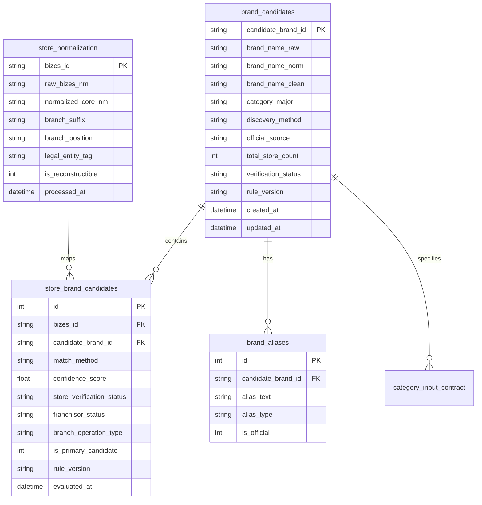

# Phase 4B 브랜드 후보 데이터 계약서 (Brand Candidate Data Contract)

- **문서 ID**: `DOC-PHASE4-STAGE4B-DATA-CONTRACT-V1`
- **프로젝트**: 대한민국 외식 프랜차이즈 시장 분석 3D GIS 대시보드 (`D:\Franchise_Dashboard`)
- **작성 단계**: Phase 4 / Stage 4B (브랜드 후보 데이터 모델 및 검증 계약 확정)
- **최종 검증일자**: 2026-10-13
- **계약 상태**: **ACTIVE & BINDING**

---

## 1. 개요 및 목적

본 문서는 전국 735,185건 외식업 점포를 대상으로 구축되는 **브랜드 후보 데이터베이스(`data/brand_candidates_v1.sqlite3`)**의 스키마, 엔터티 관계, 상태 전이 규칙, 품질 지표 산식 및 후속 단계(Stage 4C 브랜드 마스터, Phase 5~6 3D GIS 지도)와의 인터페이스를 정의하는 공식 데이터 계약서입니다.

---

## 2. Stage 4A 매칭 실험 지표 재검증 및 학술적 정밀화

Stage 4A 보고서에 제시되었던 매칭 지표의 수학적 산식과 표본 출처를 원본 실험 데이터와 대조하여 엄밀히 재검증하였습니다.

### 2.1 표본의 출처 및 구성
- **표본 대상**: 8대 외식업 대분류 전체를 아우르는 **37개 대표 브랜드** (한식 5, 중식 4, 일식 4, 양식 4, 치킨 6, 분식 4, 카페 5, 베이커리 5).
- **표본 점포 수**: 브랜드당 최대 30건씩 단순 `LIKE %브랜드명%` 질의를 통해 전국 v2 DB에서 추출된 **1,110건 점포 표본**.

### 2.2 지표 산식의 원천과 차이 규명

| 지표명 | 수치 | 계산 산식 | 통계적 의미 및 해석 |
| :--- | :---: | :---: | :--- |
| **전체 표본 중 오탐 의심률** | **47.84%** | `531 / 1,110 * 100` | 단순 LIKE 검색으로 추출된 전체 1,110건 중 일반 식당 오탐으로 분류된 점포의 점유율 |
| **휴리스틱 유효 부분집합 오탐률** | **56.67%** | `531 / (406 + 531) * 100` = `531 / 937 * 100` | 모호한 일치(173건)를 제외하고 잠정 참(TP: 406건)과 잠정 거짓(FP: 531건)으로 이진 판정된 937건 중 오탐 비율 |
| **휴리스틱 기준 잠정 정밀도** | **43.33%** | `406 / (406 + 531) * 100` = `406 / 937 * 100` | 단순 LIKE 질의 시 휴리스틱 필터가 정규 매칭(TP)으로 인정한 비율 |

### 2.3 엄격한 지표 표현 원칙 준수
> [!IMPORTANT]
> **표현 제약 준수 원칙**:
> 상기 43.33% 및 56.67%는 **사람이 직접 전수 검증한 골드 스탠다드(Gold Standard) 정답 라벨이 부재한 상태에서 도출된 '단순 키워드 검색의 잠정 휴리스틱 베이스라인'**입니다.
> 따라서 본 수치를 시스템의 '실제 정밀도'로 표현하지 않으며, Stage 4B에서는 사람이 검증 가능한 근거(공식 가맹정보, 실제 사업자 상호 구조) 기반의 정답 라벨링 평가셋을 통해 정밀도/재현율/F1을 정량 평가합니다.

---

## 3. 브랜드 후보 데이터베이스 스키마 명세

- **DB 파일 경로**: `data/brand_candidates_v1.sqlite3`
- **저널 모드**: `PRAGMA journal_mode=WAL; PRAGMA foreign_keys=ON;`
- **원본 DB 보존**: `data/nationwide_food_stores_v2.sqlite3`는 `mode=ro`로만 조회하며 100% 불변성을 보장함.

### 3.1 `brand_candidates` (브랜드 후보 마스터)
국내 외식업 프랜차이즈 후보 엔터티를 관리합니다.

| 컬럼명 | 데이터 타입 | 제약 조건 | 설명 |
| :--- | :--- | :--- | :--- |
| `candidate_brand_id` | TEXT | PRIMARY KEY | 후보 브랜드 고유 ID (예: `CAN_BRD_0001` 또는 `BRD_CHK_0001`) |
| `brand_name_raw` | TEXT | NOT NULL | 대표 브랜드 표기명 (예: `교촌치킨`, `스타벅스`) |
| `brand_name_norm` | TEXT | NOT NULL | 유니코드/공백 정규화된 대표명 |
| `category_major` | TEXT | NOT NULL | AGENTS.md 확정 8대 대분류 (`한식`, `치킨·패스트푸드` 등) |
| `discovery_method` | TEXT | NOT NULL | 후보 발견 경로 (`OFFICIAL_DICTIONARY`, `NATIONWIDE_CLUSTER_10PLUS`) |
| `official_source` | TEXT | NULL | 공식 출처 근거 (예: `FTC_EATOUT_2024`, `KFA_REGISTRY`, `UNOFFICIAL_STAT`) |
| `total_store_count` | INTEGER | NOT NULL DEFAULT 0 | 전국 73.5만 건 중 본 브랜드로 연결된 총 점포 수 |
| `verification_status`| TEXT | NOT NULL | 상태값: `OFFICIAL_VERIFIED`, `CANDIDATE_CLUSTER`, `PROVISIONAL`, `REVIEW_REQUIRED`, `REJECTED` |
| `rule_version` | TEXT | NOT NULL | 생성에 사용된 알고리즘 버전 (예: `4B.1.0`) |
| `created_at` | TEXT | NOT NULL | 최초 생성 시각 (ISO8601) |
| `updated_at` | TEXT | NOT NULL | 최종 갱신 시각 (ISO8601) |

### 3.2 `store_normalization` (상호 정규화 및 원본 보존)
전국 735,185건 개별 점포의 상호명 분해 및 원본 복원 데이터를 기록합니다.

| 컬럼명 | 데이터 타입 | 제약 조건 | 설명 |
| :--- | :--- | :--- | :--- |
| `bizes_id` | TEXT | PRIMARY KEY | 소진공 점포 고유 식별자 (20자리) |
| `raw_bizes_nm` | TEXT | NOT NULL | 소진공 원본 상호명 |
| `normalized_core_nm` | TEXT | NOT NULL | 법인격/특수문자/지점명이 분리된 순수 브랜드 코어 상호 |
| `branch_suffix` | TEXT | NULL | 추출된 지점 접미어 (예: `강남점`, `역삼1호점`, `본점`) |
| `branch_position` | TEXT | NOT NULL | 지점명 위치 (`SUFFIX`, `PREFIX`, `STANDALONE_COLUMN`, `NONE`) |
| `legal_entity_tag` | TEXT | NULL | 분리된 법인격 표기 (예: `(주)`, `주식회사`, `유한회사`) |
| `is_reconstructible`| INTEGER | NOT NULL DEFAULT 1 | 원본 상호 복원 가능 여부 (1: 가능, 0: 불능) |
| `processed_at` | TEXT | NOT NULL | 정규화 처리 일시 |

### 3.3 `store_brand_candidates` (점포-후보 N:M 매핑)
개별 점포와 브랜드 후보 간의 연결 관계 및 상태를 독립적으로 관리합니다.

| 컬럼명 | 데이터 타입 | 제약 조건 | 설명 |
| :--- | :--- | :--- | :--- |
| `id` | INTEGER | PRIMARY KEY AUTOINCREMENT | 매핑 레코드 순번 |
| `bizes_id` | TEXT | NOT NULL | 소진공 점포 고유 식별자 |
| `candidate_brand_id` | TEXT | NOT NULL | 연결된 브랜드 후보 ID |
| `match_method` | TEXT | NOT NULL | 매칭 방식: `EXACT_MATCH`, `ALIAS_MATCH`, `CLUSTER_MATCH`, `FUZZY_MATCH` |
| `confidence_score` | REAL | NOT NULL | 매칭 신뢰도 (0.00 ~ 1.00) |
| `store_verification_status` | TEXT | NOT NULL | 점포 단위 판정: `VERIFIED_AUTO`, `PROVISIONAL`, `REVIEW_REQUIRED`, `REJECTED`, `INDEPENDENT_STORE` |
| `franchisor_status`| TEXT | NOT NULL DEFAULT 'UNCONFIRMED' | 공식 가맹사업자 여부 (`OFFICIAL_FRANCHISEE`, `UNCONFIRMED`, `INDEPENDENT`) |
| `branch_operation_type` | TEXT | NOT NULL DEFAULT 'UNKNOWN' | 운영 형태 (`FRANCHISE_STORE`, `DIRECT_OPERATED`, `UNKNOWN`) |
| `is_primary_candidate` | INTEGER | NOT NULL DEFAULT 1 | 복수 후보 중 대표 후보 여부 (1: 주후보, 0: 부후보) |
| `rule_version` | TEXT | NOT NULL | 적용된 매칭 규칙 버전 |
| `evaluated_at` | TEXT | NOT NULL | 평가 일시 |

---

## 4. 3대 독립 상태 관리 모델

데이터의 투명성과 추적성을 위해 다음 3가지 개념은 **절대 단일 플래그로 결합하지 않고 각각 독립된 컬럼으로 분리 운영**합니다:

1. **공식 가맹사업자 여부 (`franchisor_status`)**:
   - `OFFICIAL_FRANCHISEE`: 공정위 등록 프랜차이즈 브랜드 소속으로 공식 확인됨.
   - `UNCONFIRMED`: 프랜차이즈로 추정되나 공정위 정보공개서 직접 연결은 미확인.
   - `INDEPENDENT`: 10개 미만 단독 개인 점포.
2. **점포의 브랜드 귀속 및 신뢰도 (`store_verification_status`)**:
   - `VERIFIED_AUTO`: 정규화 코어 상호와 공식 브랜드/별칭이 완전 일치 (신뢰도 >= 0.95).
   - `PROVISIONAL`: 전국 10개 이상 클러스터링으로 도출된 비공식 프랜차이즈 후보.
   - `REVIEW_REQUIRED`: 유사 상호 충돌, 부가 수식어 결합 등 수동 검토 필요.
   - `REJECTED`: 부정 키워드 또는 일반명사 필터에 의해 제외됨.
   - `INDEPENDENT_STORE`: 전국 10개 미만 비프랜차이즈 개인 식당.
3. **가맹점 vs 직영점 구분 (`branch_operation_type`)**:
   - 소진공 상호명에 `직영점` 표기가 명시된 경우 `DIRECT_OPERATED`, 지점명에 `가맹점` 표기가 명시된 경우 `FRANCHISE_STORE`로 부여하되, 근거가 없는 경우 임의 추측하지 않고 **`UNKNOWN`**을 유지합니다.

---

## 5. 전국 10개 이상 점포 임계치 적용 원칙

- **비공식 후보 필터**: 사전에 공식 등록되지 않은 일반 상호의 경우, 전국 동일 정규화 상호 점포 수가 **최소 10개 이상**일 때만 `CANDIDATE_CLUSTER`로 승격하여 브랜드 후보 풀에 진입시킵니다.
- **공식 브랜드 예외 보존**: 사전/공식 확인된 브랜드(예: 직영점 위주 대형 브랜드, 특수 브랜드 등)는 전국 점포 수가 **10개 미만이어도 삭제하지 않고 공식 브랜드로 완전 보존**합니다.
