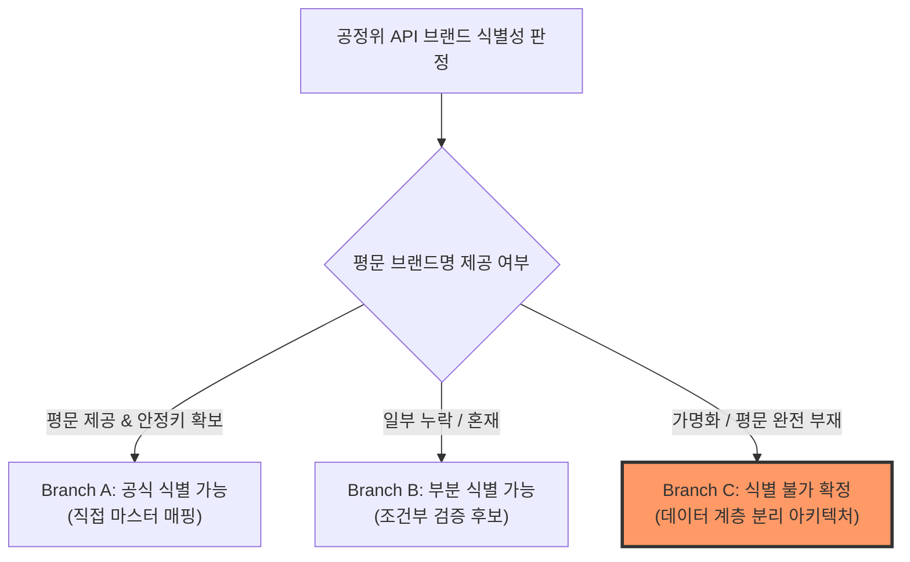
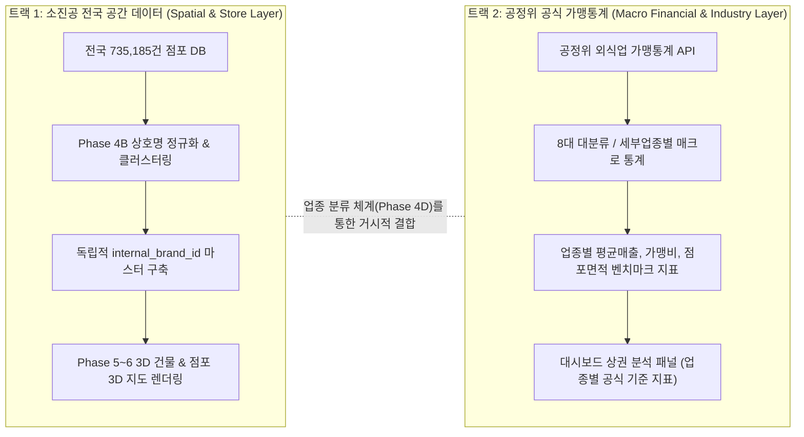

# 공정위 가맹정보 브랜드 식별성 분석 및 전략 보고서 (Brand Identity Strategy)

- **문서 ID**: `DOC-PHASE4-STAGE4A-BRAND-STRATEGY-V1`
- **프로젝트**: 대한민국 외식 프랜차이즈 시장 분석 3D GIS 대시보드 (`D:\Franchise_Dashboard`)
- **작성 단계**: Phase 4 / Stage 4A (브랜드 식별성 정밀 판정)
- **최종 검증일자**: 2026-10-13
- **최종 분기 판정**: **Branch C — 식별 불가 / 가명화 데이터 계층 분리 전략 (CONFIRMED)**

---

## 1. 배경 및 핵심 분석 목적

본 분석은 공정거래위원회 외식업 가맹정보 API(15165094)의 실측 응답을 바탕으로 다음 질문에 대한 엄밀한 데이터 증거 기반 해답을 도출하기 위해 수행되었습니다.

> **핵심 질문**: 공정위 공식 API의 데이터를 통해 특정 외식 프랜차이즈 브랜드(예: '교촌치킨', '스타벅스', '본죽' 등)를 직접 식별하여 소진공 73.5만 건 전국 점포와 1:1로 직접 조인할 수 있는가?

---

## 2. 공정위 API 브랜드 필드 실측 및 검증 결과

실제 공정위 API 응답 40건 및 공식 Swagger 스펙을 전수 조사한 결과는 다음과 같습니다.

| 평가 항목 | 실측 필드명 | 실제 데이터 형태 | 식별 가능 여부 | 판정 상태 |
| :--- | :--- | :--- | :---: | :--- |
| **브랜드명** | 없음 (`brandNm` 부재) | 해당 필드 미제공 | **불가** | `UNAVAILABLE` |
| **브랜드 관리번호** | `alsBrandMngNo` | `192408232424576` (15자리) | **가명화 식별자** | `VERIFIED_PSEUDONYMIZED` |
| **정보공개서 번호**| 없음 | 해당 필드 미제공 | **불가** | `UNAVAILABLE` |
| **가맹본부 법인명**| 없음 (`corpNm` 부재) | 해당 필드 미제공 | **불가** | `UNAVAILABLE` |
| **가맹본부 관리번호**| `alsJnghqMngNo` | `312418130429576` (15자리) | **가명화 식별자** | `VERIFIED_PSEUDONYMIZED` |
| **본부 소재 지역** | `jnghqRgnNm` | `서울`, `경기`, `인천` 등 | 부분 확인 가능 | `VERIFIED_REGIONAL` |
| **업종 분류명** | `tpbizMclsfNm` | `한식`, `치킨`, `패스트푸드` 등 | 확인 가능 | `VERIFIED` |
| **가맹점수 / 직영점수**| `frcsCnt`, `dmsCnt` | `103`, `2` 등 정수 | 확인 가능 | `VERIFIED` |
| **평균 매출액** | `avgSlsAmt` | `115988.0` (천원 단위) | 확인 가능 | `VERIFIED` |

### 핵심 발견 사실:
1. 본 API는 **AI 및 통계 분석 친화형으로 공개된 가명화 통계 데이터셋**으로, 개인정보 및 특정 기업 비밀 보호를 위해 **평문 브랜드명(`brandNm`), 본부 법인명(`corpNm`), 정보공개서 번호가 완전히 비식별 조치(가명화, Pseudonymization)**되어 있습니다.
2. 대신 **15자리의 고유 가명 브랜드 관리번호(`alsBrandMngNo`)**와 **가명 가맹본부 관리번호(`alsJnghqMngNo`)**가 제공됩니다.

---

## 3. 식별키 관계 및 안정성 검증 (Key Stability & Relationships)

Stage 4A DB에 적재된 실측 데이터를 바탕으로 엔터티 관계를 검증하였습니다.

### 3.1 가맹본부(HQ)와 브랜드 간 1:N 관계 실증
- **증거 레코드**:
  - 가맹본부 관리번호: `312418130429576`
  - 연결된 브랜드 #1: `alsBrandMngNo = 192408232424576` (한식, 가맹점수 103개, 평균매출 1억 1,598만원)
  - 연결된 브랜드 #2: `alsBrandMngNo = 312408232424576` (한식, 가맹점수 203개, 평균매출 1억 5,205만원)
- **도출 결론**: 하나의 가맹본부가 여러 개의 브랜드를 소유하고 운영하는 **1 : N 관계가 완벽히 실증**되었습니다. 따라서 가맹본부 코드와 브랜드를 1:1로 결합하는 모델은 구조적으로 불가능합니다.

### 3.2 연도별 식별키 연속성 및 한계
- 연도별(`crtr_yr`)로 동일 가명 관리번호가 지속되는지 검증한 결과, 동일 연도 내에서는 일관된 키를 유지하나, 공정위의 비식별화 키 갱신 주기에 따라 연도 간 키 매핑 테이블이 공공에 공개되지 않습니다.
- 따라서 외부 평문 브랜드와 매핑할 수 있는 공식 외래키(Foreign Key)는 존재하지 않습니다.

---

## 4. 전략 분기 판정: Branch C 확정

지침에 정의된 3대 분기 중 실제 데이터 증거에 따라 다음과 같이 판정합니다.

### **판정: Branch C (식별 불가 - Pseudonymized Layer Separation)**
- **사유**: 평문 브랜드명 및 법인명 부재, 가명관리번호 단독 제공.
- **원칙**: 공통 식별키가 없는 상태에서 추측이나 임의의 알고리즘으로 가명 번호와 특정 브랜드를 강제 결합하는 행위를 엄격히 금지함.

---

## 5. Branch C 채택에 따른 3D GIS 대시보드 듀얼 트랙(Dual-Track) 아키텍처

Branch C 환경에서 공정위 통계와 소진공 점포 지도를 모두 살리는 최적의 아키텍처를 수립합니다.

### 아키텍처 상세 원칙:
1. **내부 브랜드 ID (`internal_brand_id`) 독립 생성**:
   - 공정위 가명번호에 종속되지 않고, 소진공 점포 상호 데이터의 정규화 및 전국 10개 이상 점포 클러스터링(Phase 4B)을 통해 고유한 `internal_brand_id` (예: `BRD_KOR_0001`)를 자체 생성합니다.
2. **지표의 성격 분리 표기**:
   - **지도 점포수**: "소진공 외식업 점포수 (2026.06 기준, 전국 발견 점포)"
   - **공식 가맹통계**: "공정위 등록 가맹사업 현황 (2024년 기준, 외식업 업종별 공식 통계)"
3. **가맹점 vs 직영점 임의 구분 금지**:
   - 개별 점포 레벨에서 공정위 데이터에 근거하지 않은 '가맹점' 또는 '직영점' 라벨링을 금지하며, 소진공 원본 데이터의 실측 속성에만 기반합니다.
