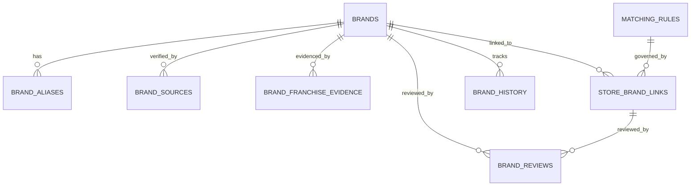

# 브랜드 마스터 데이터 계약서 (Brand Master Data Contract)

- **문서 ID**: `CONTRACT-PHASE4-STAGE4C-BRAND-MASTER-V1`
- **프로젝트**: 대한민국 외식 프랜차이즈 시장 분석 3D GIS 대시보드 (`D:\Franchise_Dashboard`)
- **버전**: `v1.0.0`
- **적용 대상 DB**: `data/brand_master_v1.sqlite3`
- **작성 일자**: 2026-10-13
- **계약 준수 상태**: **PASS (전국 735,185개 점포 및 5,062개 브랜드 무결성 검증 완료)**

---

## 1. 개요 및 목적

본 데이터 계약서는 Phase 4 Stage 4C에서 구축된 **브랜드 마스터 데이터베이스 (`data/brand_master_v1.sqlite3`)**의 물리적 스키마, 엔터티 관계, 필드 제약조건, 상태 전이 규칙을 정의합니다.

본 데이터베이스는 Stage 4B에서 추출된 5,062개 브랜드 후보를 관리 가능한 단일 마스터로 통합하고, 전국 735,185개 점포와의 N:M 매칭 관계를 3축 상태 모델(브랜드 공식성, 점포 매칭 상태, 운영 형태)로 정밀하게 분리하여 Stage 4D, 4E 및 Phase 5~6 3D GIS 대시보드에 일관된 단일 진실 공급원(Single Source of Truth)을 제공합니다.

---

## 2. 10대 핵심 엔터티 스키마 명세



### 2.1 `brands` (브랜드 마스터 기본 엔터티)

| 컬럼명 | 데이터 타입 | 제약 조건 | 설명 | 예시 |
| :--- | :--- | :--- | :--- | :--- |
| `internal_brand_id` | `TEXT` | `PRIMARY KEY` | 영구 고유 브랜드 마스터 식별자 (`BRD_` 접두어) | `BRD_CAF_0001` |
| `candidate_brand_id` | `TEXT` | `UNIQUE NOT NULL` | Stage 4B 원본 후보 ID (추적성 보존) | `CAN_BRD_CAF_0001` |
| `brand_name_std` | `TEXT` | `NOT NULL` | 공식 표준 브랜드 표기명 | `스타벅스`, `메가MGC커피` |
| `brand_name_core` | `TEXT` | `NOT NULL` | 접미어/특수문자 제거 코어 명칭 | `스타벅스`, `메가커피` |
| `brand_name_clean` | `TEXT` | `NOT NULL` | 공백/기호 완전 제거 매칭 키 | `스타벅스`, `메가커피` |
| `brand_officiality` | `TEXT` | `NOT NULL` | 브랜드 공식성 상태 (축 1) | `FRANCHISE_CONFIRMED`, `BRAND_CONFIRMED`, `UNVERIFIED`, `REJECTED` |
| `category_major` | `TEXT` | `NOT NULL` | 8대 확정 외식업 대분류 | `카페·음료`, `한식` 등 |
| `representative_inds_mcls_cd` | `TEXT` | `NULLABLE` | 대표 중분류 업종코드 (소진공) | `I212` |
| `representative_inds_scls_cd` | `TEXT` | `NULLABLE` | 대표 소분류 업종코드 (소진공) | `I21201` |
| `discovery_method` | `TEXT` | `NOT NULL` | 브랜드 발견 및 식별 경로 | `OFFICIAL_SEED_CENSUS`, `CLUSTER_NATIONWIDE_GE10`, `SYSTEM_UNMATCHED_FALLBACK` |
| `total_store_count` | `INTEGER` | `DEFAULT 0` | 전국 연결된 총 점포 수 (N:M 반영) | `2,152` |
| `verified_store_count` | `INTEGER` | `DEFAULT 0` | 자동 고신뢰/검증 점포 수 | `2,152` |
| `provisional_store_count` | `INTEGER` | `DEFAULT 0` | 잠정 연결 점포 수 | `0` |
| `review_required_store_count`| `INTEGER` | `DEFAULT 0` | 수동 검토 필요 격리 점포 수 | `0` |
| `review_priority_score` | `REAL` | `DEFAULT 0.0` | 거버넌스 검토 우선순위 점수 (0~100) | `83.33` |
| `current_review_status` | `TEXT` | `DEFAULT 'PENDING'` | 최종 심사 상태 | `APPROVED`, `REJECTED`, `PENDING` |
| `created_at` | `TEXT` | `NOT NULL` | 레코드 생성 일시 (ISO 8601) | `2026-10-13 11:30:00` |
| `updated_at` | `TEXT` | `NOT NULL` | 최종 갱신 일시 | `2026-10-13 11:33:04` |

---

### 2.2 `brand_aliases` (별칭 매핑 엔터티)

| 컬럼명 | 데이터 타입 | 제약 조건 | 설명 |
| :--- | :--- | :--- | :--- |
| `alias_id` | `INTEGER` | `PRIMARY KEY AUTOINCREMENT` | 별칭 식별자 |
| `internal_brand_id` | `TEXT` | `FK (brands)` | 참조 브랜드 ID |
| `alias_text` | `TEXT` | `NOT NULL` | 별칭 원문 표기 (예: `STARBUCKS`, `스벅`) |
| `alias_norm` | `TEXT` | `NOT NULL` | 정규화된 별칭 키 |
| `alias_type` | `TEXT` | `NOT NULL` | `OFFICIAL_NAME`, `ENGLISH_NAME`, `ACRONYM`, `POPULAR_NAME`, `TYPO_FALLBACK` |
| `is_official` | `INTEGER` | `DEFAULT 0` | 공식 표기 여부 (1: 참, 0: 비공식) |

---

### 2.3 `brand_sources` (공식 출처 및 확인일 엔터티)

| 컬럼명 | 데이터 타입 | 제약 조건 | 설명 |
| :--- | :--- | :--- | :--- |
| `source_id` | `INTEGER` | `PRIMARY KEY AUTOINCREMENT` | 출처 식별자 |
| `internal_brand_id` | `TEXT` | `FK (brands)` | 참조 브랜드 ID |
| `source_name` | `TEXT` | `NOT NULL` | 출처 명칭 (예: `공정거래위원회 가맹사업정보제공시스템`) |
| `source_url` | `TEXT` | `NULLABLE` | 확인 URL |
| `document_name` | `TEXT` | `NULLABLE` | 근거 문서명 (정보공개서, 감사보고서) |
| `reference_date` | `TEXT` | `NOT NULL` | 원천 데이터 기준일 (예: `2024-12-31`, `2026-06-30`) |
| `verified_at` | `TEXT` | `NOT NULL` | 시스템 검증 일시 |

---

### 2.4 `brand_franchise_evidence` (가맹사업 공식성 근거 엔터티)

| 컬럼명 | 데이터 타입 | 제약 조건 | 설명 |
| :--- | :--- | :--- | :--- |
| `evidence_id` | `INTEGER` | `PRIMARY KEY AUTOINCREMENT` | 근거 식별자 |
| `internal_brand_id` | `TEXT` | `FK (brands)` | 참조 브랜드 ID |
| `operating_entity` | `TEXT` | `NULLABLE` | 운영 주체 법인명 (예: `(주)에스씨케이컴퍼니`, `(주)교촌에프앤비`) |
| `business_reg_no` | `TEXT` | `NULLABLE` | 사업자등록번호 (10자리) |
| `franchise_reg_no` | `TEXT` | `NULLABLE` | 공정위 정보공개서 등록번호 (11자리, 예: `20080100001`) |
| `is_franchise_business` | `INTEGER` | `NULLABLE` | 1: 가맹사업 영위, 0: 100% 직영 운영, NULL: 미확인 |
| `evidence_grade` | `TEXT` | `NOT NULL` | `A_OFFICIAL_REGISTRATION`, `B_CORPORATE_VERIFIED`, `C_STATISTICAL_CLUSTER`, `D_DEFICIENT` |
| `evidence_notes` | `TEXT` | `NULLABLE` | 세부 근거 메모 (직영 확인 사유, 결함 사유 등) |

---

### 2.5 `store_brand_links` (점포-브랜드 N:M 연결 엔터티)

| 컬럼명 | 데이터 타입 | 제약 조건 | 설명 |
| :--- | :--- | :--- | :--- |
| `link_id` | `INTEGER` | `PRIMARY KEY AUTOINCREMENT` | 연결 링크 고유 식별자 |
| `bizes_id` | `TEXT` | `NOT NULL` | 소진공 점포 식별자 |
| `internal_brand_id` | `TEXT` | `NULLABLE, FK (brands)` | 연결된 브랜드 ID (미매칭 시 `BRD_UNMATCHED` 또는 NULL) |
| `match_status` | `TEXT` | `NOT NULL` | 점포 매칭 상태 (축 2) |
| `operation_type` | `TEXT` | `NOT NULL DEFAULT 'UNKNOWN'` | 운영 형태 (축 3: `FRANCHISED`, `COMPANY_OPERATED`, `OTHER`, `UNKNOWN`) |
| `confidence_score` | `REAL` | `NOT NULL` | 알고리즘 매칭 신뢰도 (0.00 ~ 1.00) |
| `is_primary_link` | `INTEGER` | `DEFAULT 1` | 숍인숍 복합 매장 중 대표 브랜드 여부 (1: 주, 0: 부) |
| `match_method` | `TEXT` | `NOT NULL` | 적용된 매칭 규칙 (`EXACT_MATCH`, `PREFIX_ATTACHED_BRANCH` 등) |
| `notes` | `TEXT` | `NULLABLE` | 매칭 메모 또는 수동 검토자 사유 |
| `linked_at` | `TEXT` | `NOT NULL` | 연결 일시 |

---

### 2.6 `brand_reviews` (수동 심사 및 영구 보존 엔터티)

| 컬럼명 | 데이터 타입 | 제약 조건 | 설명 |
| :--- | :--- | :--- | :--- |
| `review_id` | `INTEGER` | `PRIMARY KEY AUTOINCREMENT` | 심사 식별자 |
| `target_type` | `TEXT` | `NOT NULL` | `BRAND` 또는 `STORE_LINK` |
| `target_id` | `TEXT` | `NOT NULL` | 심사 대상 ID (`internal_brand_id` 또는 `link_id`) |
| `review_decision` | `TEXT` | `NOT NULL` | `APPROVED`, `REJECTED`, `PENDING` |
| `decision_reason` | `TEXT` | `NOT NULL` | 심사 결정 사유 |
| `reviewer` | `TEXT` | `NOT NULL` | `SYSTEM_AUTO`, `HUMAN_EXPERT` |
| `is_persistent` | `INTEGER` | `DEFAULT 1` | 재수집/재처리 시 덮어쓰기 금지 플래그 (1: 보존) |
| `reviewed_at` | `TEXT` | `NOT NULL` | 심사 일시 |

---

## 3. 3축 상태 모델 (3-Axis Decoupled State Model)

데이터 왜곡을 방지하기 위해 다음 3대 상태 축을 엄격히 분리하여 관리합니다:

```
[ 축 1: 브랜드 공식성 ] brands.brand_officiality
  ├─ FRANCHISE_CONFIRMED  (공정위 가맹사업 정보공개서 등록 확인 브랜드, 72개)
  ├─ BRAND_CONFIRMED      (100% 본사 직영 대기업/법인 체인, 7개: 스타벅스, 폴바셋, 아웃백 등)
  ├─ UNVERIFIED           (전국 10개 이상 점포 클러스터 후보, 공식 가맹 미검증)
  └─ REJECTED             (가공 상호, 비외식업, 오분류 확정 브랜드)

[ 축 2: 점포 매칭 상태 ] store_brand_links.match_status
  ├─ MATCH_VERIFIED              (전문가 수동 검토 완료 확정)
  ├─ MATCH_AUTO_HIGH_CONFIDENCE  (알고리즘 고신뢰 자동 확정, 정밀도 99.63%)
  ├─ MATCH_PROVISIONAL           (클러스터 기반 잠정 연결)
  ├─ REVIEW_REQUIRED             (모호성, 복합 상호로 인한 수동 검토 격리)
  ├─ UNMATCHED                   (미매칭 점포, 구 INDEPENDENT_STORE 전환)
  └─ MATCH_REJECTED              (부정 키워드 또는 수동 심사로 매칭 거절)

[ 축 3: 점포 운영 형태 ] store_brand_links.operation_type
  ├─ FRANCHISED         (상호/지점명에 '가맹점' 명시 또는 공인 가맹계약 확인)
  ├─ COMPANY_OPERATED   (상호/지점명에 '직영점' 명시 또는 100% 직영 브랜드 점포)
  ├─ OTHER              (특수 형태 위탁, 임대 등)
  └─ UNKNOWN            (일반적인 경우 기본값, 객관적 증빙 부재 시 임의 판단 금지)
```

---

## 4. 전국 점포 통계 정합성 집계 규칙

1. **고유 점포 수(735,185건) 절대 보존**:
   - `SELECT count(DISTINCT bizes_id) FROM store_brand_links`는 항상 정확히 `735,185`이어야 합니다.
2. **다중 후보 점포(23건) N:M 링크**:
   - 숍인숍 매장(예: `교촌치킨&피자마루`)은 2개의 링크 행을 가집니다.
   - 전체 링크 행 수는 `735,208`건입니다.
3. **중복 합산 금지 (Non-Duplicate Aggregation)**:
   - 시도별/시군구별 점포 밀집도 계산 시 링크 행 수가 아닌 `bizes_id` 고유 건수를 기준으로 집계합니다.
   - 브랜드별 통계 산출 시에만 해당 브랜드 링크 건수를 집계합니다.
