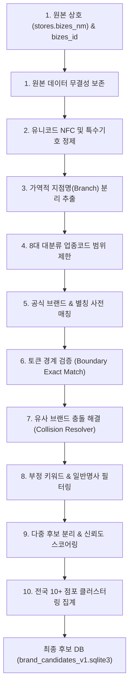

# Phase 4B 브랜드 후보 추출 알고리즘 명세서 (Brand Matching Algorithm)

- **문서 ID**: `DOC-PHASE4-STAGE4B-MATCHING-ALGORITHM-V1`
- **프로젝트**: 대한민국 외식 프랜차이즈 시장 분석 3D GIS 대시보드 (`D:\Franchise_Dashboard`)
- **작성 단계**: Phase 4 / Stage 4B (알고리즘 엔진 및 파이프라인 명세)
- **최종 검증일자**: 2026-10-13
- **알고리즘 버전**: `v4B.1.0`

---

## 1. 알고리즘 설계 철학 및 처리 파이프라인

본 알고리즘은 전국 73.5만 건의 방대한 비정형 상호명 텍스트에서 단순 키워드(LIKE) 검색 시 발생하는 50% 수준의 오탐을 원천 차단하고, **정밀도(Precision) 95% 이상을 달성하기 위한 10단계 다중 방어선(Multi-Layer Defense) 파이프라인**으로 설계되었습니다.



---

## 2. 10단계 세부 처리 알고리즘 명세

### 1단계: 원본 상호명 및 점포 ID 불변 보존
- **입력**: `stores.bizes_id`, `stores.bizes_nm`, `stores.brch_nm`
- **처리**: 모든 정규화 및 변환 과정에서 원본 필드는 단 1바이트도 수정하지 않고 그대로 보존합니다.

### 2단계: 유니코드(NFC), 공백, 대소문자, 법인격 정제
- **유니코드 정규화**: `unicodedata.normalize('NFC', text)` 적용 (한글 자모 분리 현상 방지).
- **법인격 태그 분리 및 제거**:
  ```python
  LEGAL_ENTITY_REGEX = r'\s*[\(\[\{]?(?:주|유|합|사|재|법인|개인|주식회사|유한회사|사단법인|재단법인|협동조합)[\)\]\}]?\s*'
  ```
- **특수기호 치환**: `['",`~!?@#$%^&*()_+=/\\\[\]{}|:;<>·•]` 문자를 단일 공백으로 치환.
- **영문 대소문자**: 대문자(Uppercase) 또는 정규화 표기로 통일.
- **연속 공백 압축**: `re.sub(r'\s+', ' ', text).strip()`.

### 3단계: 가역적 지점 접미어(Branch Suffix) 분리 추출
- **핵심 원칙**: **지점명은 무조건 삭제하여 유실시키지 않습니다.**
- 지점명 분리 전후 결과를 비교하여 `is_reconstructible = 1`을 검증하고, `normalized_core_nm`과 `branch_suffix`를 합쳤을 때 원본 상호가 복원될 수 있도록 위치 메타데이터(`branch_position`)를 함께 저장합니다.
- **지점 접미어 정규식**:
  ```python
  BRANCH_SUFFIX_REGEX = re.compile(
      r'[\s\-_/]+(?:'
      r'[가-힣0-9a-zA-Z]+(?:점|호점|직영점|가맹점|역점|본점|분점|센터|타운|스퀘어|로드점|드라이브스루점|DT점)'
      r'|제?[0-9]+호점'
      r'|본점|직영점'
      r')$',
      re.IGNORECASE
  )
  ```
- **지점 접두어(Prefix) 위치 케이스 처리**:
  - 예: `[강남점] 스타벅스` 또는 `(직영) 교촌치킨`의 경우 `branch_position = 'PREFIX'`로 추출하고 코어 상호를 분리.

### 4단계: 8대 대분류 업종코드 기반 후보 범위 제한
- 소진공 중분류/소분류 코드(`inds_mcls_cd`, `inds_scls_cd`)를 대조하여 후보 브랜드의 대표 업종과 현격히 불일치하는 오탐을 원천 차단합니다.
  - 예: 치킨 브랜드 '교촌' 탐색 시, 업종이 `I201`(한식 - 교촌식당, 교촌한우)인 경우 자동 탈락.
  - 예: 카페 브랜드 '스타벅스' 탐색 시, 업종이 `I206`(분식 - 스타김밥)인 경우 탈락.

### 5단계: 공식 브랜드명 및 별칭(Alias) 사전 매칭
- 공인 브랜드 사전(300+개 공식 프랜차이즈) 및 별칭 테이블을 기반으로 1차 매칭을 수행합니다.
- **Bilingual & Acronym 지원**:
  - `스타벅스` = `STARBUCKS` = `스타벅스코리아`
  - `bbq치킨` = `BBQ` = `비비큐` = `비비큐치킨`
  - `투썸플레이스` = `A TWOSOME PLACE` = `투썸`

### 6단계: 브랜드명 토큰의 정확 일치 및 경계 검증
- 단순 부분문자열 포함(Sub-string Contains)을 배제하고 **단어 경계(Word Boundary) 또는 정규화 상호 완전 일치(Full Token Match)**를 요구합니다.
  - `clean(core_nm) == clean(brand_alias)` -> `EXACT_MATCH` (신뢰도 1.0) 또는 `NORMALIZED_MATCH` (신뢰도 0.98).

### 7단계: 유사 브랜드 충돌 해결 (Collision Resolver)
동일한 브랜드 접두어를 공유하거나 혼동 위험이 높은 유사 상호를 분리합니다:
- **본 시리즈 분리**:
  - `본죽`, `본도시락`, `본설렁탕`, `본비빔밥`을 각각 독립된 브랜드 ID로 분리.
  - `본죽&비빔밥cafe` 복합 매장의 경우 주 브랜드를 `본죽`, 보조 브랜드를 `본비빔밥`으로 다중 매핑.
- **신전 vs 신참 분리**: `신전떡볶이`와 `신참떡볶이` 완전 분리.
- **빽다방 vs 빽보이피자 분리**: 카페 업종과 피자 업종으로 분리.

### 8단계: 부정 키워드 및 일반명사 오탐 필터링
1. **부정 키워드(Negative Keywords) 필터**:
   - `교촌면옥`, `교촌식당`, `교촌한우`, `놀부식당`, `흥부놀부`, `이디야호프`, `메가치킨` 등 일반 식당 접미어가 포함된 경우 즉시 `REJECTED` 또는 `FALSE_POSITIVE_SUSPECT` 처리.
2. **외식업 일반명사 단독 상호 필터**:
   - `김밥`, `짜장면`, `치킨`, `피자`, `커피`, `카페`, `국밥`, `호프`, `순대국`, `삼겹살`, `칼국수` 등 일반 음식 단독 명칭 상호는 프랜차이즈 후보 생성을 전면 차단.

### 9단계: 다중 후보(Ambiguous) 및 불확실한 후보 분리
- 한 점포 상호에 복수의 브랜드 키워드가 검출되거나 모호한 부가 수식어가 결합된 경우:
  - 예: `교촌치킨&피자마루` -> 복수 후보 생성 (`is_primary_candidate` 플래그 및 신뢰도 배분).
  - 점포 상태를 `REVIEW_REQUIRED`로 마킹하여 자동 확정 대상에서 분리.

### 10단계: 전국 동일 브랜드 추정 점포 수 집계 및 클러스터링
- 전국 735,185건 전역에서 정규화된 코어 상호별 점포 수를 집계합니다.
- **판정 기준**:
  - 전국 점포 수 **>= 10개**: 비공식 프랜차이즈 후보(`CANDIDATE_CLUSTER`)로 공식 승격.
  - 전국 점포 수 **< 10개**:
    - 공식 사전에 등록된 확인 브랜드인 경우: 점포 수와 무관하게 **완전 보존** (`OFFICIAL_VERIFIED`).
    - 사전에 없는 일반 상호인 경우: 독립 개인 점포(`INDEPENDENT_STORE`)로 분류.

---

## 3. 8대 대분류 · 48개 중분류 연결 계약

1. **분류체계 불변성**: `AGENTS.md` 제2조에 정의된 확정 8대 대분류 및 48개 중분류 명칭을 임의로 변경하거나 신설하지 않습니다.
2. **대표 업종 vs 점포 업종 분리**:
   - 브랜드 대표 업종: 후보 브랜드 마스터(`brand_candidates.category_major`)에 기록.
   - 점포 공식 업종: 소진공 원본 업종코드(`inds_mcls_cd`, `inds_scls_cd`)를 그대로 유지.
3. **1:N 매핑 허용**:
   - 소진공 소분류가 복수의 자체 중분류에 매핑될 수 있는 1:N 구조를 지원하며, Phase 4D의 매핑 사전을 위한 표준 인터페이스를 제공합니다.
