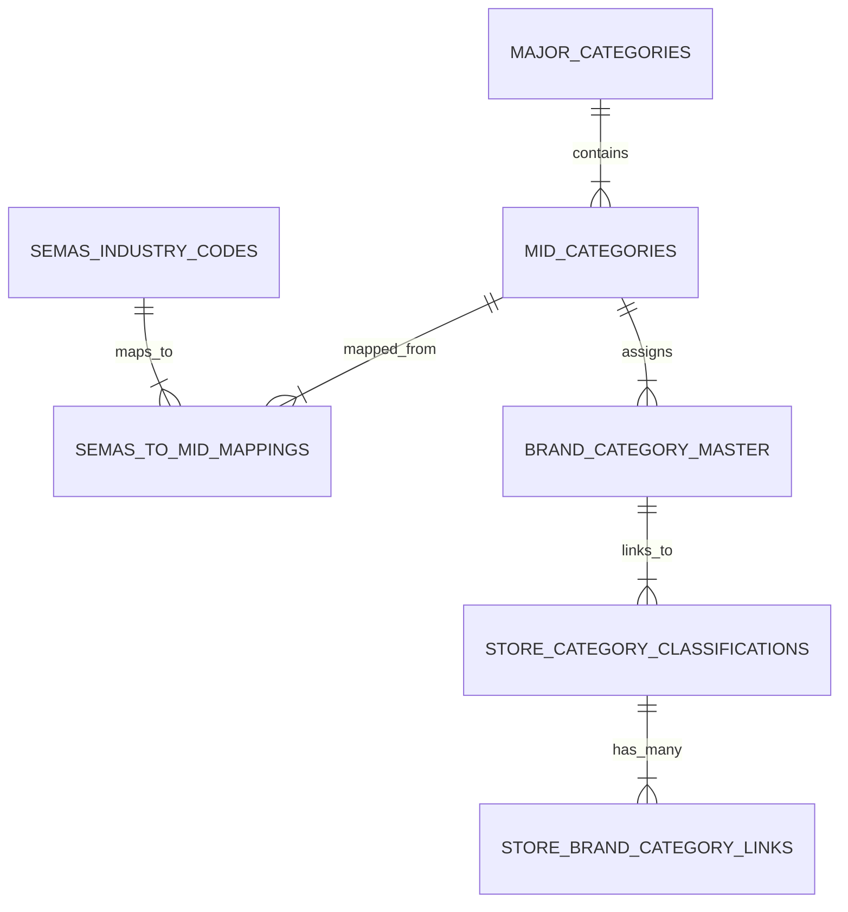

# Phase 4 Stage 4D 업종 분류 데이터 계약서 (Category Mapping Contract)

- **문서 ID**: `CONTRACT-PHASE4-STAGE4D-CATEGORY-MAP-V1`
- **프로젝트**: 대한민국 외식 프랜차이즈 시장 분석 3D GIS 대시보드 (`D:\Franchise_Dashboard`)
- **버전**: `v1.0.0`
- **작성 일자**: 2026-10-13
- **데이터베이스 산출물**: `data/food_category_master_v1.sqlite3`
- **설정 산출물**: `config/food_category_taxonomy_v1.json`

---

## 1. 개요 및 목적

본 계약서는 `AGENTS.md` 제2조에 명시된 **확정 외식업 8대 대분류 및 48대 중분류 체계**를 소진공 음식업(`I2`) 공공데이터 및 Stage 4C 브랜드 마스터와 안정적으로 결합하고, 향후 Stage 4E 지역별 통계 및 Phase 5~6 3D GIS 지도 렌더링 계층에서 일관되게 활용할 수 있도록 규정한 데이터 계약입니다.

---

## 2. 8대 대분류 및 48대 중분류 불변 규약

### 2.1 대분류 불변성 (8개)
외식업 분석 대상 대분류는 다음 8개로 확정되며, 임의 신설이나 명칭 변경을 금지합니다:

1. **한식** (`CAT_MAJ_01`): 8개 중분류 슬롯
2. **중식** (`CAT_MAJ_02`): 5개 중분류 슬롯
3. **일식** (`CAT_MAJ_03`): 6개 중분류 슬롯
4. **양식·세계음식** (`CAT_MAJ_04`): 5개 중분류 슬롯
5. **치킨·패스트푸드** (`CAT_MAJ_05`): 6개 중분류 슬롯
6. **분식·간편식** (`CAT_MAJ_06`): 6개 중분류 슬롯
7. **카페·음료** (`CAT_MAJ_07`): 6개 중분류 슬롯
8. **베이커리·디저트** (`CAT_MAJ_08`): 6개 중분류 슬롯

> **총 슬롯 수**: $8 + 5 + 6 + 5 + 6 + 6 + 6 + 6 = 48$개

### 2.2 중분류 불변 고유 식별자 (`CAT_MID_xxxx`)
모든 중분류는 영구 불변 키(`CAT_MID_0101` ~ `CAT_MID_0806`)로 관리되며, 상세 한글 명칭의 개정이나 사용자 승인 변경 시에도 식별자 자체는 변경되지 않습니다.

| 대분류 ID | 대분류명 | 슬롯 수 | 중분류 ID 범위 | 확정/제안 현황 |
| :---: | :---: | :---: | :---: | :--- |
| `CAT_MAJ_01` | 한식 | 8개 | `CAT_MID_0101` ~ `CAT_MID_0108` | 소진공 14개 소분류와 1:1/1:N 직접 매핑 (고기구이, 찌개/탕, 백반, 족발, 국수, 닭요리, 해산물, 전/기타) |
| `CAT_MAJ_02` | 중식 | 5개 | `CAT_MID_0201` ~ `CAT_MID_0205` | 일반중식, 마라탕(소진공 직접), 딤섬, 양꼬치, 중식주점(키워드/합의 제안) |
| `CAT_MAJ_03` | 일식 | 6개 | `CAT_MID_0301` ~ `CAT_MID_0306` | 돈가스/카레, 초밥/회, 라멘/우동, 덮밥/가정식, 이자카야, 기타일식 |
| `CAT_MAJ_04` | 양식·세계음식 | 5개 | `CAT_MID_0401` ~ `CAT_MID_0405` | 파스타/스테이크, 패밀리레스토랑, 베트남/아시안, 뷔페, 기타세계음식 |
| `CAT_MAJ_05` | 치킨·패스트푸드 | 6개 | `CAT_MID_0501` ~ `CAT_MID_0506` | 치킨, 버거, 피자, 토스트/샌드위치, 샐러드/포케, 기타패스트푸드 |
| `CAT_MAJ_06` | 분식·간편식 | 6개 | `CAT_MID_0601` ~ `CAT_MID_0606` | 떡볶이/튀김, 김밥/종합분식, 만두, 도시락/간편식, 죽전문, 기타분식 |
| `CAT_MAJ_07` | 카페·음료 | 6개 | `CAT_MID_0701` ~ `CAT_MID_0706` | 커피전문점, 저가커피/테이크아웃, 음료/버블티, 차/전통찻집, 디저트카페, 무인/기타카페 |
| `CAT_MAJ_08` | 베이커리·디저트 | 6개 | `CAT_MID_0801` ~ `CAT_MID_0806` | 제과/베이커리, 도넛/와플, 아이스크림/빙수, 케이크/타르트, 떡/한과, 기타디저트 |

---

## 3. 소진공 코드와 1:1 및 1:N 매핑 계약

### 3.1 1:1 직접 매핑 원칙
소진공 소분류 코드 중 단일 업태로 명확히 귀속되는 28개 코드는 `DIRECT_MAP` 규칙으로 48대 중분류에 1:1 매핑됩니다:
- `I21006` (치킨) -> `CAT_MID_0501` (치킨)
- `I21003` (피자) -> `CAT_MID_0503` (피자)
- `I21004` (버거) -> `CAT_MID_0502` (버거)
- `I21008` (아이스크림/빙수) -> `CAT_MID_0803` (아이스크림/빙수)
- `I20107` (돼지고기 구이/찜) -> `CAT_MID_0101` (고기구이/육류)

### 3.2 1:N 분기 매핑 및 키워드 해소 계약
복합 메뉴나 다수 업태를 포괄하는 소진공 코드는 우선순위(`is_primary`)와 상호명 키워드(`disambiguation_keywords`)를 통해 안전하게 분기합니다:

1. **`I21005` (토스트/샌드위치/샐러드)**:
   - 상호명에 `샐러드`, `샐러디`, `포케`, `그릭요거트` 포함 시 -> `CAT_MID_0505` (샐러드/포케)
   - 기본 및 `토스트`, `샌드위치`, `이삭`, `에그` 포함 시 -> `CAT_MID_0504` (토스트/샌드위치)
2. **`I20302` (일식 카레/돈가스/덮밥)**:
   - 상호명에 `덮밥`, `규동`, `가츠동`, `사케동` 포함 시 -> `CAT_MID_0304` (덮밥/가정식)
   - 기본 및 `돈가스`, `돈카츠`, `카레` 포함 시 -> `CAT_MID_0301` (돈가스/카레)
3. **`I21201` (카페 - 122,622건)**:
   - 상호명에 `메가`, `컴포즈`, `빽다방`, `더벤티` 등 저가 프랜차이즈 키워드 시 -> `CAT_MID_0702` (저가커피/테이크아웃)
   - 상호명에 `공차`, `버블티`, `주스`, `쥬씨` 포함 시 -> `CAT_MID_0703` (음료/버블티/주스)
   - 상호명에 `전통차`, `쌍화차`, `찻집` 포함 시 -> `CAT_MID_0704` (차/전통찻집)
   - 상호명에 구체적 키워드가 없는 일반 독립 카페는 기본 `CAT_MID_0701` (커피전문점)로 분류하되, 상태를 `AMBIGUOUS_REVIEW`로 명시.

---

## 4. 데이터베이스 엔터티 관계 (ERD)

### 4.1 핵심 테이블 스키마 계약

#### A. `major_categories`
- `category_maj_id`: `TEXT PRIMARY KEY` (`CAT_MAJ_01` ~ `CAT_MAJ_08`)
- `category_maj_name`: `TEXT NOT NULL UNIQUE` (한식, 중식, 일식 등)
- `slot_count`: `INTEGER NOT NULL` (8, 5, 6, 5, 6, 6, 6, 6)

#### B. `mid_categories`
- `category_mid_id`: `TEXT PRIMARY KEY` (`CAT_MID_0101` ~ `CAT_MID_0806`, 48개)
- `category_maj_id`: `TEXT NOT NULL REFERENCES major_categories`
- `category_mid_name`: `TEXT NOT NULL`
- `spec_status`: `TEXT NOT NULL` (`CONFIRMED_BY_SEMAS_DIRECT`, `CANDIDATE_CONSENSUS`, `PENDING_USER_APPROVAL`)
- `is_confirmed`: `INTEGER NOT NULL` (1/0)

#### C. `store_category_classifications` (전국 735,185건 고유)
- `bizes_id`: `TEXT PRIMARY KEY` (고유 점포 ID)
- `bizes_nm`: `TEXT NOT NULL`
- `inds_mcls_cd`, `inds_scls_cd`: 원본 소진공 업종코드 보존
- `primary_brand_id`: 주 브랜드 ID (`BRD_UNMATCHED` 지원)
- `category_major_id`, `category_mid_id`: 확정 분류 ID
- `classification_status`: `CATEGORY_CONFIRMED`, `CATEGORY_PROVISIONAL`, `AMBIGUOUS_REVIEW`, `UNCLASSIFIED`
- `is_brand_linked`: 브랜드 소속 여부 (1/0)
- `is_category_divergent`: 브랜드-점포 업종 불일치 여부 (1/0)

#### D. `store_brand_category_links` (735,208건 N:M 링크)
- 23개 복수 브랜드 숍인숍 점포의 각 브랜드-업종 관계를 완전 보존.
- 고유 점포 수 계산 시 왜곡 방지 보장.

---

## 5. 집계 대사 수식 계약 (Audit Reconciliations)

1. **전국 고유 점포 수**:
   $$\text{COUNT(DISTINCT bizes\_id)} = 735,185$$
2. **점포-브랜드-업종 링크 수**:
   $$\text{COUNT(link\_id)} = 735,208$$
3. **숍인숍 복수 브랜드 대사 공식**:
   $$\text{고유 점포(735,185)} + \text{복수 브랜드 점포(23)} = \text{총 링크 수(735,208)}$$
4. **미분류 점포 결측 방지**:
   $$\text{COUNT(WHERE classification\_status = 'UNCLASSIFIED')} = 0$$
