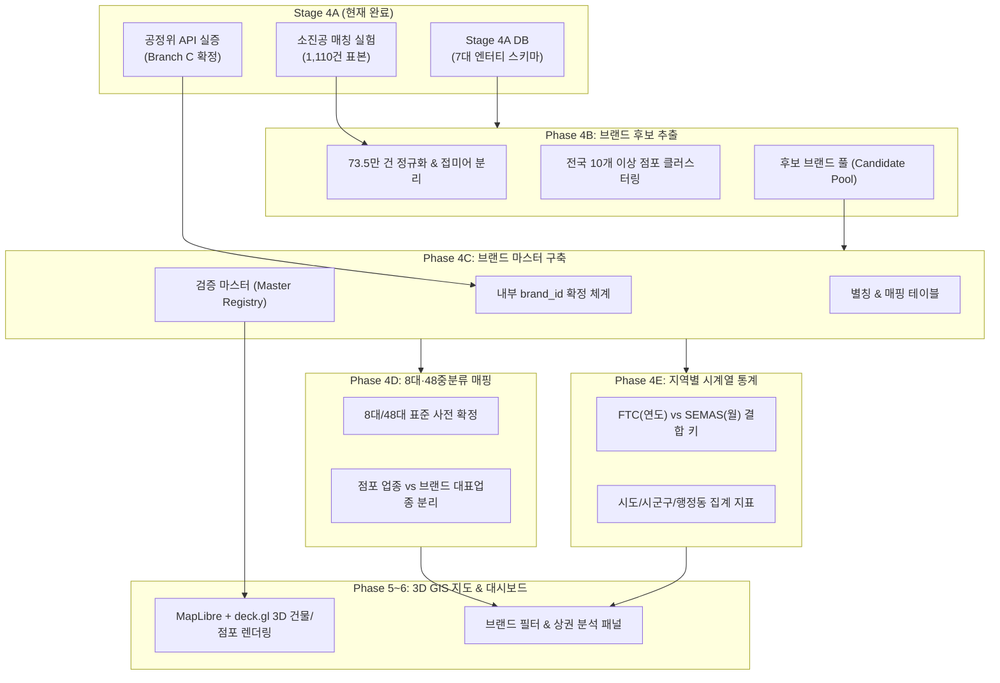

# Phase 4 후속 단계 및 Phase 5~6 3D GIS 의존성 매트릭스 (Phase 4 Dependency Matrix)

- **문서 ID**: `DOC-PHASE4-STAGE4A-DEPENDENCY-MATRIX-V1`
- **프로젝트**: 대한민국 외식 프랜차이즈 시장 분석 3D GIS 대시보드 (`D:\Franchise_Dashboard`)
- **작성 단계**: Phase 4 / Stage 4A (의존성 및 데이터 흐름 설계)
- **최종 검증일자**: 2026-10-13

---

## 1. 아키텍처 의존성 개요

Stage 4A에서 확정된 데이터 계약을 기반으로 후속 단계(Phase 4B~4E) 및 최종 3D GIS 대시보드(Phase 5~6) 간의 데이터 흐름과 인터페이스 규격을 정의합니다.

---

## 2. 단계별 상세 의존성 및 데이터 계약 매트릭스

| 대상 단계 | Stage 4A가 제공하는 산출물 | 입력 데이터 및 필수 선행 조건 | 출력 산출물 및 생성 엔터티 | 준수해야 할 핵심 제약 조건 |
| :--- | :--- | :--- | :--- | :--- |
| **Phase 4B (브랜드 후보 추출)** | - 상호명 정규화 5단계 규칙 - 지점 접미어 정규식 - 부정 키워드 사전 - 별칭 사전 초안 | - 소진공 v2 DB (`stores` 735,185건) - `docs/phase4/phase4b_handoff_contract.md` | - `brand_candidates` 테이블 - 점포별 `normalized_bizes_nm` - 전국 점포수 집계 지표 | - **전국 점포수 10개 이상 필수** - 기존 점포 DB 수정 금지 (Read-Only) - 일반명사 단독 상호 필터링 |
| **Phase 4C (브랜드 마스터 구축)** | - Branch C 듀얼 트랙 계약 - `internal_brand_id` 명명 규칙 - 1:N 본부-브랜드 관계 모델 | - Phase 4B `brand_candidates` - `docs/phase4/brand_identity_strategy.md` | - `brand_master` 테이블 - `brand_aliases` 매핑 테이블 - `brand_verification_status` | - 가명 번호와 브랜드 강제 1:1 결합 금지 - 미검증 브랜드는 `UNVERIFIED` 유지 - 멱등적 ID 생성 규칙 |
| **Phase 4D (8대·48중분류 체계)** | - FTC 외식업종 분류표 (`tpbizMclsfNm`) - 소진공 중분류 (`inds_mcls_nm`) 비교표 | - Phase 4C `brand_master` - `AGENTS.md` 확정 8대 대분류 체계 | - `category_taxonomy.json` (기계 판독형) - 브랜드 대표업종 vs 점포 업종 매핑 | - **8대 대분류 / 48대 중분류 임의 변경 금지** - 없는 분류 임의 신설 금지 |
| **Phase 4E (지역별 통계 집계)** | - 시점 차이 정의 (FTC: 연도 vs SEMAS: 월) - 금액/면적 수치 지표 단위 규명 | - 전국 점포 DB 공간 좌표/지역코드 - Phase 4C 마스터 & Phase 4D 업종 | - `brand_regional_stats` (시도/시군구/읍면동) - 상권 밀집도 및 HHI 지수 테이블 | - FTC 가맹점수와 SEMAS 점포수 분리 표기 - 256개 표준 시군구 코드 체계 준수 |
| **Phase 5~6 (3D GIS 지도)** | - 안정적 `internal_brand_id` - 점포 연결 키 (`bizes_id`) - 3D 렌더링용 브랜드 컬러/카테고리 | - Phase 4C 마스터 - 전국 v2 DB 점포 좌표 (`lon`, `lat`) - 3D 건물 레이어 데이터 | - deck.gl / MapLibre 3D 점포 인스턴스 - 줌레벨별 클러스터링 레이어 | - WebGL GPU 메모리 최적화 - 3D 빌딩 높이 및 가시성 보장 |

---

## 3. 핵심 데이터 엔터티 인터페이스 명세

### 3.1 내부 브랜드 ID (`internal_brand_id`) 생성 규칙
Phase 4C에서 부여할 내부 브랜드 식별자는 다음과 같은 체계로 설계됩니다.
- 형식: `BRD_{CAT3}_{SEQ4}`
  - 예: 한식: `BRD_KOR_0001` (본죽), 치킨: `BRD_CHK_0001` (교촌치킨), 카페: `BRD_CAF_0001` (스타벅스)
- 불변성 보장: 한 번 부여된 `internal_brand_id`는 대시보드 3D 지도 렌더링 및 통계 API에서 영구 식별자로 사용됩니다.

### 3.2 점포-브랜드 연결 관계 (Store-to-Brand Mapping)
- 관계 형태: **N : 1 (다수의 점포가 하나의 내부 브랜드 ID를 참조)**
- 테이블 연결: `stores.bizes_id` -> `store_brand_map.internal_brand_id`
- 복합 브랜드 지원: 숍인숍 매장의 경우 가중치 또는 서브 브랜드 ID 복수 허용.

---

## 4. 데이터베이스 및 스키마 진화 로드맵

1. **Stage 4A (완료)**: `data/brand_intelligence_stage4a.sqlite3`
   - FTC 원본 및 표본 매칭 실험 데이터 보관.
2. **Phase 4B~4C (예정)**: `data/brand_master_v1.sqlite3`
   - 전국 73.5만 건 점포에서 추출된 전수 브랜드 마스터 및 별칭 테이블 구축.
3. **Phase 4E~5 (예정)**: `data/franchise_spatial_intelligence.sqlite3`
   - 3D 지도 및 대시보드 백엔드 API 서빙을 위한 인덱싱된 공간 뷰 및 집계 테이블 구축.
