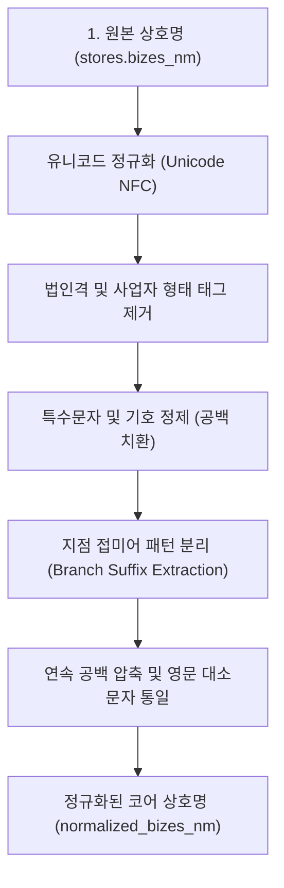

# Phase 4B 브랜드 후보 추출 인계 데이터 계약서 (Phase 4B Handoff Contract)

- **문서 ID**: `DOC-PHASE4-STAGE4A-HANDOFF-4B-V1`
- **프로젝트**: 대한민국 외식 프랜차이즈 시장 분석 3D GIS 대시보드 (`D:\Franchise_Dashboard`)
- **작성 단계**: Phase 4 / Stage 4A -> Phase 4B Handoff
- **최종 검증일자**: 2026-10-13
- **계약 상태**: **READY FOR PHASE 4B APPROVAL**

---

## 1. 개요 및 목적

본 문서는 Stage 4A에서 수행한 37개 대표 표본 브랜드 및 1,110건 소진공 점포 매칭 실증 실험 결과를 바탕으로, **향후 전국 735,185건 점포 전수를 대상으로 브랜드 후보를 자동 추출·정제하는 Phase 4B 개발팀/에이전트에 전달하는 엔지니어링 계약 및 알고리즘 규칙 명세서**입니다.

---

## 2. Stage 4A 매칭 실험 결과 및 실증 통계

Stage 4A에서 37개 대표 브랜드를 대상으로 소진공 nationwide_food_stores_v2 DB에서 추출한 1,110건의 정밀 매칭 분석 통계입니다.

| 매칭 판정 분류 (Match Type) | 건수 | 점유율 | 판정 기준 및 처리 방침 |
| :--- | :---: | :---: | :--- |
| **정확 일치 (EXACT_MATCH)** | 81건 | 7.30% | 점포 상호명이 브랜드 정식 명칭과 100% 완전 일치 |
| **정규화 일치 (NORMALIZED_MATCH)**| 325건 | 29.28% | 지점 접미어(`강남점` 등), 법인격(`(주)` 등) 제거 후 정식 명칭 또는 등록 별칭과 완전 일치 |
| **모호한 일치 (AMBIGUOUS_MATCH)** | 173건 | 15.58% | 브랜드명이 포함되나 부가 수식어가 결합된 경우 (`교촌치킨&호프`, `배달전문점` 등) -> 수동 검토 및 복수 후보 관리 |
| **오탐 의심 (FALSE_POSITIVE_SUSPECT)**| **531건** | **47.84%** | 단순 키워드 매칭 시 일반 음식점이 프랜차이즈로 오인식된 사례 (`교촌식당`, `본가한우`, `스타김밥` 등) |
| **합계** | **1,110건** | **100.0%** | **확정 라벨링 표본 정밀도: 43.33% (단순 LIKE 검색 시 오탐률 56.67%에 달함)** |

> [!IMPORTANT]
> **핵심 교훈**: 단순 `LIKE '%브랜드명%'` 쿼리는 50% 이상의 극심한 오탐(False Positive)을 발생시킵니다. 따라서 Phase 4B에서는 반드시 **지점 접미어 분리 + 토큰 완전 일치 + 부정 키워드 필터 + 전국 10개 이상 점포 클러스터링**이 결합된 다단계 파이프라인을 구축해야 합니다.

---

## 3. 상호명 정규화 5단계 표준 파이프라인 규칙

Phase 4B에서 전국 73.5만 건 상호명에 적용할 정규화 알고리즘 명세입니다.



### 세부 정규식 규칙:
1. **유니코드 정규화**: `unicodedata.normalize('NFC', text)` 적용 (자모 분리 방지).
2. **법인격 제거 정규식**:
   ```regex
   \s*[\(\[\{]?(?:주|유|합|사|재|법인|개인|주식회사|유한회사|사단법인|재단법인|협동조합)[\)\]\}]?\s*
   ```
3. **특수기호 제거**:
   `['",`~!?@#$%^&*()_+=/\\\[\]{}|:;<>·•]` 문자를 단일 공백으로 치환.
4. **지점 접미어 추출 정규식 (대소문자 무시)**:
   ```regex
   [\s\-_/]+(?:[가-힣0-9a-zA-Z]+(?:점|호점|직영점|가맹점|역점|본점|분점|센터|타운|스퀘어|로드점|드라이브스루점|DT점)|제?[0-9]+호점|본점|직영점)$
   ```
5. **공백 정규화**: `re.sub(r'\s+', ' ', text).strip()`

---

## 4. 별칭 관리 및 유사 상호 충돌 해결 규칙

### 4.1 한글 / 영문 혼용 표기 (Bilingual Aliases)
동일 브랜드의 다양한 표기법을 단일 `internal_brand_id`로 통합하기 위한 사전 매핑 규칙입니다.

| 대표 브랜드명 | 허용 별칭 (Aliases) 목록 |
| :--- | :--- |
| **스타벅스** | `스타벅스`, `STARBUCKS`, `스타벅스코리아`, `STARBUCKS COFFEE` |
| **bbq치킨** | `bbq치킨`, `BBQ`, `비비큐`, `비비큐치킨`, `BBQ치킨` |
| **bhc치킨** | `bhc치킨`, `BHC`, `비에이치씨`, `BHC치킨` |
| **메가MGC커피** | `메가MGC커피`, `메가커피`, `MEGA COFFEE`, `메가엠지씨커피` |
| **투썸플레이스** | `투썸플레이스`, `투썸`, `A TWOSOME PLACE`, `TWOSOME PLACE` |
| **버거킹** | `버거킹`, `BURGER KING`, `BURGERKING` |
| **파리바게뜨** | `파리바게뜨`, `파리바게트`, `PARIS BAGUETTE`, `파리크라상` |
| **배스킨라빈스** | `배스킨라빈스`, `베스킨라빈스`, `BASKIN ROBBINS`, `배스킨라빈스31` |
| **던킨** | `던킨`, `던킨도너츠`, `DUNKIN'`, `DUNKIN DONUTS` |

### 4.2 접두어 공유 유사 상호 분리 (Prefix Confusion)
- **본 시리즈 분리**:
  - `본죽`, `본도시락`, `본설렁탕`, `본비빔밥`은 동일 그룹사이나 **독립된 개별 브랜드 ID**로 분리 관리.
  - 단, `본죽&비빔밥`과 같은 복합 매장은 `본죽`과 `본비빔밥`의 복합 브랜드 속성으로 태깅.
- **신전 vs 신참 분리**:
  - `신전떡볶이`와 `신참떡볶이`는 완전히 다른 법인 프랜차이즈이므로 엄격히 분리.
- **빽다방 vs 빽보이피자 분리**:
  - 더본코리아 산하이나 업종 및 브랜드가 상이하므로 독립 분리.

---

## 5. 일반 음식점 오탐(False Positive) 방지 필터링 규칙

일반 개인 음식점이 프랜차이즈로 잘못 분류되는 것을 원천 차단하기 위한 3대 안전장치입니다.

1. **부정 키워드 (Negative Keywords) 사전 적용**:
   - 상호명에 지역 고유명사나 일반 식당 접미어가 포함된 경우 프랜차이즈 후보에서 즉시 제외.
   - 예: `교촌` 키워드 중 `교촌식당`, `교촌면옥`, `교촌한우`, `교촌마을`, `교촌쌈밥` 등은 제외.
   - 예: `놀부` 키워드 중 `놀부식당`, `흥부놀부`, `놀부네` 등은 제외.
2. **일반명사 단독 상호 필터링**:
   - `김밥`, `짜장면`, `커피`, `치킨`, `피자`, `국밥` 등 외식업 일반명사만으로 구성된 상호는 브랜드 후보 추출 대상에서 전면 차단.
3. **전국 10개 이상 점포 임계치 (AGENTS.md 준수)**:
   - 정규화된 상호명과 업종이 일치하는 점포 수가 전국에서 **최소 10개 이상** 존재하는 경우에만 `brand_candidates`로 승격.
   - 10개 미만인 단일 점포는 독립 개인 식당(`INDEPENDENT_STORE`)으로 분류.
