# Phase 4 Stage 4E: 공간 분석 및 비즈니스 데이터 무결성 계약서 (Spatial Analytics Contract)

본 문서는 **대한민국 외식 프랜차이즈 시장 분석 3D GIS 대시보드**의 Phase 4 Stage 4E(공간 분석 엔진 및 분석 데이터베이스)와 후속 Phase 5(지도 서비스) 및 Phase 6(3D 디지털 트윈 대시보드) 간의 **공간 집계 규칙, 비즈니스 4축 격리 원칙, 23개 복수 후보 점포 중복 방지 방패**를 정의하는 공식 데이터 계약서입니다.

---

## 1. 전제 조건 및 모수 정의 (Universe Contract)

1. **외식업 전수 모수**:
   - 전국 외식업 고유 점포 수는 **735,185건**으로 고정됩니다.
   - 모든 지역별, 업종별, 공간 격자별 점포 수의 총합은 735,185건과 $100.00\%$ 일치해야 합니다.
2. **선행 데이터베이스 불변성 (Immutability)**:
   - `data/nationwide_food_stores_v2.sqlite3` (735,185건)
   - `data/brand_master_v1.sqlite3` (5,063개 브랜드, 735,208개 링크)
   - `data/food_category_master_v1.sqlite3` (735,185건 분류)
   - 상기 3개 원본 데이터베이스는 **수정·삭제가 엄격히 금지된 Read-Only 자산**입니다.
3. **분석 데이터베이스 단일 진실 공급원 (Single Source of Truth)**:
   - 대시보드 및 API는 오직 `data/franchise_analytics_v1.sqlite3`만을 참조하여 데이터를 서빙합니다.

---

## 2. 23개 복수 브랜드 샵인샵 점포 중복 방지 방패 (Duplicate Shield)

### 2.1 문제 정의
- Stage 4C 브랜드 연결 과정에서 1개 점포에 2개 이상의 브랜드 후보가 연결된 샵인샵(Shop-in-Shop) 또는 복합 매장 **23개**가 발견되었습니다 ($735,185 + 23 = 735,208$ 링크).
- 단순 `JOIN store_brand_links` 실행 시 전체 외식업 점포 수 및 지역 통계가 735,208건으로 왜곡되어 **23건의 이중 계산(Double Counting)**이 발생하는 치명적 결함이 유발됩니다.

### 2.2 중복 방지 아키텍처 규칙
1. **외식업 전체 모수 및 점포 수 집계 원칙**:
   - 모든 `total_stores`, `independent_stores`, 지역별 총 점포 수는 `COUNT(DISTINCT bizes_id)`를 기준으로 산출합니다.
   - `store_analytics_lookup` 테이블은 전국 735,185개 점포와 **1:1 고유 관계**를 보장합니다.
2. **주 브랜드(Primary Brand) 및 보조 브랜드(Auxiliary Brand) 분리**:
   - 23개 복수 매장의 경우, 매칭 점수(match_score) 및 우선순위가 가장 높은 1개 브랜드를 `primary_brand_id`로 지정합니다.
   - 보조 브랜드는 `auxiliary_brand_names` 필드에 쉼표로 보존되며, `is_multi_brand_store = 1` 플래그로 마킹됩니다.
3. **개별 점포 상세 팝업 계약**:
   - 23개 점포 상세 조회 시 API는 `ui_presentation.multi_brand_alert` 배지를 생성하여 사용자가 샵인샵 복합 매장임을 명확히 인지할 수 있도록 서빙합니다.

---

## 3. 비즈니스 4축 독립성 및 상태 격리 원칙 (4-Axes Decoupling)

본 프로젝트는 분석 데이터의 왜곡을 방지하기 위해 다음 4개 축을 상호 독립된 차원으로 엄격히 분리 관리합니다.

```mermaid
graph TD
    Store["개별 외식업 점포 (735,185건)"] --> Axis1["1. 브랜드 공식성 (Brand Officiality)"]
    Store --> Axis2["2. 점포 매칭 신뢰도 (Store Match Status)"]
    Store --> Axis3["3. 점포 운영 형태 (Store Operation Type)"]
    Store --> Axis4["4. 카테고리 확정 상태 (Classification Status)"]

    Axis1 --> Off1["FRANCHISE_CONFIRMED (공인 72개 가맹사업)"]
    Axis1 --> Off2["BRAND_CONFIRMED (직영 중심 검증 브랜드)"]
    Axis1 --> Off3["UNVERIFIED (동일 상호 10개 이상 후보)"]
    Axis1 --> Off4["UNMATCHED (단독 점포)"]

    Axis2 --> Mat1["MATCH_VERIFIED (사전 검증)"]
    Axis2 --> Mat2["MATCH_AUTO_HIGH_CONFIDENCE (자동 매칭)"]
    Axis2 --> Mat3["MATCH_PROVISIONAL (잠정 매칭)"]
    Axis2 --> Mat4["REVIEW_REQUIRED (검토 필요)"]
    Axis2 --> Mat5["UNMATCHED (미매칭)"]

    Axis3 --> Op1["COMPANY_OPERATED (직영점)"]
    Axis3 --> Op2["FRANCHISED (가맹점)"]
    Axis3 --> Op3["UNKNOWN (미확인)"]

    Axis4 --> Cat1["CATEGORY_CONFIRMED (1:1 코드 확정)"]
    Axis4 --> Cat2["CATEGORY_PROVISIONAL (키워드 매핑)"]
    Axis4 --> Cat3["AMBIGUOUS_REVIEW (1:N 모호 분류, 104,060건)"]
```

### 3.1 4개 축 정의 및 격리 규칙
1. **브랜드 공식성 (`brand_officiality`)**:
   - 브랜드 수준의 법적 실체성 분류 (`FRANCHISE_CONFIRMED`, `BRAND_CONFIRMED`, `UNVERIFIED`, `UNMATCHED`).
   - 점포가 `primary_brand_id = 'BRD_UNMATCHED'`인 경우 공식성은 반드시 `UNMATCHED`로 표현되어야 하며, `UNVERIFIED`로 오인되어서는 안 됩니다.
2. **점포 매칭 신뢰도 (`match_status`)**:
   - 알고리즘 상호명 정규화 매칭의 기술적 확신도.
3. **점포 운영 형태 (`operation_type`)**:
   - 해당 점포가 가맹점인지 직영점인지 여부 (`COMPANY_OPERATED`, `FRANCHISED`, `UNKNOWN`).
   - 공인 가맹사업 브랜드라 하더라도 직영점으로 등록된 매장이 존재하므로, **"발견 점포 수"**와 **"확인된 가맹점 수"**는 별개의 지표로 제공되어야 합니다.
4. **업종분류 확정 상태 (`classification_status`)**:
   - 8대 대분류/48대 중분류 매핑 신뢰도 (`CATEGORY_CONFIRMED`, `CATEGORY_PROVISIONAL`, `AMBIGUOUS_REVIEW`).
   - 104,060건의 모호 분류 점포는 전체 시장 규모(735,185건)에는 포함되지만, 세부 업종 분석 시 `include_ambiguous=false` 파라미터로 격리될 수 있어야 합니다.

---

## 4. 3D GIS 공간 집계 및 시각화 데이터 계약

사용자가 제시한 **3D 디지털 트윈 상권 분석 대시보드**와의 연동을 위해 다음 3개 공간 계층을 지원합니다.

### 4.1 뷰포트 바운딩 박스 (BBOX) 점포 스트리밍
- **용도**: 줌인(Zoom $\ge 14.0$) 시 MapLibre GL JS 및 deck.gl `ScatterplotLayer` / `IconLayer` 렌더링.
- **포맷**: GeoJSON FeatureCollection (`type: "Point"`, `coordinates: [lon, lat]`).
- **성능 계약**: 뷰포트 500개 점포 렌더링 시 응답 시간 **$\le 100\text{ms}$** (인메모리 mmap 및 직렬화 우회).

### 4.2 100m 정밀 격자 기둥 (Spatial Density Grid)
- **용도**: 줌아웃/중간 줌(Zoom $11.0 \sim 15.0$) 시 3D 밀집도 기둥 렌더링 (deck.gl `ColumnLayer`).
- **데이터 구조**:
  - `center_lon`, `center_lat`: 100m 격자 중심 좌표
  - `total_stores`: 격자 내 외식업 점포 수
  - `brand_stores`: 브랜드 소속 점포 수
  - `top_category_name`: 최다 분포 업종명
  - `column_height_m`: 3D 기둥 렌더링 높이 (점포 밀집도에 비례, $8.5\text{m} \times \text{점포수}$)
- **보호 필터**: 시각적 노이즈를 방지하기 위해 점포 수 3개 이상인 76,745개 클러스터 격자만 제공.

### 4.3 상권 핫스팟 및 드론 비행 카메라 투어 (Commercial Hotspots)
- **용도**: "드론 비행 1/5 예측 핫스팟 1위"와 같은 시네마틱 3D 카메라 투어 기능 제공.
- **파라미터**:
  - `hotspot_id`, `hotspot_name`, `address`
  - `center_lon`, `center_lat`
  - `pitch` (기본 $60^\circ$), `bearing` (기본 $-20^\circ$), `zoom` (기본 $16.5$)
  - `tour_order`: 1~10 순차 비행 경로

---

## 5. 행정구역 폴리곤 면적 산출 가이드라인 (Density Contract)
- 현재 소상공인진흥공단 공공데이터에는 행정구역 중심점 좌표만 존재하며 정밀 경계 폴리곤이 부재합니다.
- 임의의 외접 직사각형이나 Centroid 반경으로 가짜 면적($\text{km}^2$)을 계산하는 것을 엄격히 금지합니다.
- 공인 행정구역 폴리곤(WGS84/EPSG:5179)이 연동되기 전까지 지역별 밀도 지표는 `density_status = 'UNAVAILABLE'`로 표기합니다.
