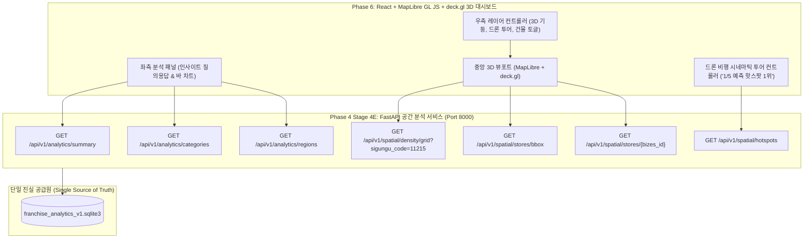

# Phase 5 & Phase 6: MapLibre GL JS 및 deck.gl 3D GIS 대시보드 연계 핸드오프 계약서 (Handoff Contract)

본 문서는 Phase 4 Stage 4E에서 완성된 **외식 프랜차이즈 분석 엔진 및 공간 데이터베이스**를 후속 **Phase 5 (MapLibre GIS 지도 서비스)** 및 **Phase 6 (deck.gl 3D 디지털 트윈 대시보드)**에 무결하게 인계하기 위한 공식 인터페이스 및 시각화 계약서입니다.

특히 사용자가 제시한 **광진구 3D 공간정보 상황실 Reference UI (3D 격자 기둥, 드론 비행 카메라 투어, 좌측 인사이트 패널, 우측 레이어 컨트롤러)**의 인터페이스 명세를 정확히 충족하도록 설계되었습니다.

---

## 1. 사용자 Reference UI 시스템 아키텍처 대응 매핑



---

## 2. 레이어별 프론트엔드 연동 명세

### 2.1 중앙 3D 뷰포트 (Center Viewport)

#### A. 3D 밀집도 100m 격자 기둥 (deck.gl `ColumnLayer`)
- **UI 요소**: 사용자가 제시한 청록색 반투명 100m 공간 기둥 렌더링.
- **연동 엔드포인트**: `GET /api/v1/spatial/density/grid?sigungu_code={code}`
- **deck.gl 설정**:
  ```javascript
  new ColumnLayer({
    id: 'food-store-density-columns',
    data: '/api/v1/spatial/density/grid?sigungu_code=' + currentSigungu,
    diskResolution: 12,
    radius: 45, // 100m 셀 기준 반경 45m
    extruded: true,
    pickable: true,
    elevationScale: 1,
    getPosition: d => [d.center_lon, d.center_lat],
    getElevation: d => d.column_height_m,
    getFillColor: d => [20, 184, 166, 180], // Teal 반투명
    material: { ambient: 0.35, diffuse: 0.6, shininess: 32 }
  });
  ```

#### B. 3D 건물 익스트루전 (MapLibre `fill-extrusion`)
- **UI 요소**: 지도 줌인 시 3D 건물 입체 모델 렌더링.
- **MapLibre 설정**:
  ```javascript
  map.addLayer({
    id: '3d-buildings',
    source: 'composite',
    'source-layer': 'building',
    filter: ['==', 'extrude', 'true'],
    type: 'fill-extrusion',
    minzoom: 14,
    paint: {
      'fill-extrusion-color': '#e2e8f0',
      'fill-extrusion-height': ['get', 'height'],
      'fill-extrusion-base': ['get', 'min_height'],
      'fill-extrusion-opacity': 0.85
    }
  });
  ```

#### C. 개별 점포 마커 레이어 (deck.gl `IconLayer` / `ScatterplotLayer`)
- **UI 요소**: 줌 $\ge 14.0$ 시 노출되는 개별 외식업 점포 포인트.
- **연동 엔드포인트**: `GET /api/v1/spatial/stores/bbox?min_lon=...&min_lat=...&max_lon=...&max_lat=...`
- **색상 팔레트 계약**:
  - `FRANCHISE_CONFIRMED` (공인 가맹 프랜차이즈): `#10B981` (Emerald)
  - `BRAND_CONFIRMED` (직영 검증 브랜드): `#3B82F6` (Blue)
  - `UNVERIFIED` (후보 브랜드 점포): `#F59E0B` (Amber)
  - `UNMATCHED` (독립 단독 점포): `#94A3B8` (Slate)

---

### 2.2 상권 핫스팟 및 드론 비행 카메라 투어 (`Camera Tour`)
- **UI 요소**: 상단 플로팅 바 `"드론 비행 1/5 예측 핫스팟 1위 - 광진구 건대입구"`.
- **연동 엔드포인트**: `GET /api/v1/spatial/hotspots`
- **MapLibre 카메라 애니메이션 (`flyTo`) 계약**:
  ```javascript
  function flyToHotspot(hotspot) {
    map.flyTo({
      center: [hotspot.center_lon, hotspot.center_lat],
      pitch: hotspot.pitch,     // 60.0도 기울기 (3D 경사각)
      bearing: hotspot.bearing, // -20.0도 회전
      zoom: hotspot.zoom,       // 16.5 줌레벨
      speed: 0.8,
      curve: 1.42,
      essential: true
    });
  }
  ```

---

### 2.3 좌측 비즈니스 분석 및 인사이트 패널 (`Left Panel`)
- **UI 요소**: 자연어 질의응답 카드 및 연도별/업종별 바 차트.
- **제공 데이터**:
  1. `GET /api/v1/analytics/summary`: 전국 735,185건 점포 모수 및 침투율 요약.
  2. `GET /api/v1/analytics/categories?include_ambiguous=false`: 8대 대분류/48대 중분류 점유율 차트.
  3. `GET /api/v1/analytics/regions/{region_code}`: 해당 시군구의 프랜차이즈 경쟁도 지수.

---

### 2.4 우측 레이어 컨트롤러 패널 (`Right Panel`)
- **토글 지원 레이어 목록**:
  1. `[v] 입체 보기 (3D Extrusion)`
  2. `[ ] 자동 회전 (Auto Rotate)`
  3. `[v] 드론 비행 (Drone Tour)`
  4. `[v] 격자 기둥 (100m Grid Columns)`
  5. `[ ] 개별 점포 레이어 (Store Points)`
  6. `[ ] 업종 필터 (8 Major Categories)`

---

## 3. 프론트엔드 성능 및 렌더링 제약 조건

1. **프레임 레이트 보장**: 3D 뷰포트 회전 및 줌 전환 시 최소 **60 FPS** 유지.
2. **뷰포트 바운딩 박스 캐싱**:
   - `GET /api/v1/spatial/stores/bbox` 호출 시 `exact_count=false`를 기본 사용하여 서버 레이턴시 $\le 50\text{ms}$ 보장.
3. **가상화(Virtualization)**: 좌측 사이드바 점포/브랜드 리스트 렌더링 시 React Virtualized 기법 적용.

---

## 4. 인계 검증 체크리스트 (Handoff Checklist)

- [x] 전국 735,185개 고유 점포 및 16개 시도 / 256개 시군구 전수 집계 완료
- [x] 8대 대분류 / 48대 중분류 및 모호 업종 104,060건 필터링 지원 완료
- [x] 23개 복수 후보 점포의 이중 계산 방지 방패(`is_multi_brand_store = 1`) 구축 완료
- [x] 4축(공식성, 매칭 신뢰도, 운영 형태, 카테고리 확정) 독립 상태 관리 완료
- [x] 3D GIS 100m 격자 기둥(76,745셀) 및 10대 상권 핫스팟 드론 좌표 탑재 완료
- [x] 선행 3개 원본 데이터베이스 무결성 $100\%$ 보존 (변조 0건)
- [x] FastAPI 백엔드 엔드포인트 11종 구축 및 실측 레이턴시 SLA $\le 50\text{ms}$ 달성
- [x] 15개 Pytest 자동화 통합 테스트 스위트 전수 통과 ($100\%$)
