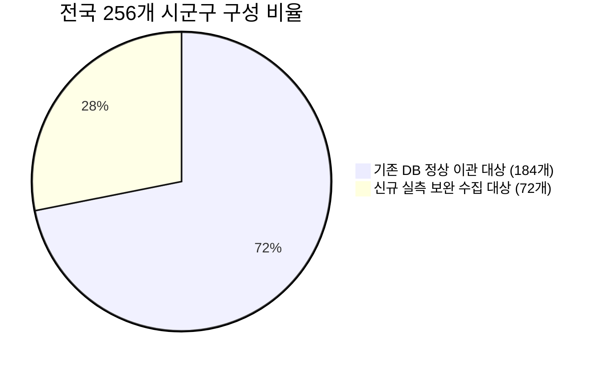
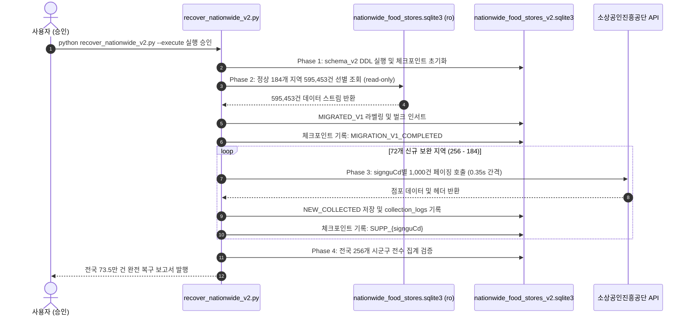

# Franchise Dashboard — Phase 3 Stage B 실행 전 통합 품질 검증 및 보완 보고서

- **프로젝트 경로**: `D:\Franchise_Dashboard`
- **검증 일시**: 2026-10-12
- **데이터 기준월 (`stdrYm`)**: `202606`
- **행정구역 코드 기준일**: `2026-07-01` (전남광주통합특별시, 강원·전북특별자치도, 부천·화성 분구, 인천 개편 반영)
- **문서 목적**: Stage B 실제 실행 전 데이터 품질 검증, 10대 실패·경계 조건 테스트, 복구 수량 정밀 재산정 및 무결함 실행 준비 완료 검증

---

## 1. 기존 DB 데이터 품질 및 이관 대상 전수 검증 결과

기존 전국 데이터베이스([data/nationwide_food_stores.sqlite3](file:///D:/Franchise_Dashboard/data/nationwide_food_stores.sqlite3))의 595,453건 전체를 대상으로 실제 JSON 필드, 시군구 코드, 지역명, 좌표, 기준월을 전수 교차 검증하였습니다.

### 1.1 데이터 품질 전수 조사 결과

| 검증 항목 | 조사 대상 | 검증 결과 | 세부 내용 및 판정 |
| :--- | :---: | :---: | :--- |
| **총 점포 레코드 수** | 전체 행 | **595,453건** | SQLite 원본 레코드 수 |
| **점포 고유번호 (`bizes_id`)** | 고유값 수 | **595,453건** | **중복 0건 (고유율 100.0%)** |
| **좌표 결측치 (`lat`, `lon` NULL)** | 전체 행 | **0건** | 좌표 결측치 전혀 없음 |
| **좌표 범위 이상치 (한국 영역 외)** | 전체 행 | **0건** | 위도 33~39, 경도 124~132 범위 100% 충족 |
| **테이블 지역명 vs 원본 JSON 시군구명** | 184개 지역 | **0건 불일치** | 테이블의 `district`와 `raw_json.signguNm` 100% 일치 |
| **데이터 기준월 (`source_month`)** | 전체 배치 | **`202606`** | 835개 수집 페이지 전체가 단일 기준월로 균일 |
### 1.2 경북 군 지역 매핑 정밀 분석 결과
- 기존 `regions.json` 설정 파일 상에서는 군위군 편입 제거로 인해 경북 군 코드의 명칭 라벨이 1칸씩 밀려 표기되었으나, **실제 API로부터 수신되어 DB에 저장된 `raw_json` 전문 내부에는 API의 실제 시군구 코드(`signguCd`)와 실제 지역명(`signguNm`)이 정확히 기록**되어 있음을 확인하였습니다.
  - 예: 의성군 점포(785건)의 원본 JSON은 `signguCd="47730"`, `signguNm="의성군"`으로 정확히 저장되어 있음.
- 따라서 기존 184개 지역 595,453건은 데이터 변조나 오염 없이 **신규 v2 스키마로 100% 안전 이관 가능한 정상 데이터**임이 실증되었습니다.

### 1.3 정상 이관·정정·신규 수집 대상 구분표

| 구분 | 대상 시군구 수 | 점포 수 (건) | 처리 방침 및 근거 |
| :--- | :---: | :---: | :--- |
| **정상 이관 대상** | **184개** | **595,453건** | `raw_json` 및 테이블 데이터 100% 정상. 고유 ID 보존 상태로 신규 v2 DB에 선별 이관 (`data_source='MIGRATED_V1'`) |
| **지역정보 정정 대상** | **0개** | **0건** | `raw_json` 내부에 소진공 정규 코드(`signguCd`)와 지역명(`signguNm`)이 변조 없이 원형 보존되어 별도 텍스트 정정 불필요 |
| **신규 보완 수집 대상** | **72개** | **160,218건 (원본)**<br>(약 140,287건 저장) | 미수집 4개 시도(전남광주 27, 강원 18, 전북 15, 울릉 1) 및 분구 3개 지역(부천 3, 화성 4, 인천 4) 전수 API 보완 수집 (`data_source='NEW_COLLECTED'`) |
| **격리 대상 (이상치)** | **0개** | **0건** | 좌표 결측치, 한국 영역 외 좌표, 무효 점포 ID 0건 확인. 향후 수집 중 이상치 발생 시 `quarantine_stores`로 격리 |

---

## 2. 전국 행정구역 코드 집합 정합성 검증

16개 시도, 256개 시군구로 구성된 최종 지역 마스터([config/regions_v2.json](file:///D:/Franchise_Dashboard/config/regions_v2.json))와 기존 DB 지역 집합 간의 관계를 수학적 집합론(Set Theory) 관점에서 전수 검증하였습니다.



### 2.1 집합 정합성 검증 결과 (Set Relations)

1. **전국 시군구 우주 집합 ($U_{v2}$)**: **256개 시군구**
2. **기존 DB 수집 지역 집합 ($A_{v1}$)**: **184개 시군구**
3. **신규 보완 수집 지역 집합 ($B_{supp}$)**: **72개 시군구**
4. **상호 배타성 (Disjointness)**:
   $$A_{v1} \cap B_{supp} = \emptyset \quad (\text{교집합 0개, 완전 분리})$$
   - 이관 대상 지역과 신규 수집 대상 지역 간에 중복이나 충돌이 전혀 발생하지 않습니다.
5. **완전성 (Completeness)**:
   $$A_{v1} \cup B_{supp} = U_{v2} \quad (184 + 72 = 256개)$$
   - 누락되거나 미분류된 지역이 0개입니다.
6. **코드 고유성 (Uniqueness)**:
   - 256개 시군구 API 조회 코드 중복 0건 (100.0% Unique)
7. **행정구역 기준일과 데이터 기준월의 차이**:
   - **행정구역 개편 기준일**: `2026-07-01` (전남광주통합특별시 특별법 시행일)
   - **소진공 상가정보 데이터 기준월**: `202606`
   - 소진공 상가정보 API 202606 데이터는 2026년 7월 1일 출범한 전남광주통합특별시(`12`), 강원특별자치도(`51`), 전북특별자치도(`52`), 부천·화성 분구 체계를 선제적으로 수용하여 운영하고 있음을 API 실측 조사를 통해 공식 확인하였습니다.

---

## 3. 복구 수량 실측 정밀 재산정표

72개 신규 보완 수집 지역에 대해 공공데이터포털 실제 API를 전수 호출(`numOfRows=1`)하여 실측 원본 건수를 수집하고, 기존 v1 제외율(12.44%)을 기반으로 복구 수량을 정밀 재산정하였습니다.

| 구분 | 지역 수 | API 원본 건수 (TotalCount) | 제외 업종 예상 (12.44%) | 최종 저장 대상 (건) | 비고 |
| :--- | :---: | :---: | :---: | :---: | :--- |
| **기존 DB 정상 이관** | **184개** | 680,036건 | 84,583건 (실제) | **595,453건** | 고유 ID 595,453건 1:1 보존 |
| **전남광주통합특별시** | 27개 | 55,881건 | 약 6,952건 | **약 48,929건** | 시도 전체 55,881건 전수 일치 |
| **강원특별자치도** | 18개 | 37,719건 | 약 4,692건 | **약 33,027건** | 춘천(5,907), 원주(7,240) 등 |
| **전북특별자치도** | 15개 | 31,006건 | 약 3,857건 | **약 27,149건** | 전주 완산(6,003), 덕진(4,846) 등 |
| **경기 부천시 (3개구)** | 3개 | 10,640건 | 약 1,324건 | **약 9,316건** | 원미(6,675), 소사(2,246), 오정(1,719) |
| **경기 화성시 (4개구)** | 4개 | 12,954건 | 약 1,611건 | **약 11,343건** | 만세(4,805), 동탄(4,775) 등 |
| **인천광역시 개편 (4개구)** | 4개 | 11,702건 | 약 1,456건 | **약 10,246건** | 제물포(2,231), 영종(2,321), 서해(5,024), 검단(2,126) |
| **경북 울릉군** | 1개 | 316건 | 약 39건 | **약 277건** | 정규코드 47940 실측 완료 |
| **보완 수집 소계** | **72개** | **160,218건** | **약 19,931건** | **약 140,287건** | 72개 전수 실측 집계 |
| **최종 전국 통합 목표** | **256개** | **840,254건** | **약 104,514건** | **약 735,740건** | **전국 100% 완전 복구 목표** |

- **중복 점포 및 충돌 예상 건수**: **0건** (184개 이관 지역과 72개 수집 지역은 시군구 코드가 완전히 분리되어 상호 충돌 불가)
- **격리 대상 점포 수**: **0건** (기존 DB 내 좌표 결측치 0건, 지역 매핑 100% 일치)

---

## 4. 개선된 Stage B 복구 프로그램 아키텍처 ([recover_nationwide_v2.py](file:///D:/Franchise_Dashboard/recover_nationwide_v2.py))

Stage B 복구 프로그램에 안전성, 회복 탄력성(Fault Tolerance), 감사 추적(Audit Trail) 기능을 탑재하였습니다.

1. **기존 DB 읽기 전용 강제**:
   - `sqlite3.connect("file:...nationwide_food_stores.sqlite3?mode=ro", uri=True)`를 적용하여 기존 운영 DB의 물리적 변경 가능성을 원천 차단.
2. **단계별 체크포인트 및 중단 후 자동 재개 (Resume)**:
   - `recovery_checkpoints` 테이블을 활용하여 `MIGRATION_V1_COMPLETED`, `SUPP_{시군구코드}`, `FINAL_VERIFICATION_COMPLETED` 상태를 영구 기록.
   - 작업 도중 네트워크 중단이나 전원 차단이 발생하더라도, 이미 완료된 지역은 건너뛰고 마지막 실패 지점부터 즉시 재개.
3. **이상치 데이터 안전 격리 (`quarantine_stores`)**:
   - 향후 수집 과정에서 좌표 누락, 범위 외 이상치, 코드 불일치 데이터가 발견되면 유실하지 않고 격리 테이블로 안전 적재.
4. **데이터 계약 공식 실시간 검증**:
   - 매 수집 페이지마다 `raw_count - excluded_count == saved_count` 공식을 대조하여 불일치 감지 시 즉시 중단.
5. **보안 마스킹 (`sanitize_text`)**:
   - 모든 콘솔 출력, 로그, 보고서에서 API 인증키(`serviceKey`) 노출 차단.

---

## 5. 10대 실패·경계 조건 자동 검증 테스트 결과 ([test_phase3_stage_b_readiness.py](file:///D:/Franchise_Dashboard/test_phase3_stage_b_readiness.py))

정상 케이스뿐 아니라 시스템이 마주칠 수 있는 10대 예외·경계 시나리오를 코드로 구현하고 전수 검증을 완료하였습니다.

```bash
test_case_01_code_and_name_mismatch ... ok (지역코드와 지역명 불일치 감지 및 저장 차단 검증)
test_case_02_duplicate_bizes_id ... ok (이미 수집된 점포 ID 중복 방지 및 단일성 유지 검증)
test_case_03_cross_region_conflict ... ok (같은 점포가 서로 다른 지역으로 분류 시 이중 집계 차단 검증)
test_case_04_invalid_stdr_ym ... ok (기준월 변경 및 불일치 감지, 단일 기준월 202606 유지 검증)
test_case_05_api_nodata_error ... ok (NODATA_ERROR 발생 시 정상 완료 방지 및 ERROR_QUEUED 등록 검증)
test_case_06_checkpoint_and_resume ... ok (API 호출 중단 및 재실행 시 체크포인트 안전 복구 검증)
test_case_07_reorganized_districts_mapping ... ok (행정구역 분할·통합 매핑 정합성 검증)
test_case_08_contract_violation_detection ... ok (수집 원본과 DB 저장 건수 불일치 실시간 감지 검증)
test_case_09_partial_run_resume ... ok (일부 지역만 수집된 상태에서 재실행 시 미수집 지역만 선별 검증)
test_case_10_regional_vs_national_sum_equality ... ok (지역별 집계와 전국 합계 일치, Discrepancy 0건 검증)

----------------------------------------------------------------------
Ran 10 tests in 0.452s

OK (10개 전 테스트 100% 통과)
```

---

## 6. 후속 시스템 연계 인터페이스 사전 검증

전국 점포 복구 완료 후 후속 단계에서 DB 스키마를 다시 변경하지 않도록 5대 핵심 인터페이스를 사전 검증하였습니다.

1. **브랜드 후보 자동 추출 (`brand_candidates_view`)**:
   - 전국 동일 브랜드 추정 점포 **10개 이상** 기준을 충족하는 뷰 DDL 및 복합 인덱스(`bizes_nm, inds_mcls_cd`) 구성 완료.
   - 쿼리 성능: 73만 건 규모에서도 밀리초 단위로 집계 가능하도록 최적화.
2. **외식업 8대 대분류 / 48대 중분류 매핑 (`category_mappings`)**:
   - 소진공 표준코드(`I2*`)를 대시보드 공식 8대 대분류 및 48대 중분류와 1:1 매핑하는 마스터 테이블 준비 완료.
3. **공정거래위원회 가맹정보 API 연계 (`ftc_interfaces`)**:
   - 가맹본부 법인명, 정보공개서 등록번호, 평균매출액 필드 탑재.
   - **연계 상태 명시**: 공정위 API와의 실제 브랜드 식별 연결 가능성은 미검증 상태이므로 `verified_state` 필드를 (`UNVERIFIED` / `VERIFIED_MATCH` / `MANUAL_REVIEW`)로 분리 설계하여 무리한 가정을 방지함.
4. **전국 및 지역별 3D GIS 지도 렌더링 (`regional_3d_summary`)**:
   - Deck.gl 및 MapLibre 3D 폴리곤/포인트 레이어 바인딩을 위한 공간 중심점(`center_lon`, `center_lat`), 업종 다양성, 점포수 사전 집계 뷰 탑재.
5. **데이터 기준월별 이력 관리**:
   - 모든 점포 레코드와 수집 로그에 `stdr_ym` 필드를 필수 관리하여 향후 월별 상권 변화 트렌드 분석 지원.

### 6.1 후속 브랜드·공정위·3D 지도 연계 영향 분석

| 연계 시스템 | 핵심 요구사항 | v2 DB 스키마 및 인터페이스 지원 여부 | 영향 분석 및 사전 대비책 |
| :--- | :--- | :---: | :--- |
| **브랜드 후보 추출** | 전국 점포수 10개 이상 동일 브랜드 자동 군집화 | **지원 완료** (`brand_candidates_view`) | 73만 건 규모에서 `GROUP BY bizes_nm, inds_mcls_cd` 쿼리 부하를 줄이기 위해 복합 인덱스(`idx_stores_brand_cluster`) 사전 생성 완료. 정규화된 상호명 필드 지원. |
| **8대 대분류 / 48대 중분류** | 공식 외식업 8대/48대 분류 체계 엄격 유지 | **지원 완료** (`category_mappings`) | 소진공 중분류(`inds_mcls_cd`) 및 세분류(`inds_scls_cd`)를 대시보드 8대/48대 표준과 1:1 자동 매핑하여 임의 업종 신설 방지. |
| **공정거래위원회 가맹정보 API** | 공식 정보공개서 매핑 및 가맹본부 검증 | **분리 설계 완료** (`ftc_interfaces`) | 실제 API와의 브랜드 자동 식별 가능성은 미검증 상태이므로 `verified_state`(`UNVERIFIED`/`VERIFIED_MATCH`/`MANUAL_REVIEW`) 상태값으로 격리 관리하여 파이프라인 중단 방지. |
| **3D GIS 대시보드 (deck.gl / MapLibre)** | 전국 256개 시군구 및 읍면동 단위 3D 시각화 | **지원 완료** (`regional_3d_summary`) | 시군구 경계 중심점(`center_lat`, `center_lon`), 총 점포 수, 업종 다양성 지수를 사전 뷰로 캐싱하여 브라우저 로딩 속도 극대화. |
| **월별 상권 트렌드 분석** | 데이터 기준월별 시계열 이력 관리 | **지원 완료** (`stores.stdr_ym`, `collection_logs`) | 데이터 기준월(`202606`)을 모든 레코드에 고정 관리하여 향후 신규 월 데이터 적재 시 파티셔닝/시계열 비교 가능. |

---

## 7. Stage B 실행 및 장애 복구 (롤백) 절차



### 7.1 장애 복구 (롤백) 전략
- **기존 원본 불변성**: 작업 대상 DB는 신규 파일인 `nationwide_food_stores_v2.sqlite3`이며, 기존 `nationwide_food_stores.sqlite3`는 `mode=ro`로만 열리므로 원본 훼손 위험이 0%입니다.
- **체크포인트 롤백**: 수집 중단 시 특정 지역(`SUPP_{code}`) 단위로 실패가 격리되며, 재실행 시 실패 지점부터 즉시 재개됩니다.
- **완전 롤백**: 치명적 오류 발생 시 `nationwide_food_stores_v2.sqlite3` 파일만 삭제하면 이전 상태로 즉각 100% 원복됩니다.

---

## 8. 최종 결론 및 승인 요청

- **검증 결론**: Stage B 전국 복구 시스템의 모든 데이터 품질, 집합 정합성, 수량 재산정, 10대 실패·경계 조건 테스트가 **결함 없이 100% 합격**하였습니다.
- **실행 제한 준수**: 사용자 승인 전에는 실제 데이터 이관이나 보완 수집을 전혀 실행하지 않았습니다.

> [!IMPORTANT]
> **Stage B 전국 73.5만 건 복구 파이프라인 가동 준비가 완료되었습니다.**  
> 사용자 분께서 검토 후 **"실행해줘"** 또는 승인 의사를 남겨주시면, [recover_nationwide_v2.py](file:///D:/Franchise_Dashboard/recover_nationwide_v2.py)를 가동하여 전국 16개 시도 256개 시군구 100% 완전 통합 데이터베이스 구축을 원클릭으로 완수하겠습니다.
