# Phase 5B: 공정위 최신 거시통계 지도·대시보드 통합 검증 및 승인 체크리스트 (R1)

- **문서 번호**: P5B-CHK-2026-001-R1
- **작성 일자**: 2026-10-13T19:05:00+09:00
- **프로젝트 경로**: `D:\Franchise_Dashboard`
- **적용 대상**: Phase 5B 구현 단계 착수 전 사전 승인 및 구현 완료 후 인수 검증
- **검증 환경**:
  - OS: Windows 11
  - DB: `data/franchise_analytics_v1.sqlite3` (기존 소상공인 지도), `data/ftc_macro_statistics_v1.sqlite3` (공정위 4개년)
  - Backend: Python FastAPI (`http://127.0.0.1:8000`)
  - Frontend: React 18 + MapLibre GL JS v4.7.1 (`http://127.0.0.1:5173`)
- **문서 상태**: `REVISED_R1_PENDING_APPROVAL` (실제 DB 실측치 100% 대사 및 미검증 단정 표현 정정본)

---

## 1. 종합 검증 매트릭스 및 판정 기준 요약

| 검증 영역 | 세부 검증 항목 수 | 핵심 성공 기준 (Pass Criteria) | 판정 방식 |
| :--- | :---: | :--- | :---: |
| **1. 업종 매핑 검증** | 5개 | 8대 대분류 ↔ 15개 공정위 업종 매핑 제안(`PROPOSED_FOR_APPROVAL`) 정합성, 임의 확정 매핑 0건 | 단위 테스트 |
| **2. API 계약 검증** | 6개 | 4대 엔드포인트 응답 스키마(JSON Schema), 상태 코드, 에러 핸들링 일치, 시간대 `+09:00` 준수 | 계약 테스트 |
| **3. 연도 무결성 검증** | 4개 | 단일 위젯 내 서로 다른 연도 혼합 0건, 분모·분자 동일 기준연도 일치 | 데이터 대사 |
| **4. 대체(Fallback) 검증** | 4개 | 명시적 연도 부재 시 `NO_DATA_FOR_REQUESTED_YEAR` 에러 반환, 기본 최신연도 조회 시에만 원자적 대체 | 시나리오 테스트 |
| **5. 0원·결측치 분리** | 3개 | 양수(>0), 0원(=0), 결측(NULL) 3분류 합계 == 전체 레코드 일치 ($\Delta=0$, 2026년 4,521건) | DB 전수 대사 |
| **6. 통계 지표 및 창업비용** | 4개 | 중앙값 1순위 노출, 이상치 플래그 및 절사평균 제공, `reported_deposit_amount` 명칭 및 비공식 안내 | 통계 검증 |
| **7. UI 상태 및 반응형** | 9개 | 9대 UI 상태(정상, 대체, 매핑불가, 이상치 등) 표출, 모바일 가로스크롤 0px | E2E 브라우저 실측 |
| **8. 기존 지도 회귀** | 5개 | OSM 타일, 광진구 466개 격자, 핫스팟 카메라, 회색 지도 0건, 타일 로드 보장 | 비주얼 회귀 |
| **9. 성능 및 접근성 목표** | 5개 | 캐시 적중 p95 ≤ 50ms, 미적중 p95 ≤ 200ms, Gzip ≤ 10KB, 지도 FPS 무회귀 목표 달성 | 성능 벤치마크 |
| **합계** | **45개 항목** | **전 항목 100% PASS 시에만 최종 인수 승인** | - |

---

## 2. 상세 검증 체크리스트

### 2.1 [매핑] 업종 매핑 단위 테스트 검증 기준
- [ ] **CHK-MAP-01 (1:1 매핑 제안 검증)**: `CAT_MAJ_01`(한식), `CAT_MAJ_02`(중식), `CAT_MAJ_03`(일식), `CAT_MAJ_06`(분식)이 공정위 동일 명칭 단일 업종과 1:1로 매핑 제안(`PROPOSED_FOR_APPROVAL`)되어 있는가?
- [ ] **CHK-MAP-02 (N:1 합산 매핑 제안 검증)**:
  - `CAT_MAJ_04`(양식·세계음식) $\rightarrow$ 서양식 + 기타 외국식 (2개 업종 합산 제안)
  - `CAT_MAJ_05`(치킨·패스트푸드) $\rightarrow$ 치킨 + 패스트푸드 + 피자 (3개 업종 합산 제안)
  - `CAT_MAJ_07`(카페·음료) $\rightarrow$ 커피 + 음료 (커피 외) (2개 업종 합산 제안)
  - `CAT_MAJ_08`(베이커리·디저트) $\rightarrow$ 제과제빵 + 아이스크림/빙수 (2개 업종 합산 제안)
  - 각 합산 대분류의 모수가 구성 공정위 업종들의 합과 정확히 일치하는가?
- [ ] **CHK-MAP-03 (평균의 평균 계산 금지 검증)**: 복수 업종 합산 시 각 업종의 평균을 단순 산술평균하지 않고, `sum_sls_amount`의 합을 `sls_positive_record_count`의 합으로 나누어 가중 재계산하는가?
- [ ] **CHK-MAP-04 (제외 업종 정책 격리 검증)**: 공정위 `주점`(242건)이 프로젝트 업종 정책(소진공 I211 제외)에 따라 지도 8대 대분류에 매핑되지 않고 명시적으로 제외 격리(`EXCLUDED_BY_PROJECT_POLICY`)되는가?
- [ ] **CHK-MAP-05 (추정 매핑 금지 및 대분류 제안 상태 표기)**: 공정위 `기타 외식`(520건)을 임의의 대분류에 추정 배정하지 않고 `UNMAPPED_REVIEW`로 안전하게 격리 처리하며, 공정위 업종과의 연계는 `config/food_category_taxonomy_v1.json` 8대 대분류 수준의 승인 대기 제안(`PROPOSED_FOR_APPROVAL`)임을 명시하는가?

### 2.2 [API] 백엔드 API 계약 및 스키마 검증
- [ ] **CHK-API-01 (`/api/v1/ftc/status` 응답 스키마)**:
  - `latest_benchmark_year == "2026"`, `financial_year == "2025"`를 반환하는가?
  - `display_label == "2026년 공정위 등록 기준 스냅샷 (2025 회계연도 실적)"`을 반환하는가?
  - `data_status_description`에 `수집 시점 기준 최신 제공 스냅샷이며 향후 모수가 변동될 수 있음`이 명시되는가?
  - 응답 시각 필드가 한국 표준시 ISO-8601(`+09:00`) 형식을 엄격히 준수하는가? (예: `2026-10-13T19:05:00+09:00`)
- [ ] **CHK-API-02 (`/api/v1/ftc/benchmark/latest` 응답 및 수치 일치)**:
  - 필수 파라미터 `category_major_id` 누락 시 HTTP 422 또는 400 에러를 반환하는가?
  - 2026년 한식(`CAT_MAJ_01`) 요청 시 실제 DB 집계값(중위매출 361,174.5천원, 5% 절사평균 394,210.78천원, 점포수 가중평균 395,702.93천원)과 100% 일치하는가?
  - 창업비용 구성항목 필드에서 `reported_deposit_amount` 명칭을 사용하고, "공식 보증금" 단정 표현이 배제되어 있는가?
- [ ] **CHK-API-03 (매핑 불가 업종 에러 처리)**: 매핑되지 않은 업종 요청 시 HTTP 400과 함께 `ERR_CATEGORY_UNMAPPED` 에러 코드를 반환하는가?
- [ ] **CHK-API-04 (`/api/v1/ftc/trends` 시계열 응답)**: 2023부터 2026까지 4개년 시리즈를 누락 없이 반환하며, 2026년 포인트에 `data_status == "CURRENT_SNAPSHOT_COLLECTED"` 플래그가 지정되어 있는가?
- [ ] **CHK-API-05 (`/api/v1/ftc/years` 목록 응답)**: 기본 선택 연도가 `2026`이고 2025년의 상태가 `최신 완결 후보 연도이며 공식 마감 여부는 확인되지 않음`으로 표기되어 있는가?
- [ ] **CHK-API-06 (캐시 헤더)**: 응답 헤더에 `Cache-Control: public, max-age=3600`이 정상 부여되는가?

### 2.3 [정직성] 연도 무결성 및 대체(Fallback) 정책 검증
- [ ] **CHK-INT-01 (단일 위젯 연도 혼합 0건)**: 단일 벤치마크 카드 내에서 2026년 매출과 2025년 점포수가 섞여 표시되는 경우가 0건인가?
- [ ] **CHK-INT-02 (분모·분자 단일 연도 일치)**: 점포수 가중평균 산출 시 분자의 매출액과 분모의 가맹점수가 동일한 단일 기준연도 레코드에서만 추출되었는가? (2026년 한식 기준 분모: 27,187개)
- [ ] **CHK-INT-03 (명시적 연도 조회 시 자동 대체 차단)**: 사용자가 `year=2024` 등 특정 연도를 직접 요청하였으나 데이터가 없는 경우, 타 연도로 임의 대체하지 않고 `NO_DATA_FOR_REQUESTED_YEAR` 에러를 반환하는가?
- [ ] **CHK-INT-04 (기본 최신연도 조회 시 원자적 대체 및 배지 표출)**: 기본 최신연도 조회에서 매핑된 업종 전체가 2026년에 부재할 때만 위젯 전체가 2025년으로 일괄 전환되며, `2025년 대체 표시` 배지가 강제 노출되는가? (특정 지표 하나 결측으로 인한 타 연도 혼합 차단)

### 2.4 [품질] 0원·결측치 분리 및 이상치 방어 검증
- [ ] **CHK-QLT-01 (3대 상태 전수 대사)**:
  - 2026년 15개 전체 업종: 양수(3,075건) + 0원(1,299건) + 결측(147건) == 전체(4,521건) ($\Delta = 0$)
  - 2026년 한식 업종: 양수(1,204건) + 0원(584건) + 결측(70건) == 전체(1,858건) ($\Delta = 0$)
  - 4개년 23,537건 전수에서 세 상태의 합이 100.0% 일치하는가?
- [ ] **CHK-QLT-02 (0원 원인 단정 배제)**: 0원 매출에 대해 "신규 브랜드라 정상" 등으로 단정하지 않고 "0원 공시 브랜드"로 중립 표기하는가?
- [ ] **CHK-QLT-03 (단순평균 단독 노출 차단)**: UI 카드 상단 대표값에 단순평균이 단독으로 노출되지 않고, **중앙값(1순위)**이 메인으로 표출되는가?
- [ ] **CHK-QLT-04 (이상치 왜곡 방어)**: 극단적 이상치가 존재하는 데이터셋 선택 시, 단순평균 대신 5% 절사평균과 중앙값이 정상 표출되고 이상치 안내 배지가 부착되는가?

### 2.5 [통계] 대표값 및 창업비용 표기 검증
- [ ] **CHK-STAT-01 (DB 사전집계 일치성)**: API가 반환하는 중앙값·절사평균이 `ftc_industry_macro_summary` 테이블의 수치와 소수점 둘째 자리까지 정확히 일치하는가?
- [ ] **CHK-STAT-02 (창업비용 명칭 및 안내문 검증)**:
  - 공정위 원본 `depstAmt` 필드가 `reported_deposit_amount`로 제공되는가?
  - "공식 보증금/공식 합계/법정 예치"라는 미검증 단정 표현이 전면 배제되고, "공정위 원본 depstAmt 값이며 구성항목 합계와 항상 일치하지 않는다"는 설명이 제공되는가?
  - 파생 합계(`tentative_startup_cost_thousand`) 표출 시 "항목 합산 잠정 창업비용 (참고용)"으로 명시하는가?
- [ ] **CHK-STAT-03 (창업비용 개별 항목 분리)**: 가맹비, 교육비, 보증금, 인테리어비용을 개별 카드로 분리하여 투명하게 제공하는가?
- [ ] **CHK-STAT-04 (점포수 가중평균 분모 표기)**: 점포수 가중평균 노출 시 계산에 참여한 실제 가맹점 수 합계(`denom_store_weighted_sls`)를 함께 표기하는가?

### 2.6 [다년도] 4개년 시계열 추세 검증
- [ ] **CHK-SER-01 (모집단 크기 병기)**: 2023~2026년 추세 차트의 각 연도 포인트마다 브랜드 수($N$)와 총 가맹점 수를 툴팁으로 함께 노출하는가?
- [ ] **CHK-SER-02 (2026 스냅샷 직접 성장·감소 해석 금지)**: "2026년은 수집 시점의 최신 제공 스냅샷으로 이전 연도와 모집단이 달라, 점포 수 차이를 산업 성장·감소로 직접 해석할 수 없다"는 원칙을 준수하고 주의 안내를 제공하는가?
- [ ] **CHK-SER-03 (존속 브랜드 패널 비활성)**: 4개년 연속 관측 브랜드(2,504개) 균형 패널이 UI에서 기본 비활성화되어 있는가?
- [ ] **CHK-SER-04 (명목금액 주석)**: 추세 차트 하단에 "물가변동 미반영 명목금액 기준" 주석이 명시되어 있는가?

### 2.7 [UI/UX] 화면 정보구조 및 반응형 검증
- [ ] **CHK-UI-01 (기존 지도 시야 확보)**: 공정위 벤치마크 카드가 지도의 중심(건대입구 핫스팟 및 밀집도 서클)을 가리지 않는 위치에 배치되는가?
- [ ] **CHK-UI-02 (접기/펼치기 동작)**: 벤치마크 카드를 접었을 때 지도 뷰포트가 즉시 100% 확보되는가?
- [ ] **CHK-UI-03 (모바일 390×844 바텀시트)**: 모바일 접속 시 지도 하단 64px 앵커로 시작하며, 스와이프 시 부드럽게 확장되는가?
- [ ] **CHK-UI-04 (모바일 가로 스크롤 0px)**: 모바일 뷰포트(390×844)에서 `document.body.scrollWidth == 390px`이며 가로 스크롤이 단 1px도 발생하지 않는가?
- [ ] **CHK-UI-05 (9대 UI 상태 E2E 확인)**: 정상, 로딩, 데이터 없음, 매핑 제안 대기, 대체, 오류, 스냅샷 주의, 0원 주의, 이상치 주의 9개 상태가 각각 올바른 메시지와 배지를 표출하는가?

### 2.8 [회귀] 기존 지도 서비스(Phase 5A) 무손실 회귀 검증
- [ ] **CHK-REG-01 (OSM 타일 렌더링 유지)**: 타일 프로바이더(`tile.openstreetmap.org`)에서 지도 타일이 워터마크 없이 100% 정상 로드되는가? (회색 빈 지도 배제)
- [ ] **CHK-REG-02 (광진구 100m 밀집도 격자)**: 건대입구 중심 466개 격자 셀 원형 서클(`density-grid-circles`)이 고대비 컬러(Sky Blue~Crimson Red)로 렌더링되는가?
- [ ] **CHK-REG-03 (상권 핫스팟 투어)**: Top 5 상권 핫스팟 클릭 시 3D 카메라(Pitch 45°, Bearing -20°) flyTo 이동 및 마커가 정상 동작하는가?
- [ ] **CHK-REG-04 (팝업 XSS 방지)**: 격자 셀 클릭 시 DOM 노드 방식(`textContent`)으로 상세 팝업이 안전하게 열리는가? (`setHTML` 사용 금지)
- [ ] **CHK-REG-05 (기존 소상공인 KPI 보존)**: `전국 외식업 총 점포 수 735,185개소`, `주요 검증 브랜드 연결 점포 48,002개소` 수치가 왜곡 없이 그대로 유지되는가?

### 2.9 [성능 및 접근성] 성능 엔지니어링 목표 및 웹 접근성 검증
- [ ] **CHK-NFR-01 (API 응답 레이턴시 엔지니어링 목표)**:
  - In-Memory 캐시 적중 시 API 응답 시간 **p95 ≤ 50ms** 달성하는가?
  - 캐시 미적중(최초 DB 쿼리) 시 API 응답 시간 **p95 ≤ 200ms** 달성하는가?
  - (측정 전 사전 보장 단정 금지, 구현 후 벤치마크 실측으로 확인)
- [ ] **CHK-NFR-02 (지도 프레임레이트 목표)**: 벤치마크 카드 노출 상태에서도 지도 드래그/줌 조작 시 기존 FPS 대비 유의미한 회귀 없이 **60fps 목표** 수준을 유지하는가?
- [ ] **CHK-NFR-03 (불필요한 공정위 재호출 방지)**: 지도를 패닝하거나 줌할 때 공정위 API 네트워크 요청이 0건인가? (업종/연도 변경 시에만 발생)
- [ ] **CHK-NFR-04 (응답 페이로드 목표)**: 벤치마크 단일 응답 압축 페이로드가 **Gzip ≤ 10KB** 목표를 충족하는가?
- [ ] **CHK-NFR-05 (키보드 및 스크린리더 접근성)**: 벤치마크 카드의 접기 버튼, 연도 셀렉터가 `Tab` 키로 포커스 가능하며 `aria-expanded`, `aria-label`이 올바르게 선언되어 있는가?

---

## 3. 장애 대책 및 롤백 절차 (Rollback Plan)

만약 구현 또는 배포 단계에서 결함이 발생할 경우 다음 절차에 따라 즉각 안전 롤백합니다:

```mermaid
graph TD
    Trigger["결함 발생 (예: 회색 지도 재발, 연도 혼합, 500 에러)"] --> Check{"결함 발생 계층 판단"}
    
    Check -->|"백엔드 API 결함"| RollbackBE["백엔드 롤백: main.py에서 ftc_macro 라우터 마운트 해제"]
    Check -->|"프런트엔드 UI 결함"| RollbackFE["프런트엔드 롤백: App.jsx에서 FtcBenchmarkPanel 마운트 해제"]
    Check -->|"성능 저하/병목"| DisableCache["사전집계 정적 JSON 서빙으로 전환"]
    
    RollbackBE --> Restore5A["Phase 5A-R3 안정 버전으로 즉시 복귀"]
    RollbackFE --> Restore5A
    DisableCache --> Restore5A
    
    Restore5A --> Verify["Phase 5A 회귀 검증 스크립트 실행 (verify_phase5a_r1.py)"]
    Verify --> OK["지도 서비스 100% 정상 가동 확인"]
```

1. **프런트엔드 롤백**:
   - `App.jsx`에서 `FtcBenchmarkPanel` 컴포넌트 호출부만 주석 처리하면 즉시 Phase 5A 기본 지도 서비스로 100% 무손실 복구됩니다.
2. **백엔드 롤백**:
   - `main.py`에서 `app.include_router(ftc_macro.router)` 한 줄만 제거하면 기존 5대 분석 라우터(`summary`, `regions`, `categories`, `brands`, `spatial`)에 전혀 영향을 주지 않고 안전 격리됩니다.
3. **데이터베이스 무결성 보존**:
   - `ftc_macro_statistics_v1.sqlite3`와 `franchise_analytics_v1.sqlite3`는 모두 읽기 전용(`mode=ro`)으로만 연결되므로, 어떤 API 오류가 발생하더라도 원본 DB 파일은 0.0001%의 변경 없이 영구 보존됩니다.
