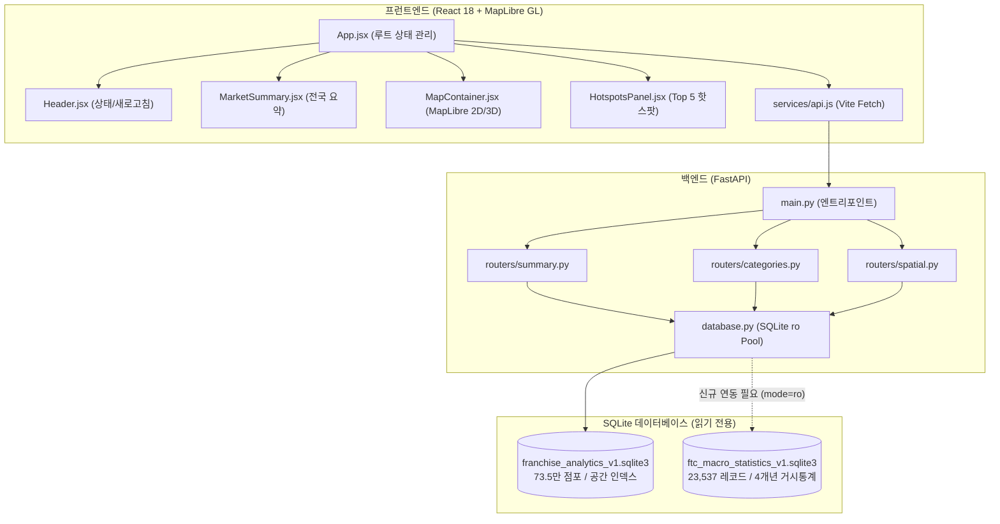

# Phase 5B: 공정거래위원회 외식업 최신 거시통계 지도·대시보드 통합 기술 설계서

- **문서 번호**: P5B-DES-2026-001-FINAL
- **작성 일자**: 2026-10-13
- **프로젝트 경로**: `D:\Franchise_Dashboard`
- **설계 상태**: **설계 완료 (Draft Completed - Awaiting User Approval, 코딩 및 DB 변경 미착수)**
- **대상 원천 DB**:
  - 기존 지도·분석 DB: `data/franchise_analytics_v1.sqlite3` (735,185 점포, 16 시도, 256 시군구, 100m 정밀 격자 466개)
  - 공정위 거시통계 DB: `data/ftc_macro_statistics_v1.sqlite3` (23,537건, 4개년 15개 업종, R1 정정 완료)

---

## 1. 개요 및 핵심 제품 원칙 준수 방침

본 기술 설계서는 Phase 5A에서 구축된 기본 지도 서비스(광진구 100m 밀집도 격자, 상권 핫스팟, 모바일 390×844 최적화)와 Phase 4F에서 전수 적재·R1 정정된 공정위 2023~2026년 거시 가맹통계 데이터를 안전하고 왜곡 없이 연결하기 위한 통합 아키텍처를 정의합니다.

> [!IMPORTANT]
> **실행 제한 준수 확인**:
> 본 단계에서는 기존 코드의 수정, 신규 기능 코딩, DB 스키마 변경, API 재수집, 서버 구동 및 패키지 설치를 일체 수행하지 않으며, **오직 본 설계서와 API 계약서, 검증 체크리스트 3개 산출물만을 독립 생성**합니다.

### 1.1 3대 핵심 제품 원칙

```
┌────────────────────────────────────────────────────────────────────────┐
│                        Phase 5B 3대 핵심 제품 원칙                      │
├────────────────────┬────────────────────┬──────────────────────────────┤
│   최신자료 원칙    │    역할 분리 원칙  │       데이터 정직성          │
│(Latest & Honest)   │  (Role Separation) │    (Strict Data Integrity)   │
├────────────────────┼────────────────────┼──────────────────────────────┤
│• 기본연도: 2026년  │• 지도: 소진공 점포 │• 한 위젯 내 연도 혼합 금지   │
│• 2026 등록·2025실적│• 공정위: 전국 벤치 │• 2026 부재 시 2025 원자 대체 │
│• 스냅샷 버전 표기  │• 본부소재지!=점포  │• 양수/0원/NULL 상태 분리     │
│• 조용한 과거대체금지│• 지도마커 연동 금지│• 중앙값/절사평균 우선 채택   │
└────────────────────┴────────────────────┴──────────────────────────────┘
```

1. **최신자료 원칙 (Latest Data First)**
   - 대시보드와 지도의 공정위 벤치마크 기본연도는 데이터가 존재하는 최신 기준연도인 **`2026년`**으로 강제 고정합니다.
   - 표준 표기 문자열:
     > **`2026년 공정위 등록 기준 · 2025 회계연도 실적`**
   - 데이터 버전 및 수집 시각:
     > **`데이터 버전: 2026년 스냅샷 (수집시각: 2026-10-13 08:53:05, 확정모수: 4,521건)`**
   - 2026년은 공정위 포털에 실시간 등록 중인 `최신 제공 스냅샷`임을 명시하고, 과거 연도(2024~2025)를 기본값으로 조용히 대체하지 않습니다.

2. **역할 분리 원칙 (Strict Role Separation)**
   - **지도(GIS)**: 공간 좌표, 100m 밀집도 격자, 핫스팟, 3D 건물 레이어는 소진공(SEMAS) 73.5만 개 점포 데이터가 전담합니다.
   - **공정위 데이터**: 개별 점포의 위경도 좌표(Lat/Lon)가 없으므로 지도 마커나 건물 익스트루전 높이에 절대 사용하지 않습니다.
   - **본부 소재지(`jnghqRgnNm`) 해석 통제**: 본부 소재지는 법인 본사 주소일 뿐 가맹점 위치가 아니므로, 시도별 가맹점 분포로 해석하거나 지도에 투영하지 않습니다. 공정위는 오직 **전국 거시 벤치마크 패널 및 시계열 추세 비교**에만 사용합니다.

3. **데이터 정직성 원칙 (Data Honesty & Robust Metrics)**
   - **연도 혼합 절대 금지**: 단일 위젯 및 단일 지표 카드 내부에서 서로 다른 연도의 분모·분자 혼합을 금지합니다.
   - **원자적 대체**: 2026년 데이터가 부재한 경우, 해당 위젯 전체를 2025년으로 일괄 대체하고 `2025년 대체 표시` 배지를 노출합니다.
   - **매출 3분류 엄격 준수**: 매출 데이터를 양수(`> 0`), 0원(`= 0`), 결측(`IS NULL`)으로 분리 표기합니다.
   - **로버스트 벤치마크 우선**: 극단 이상치(2024년 중식 53.7억 등) 왜곡을 방지하기 위해 단순평균 단독 노출을 금지하고, **중앙값(Median)**과 **5% 절사평균(Trimmed Mean)**을 1순위 대표값으로 지정합니다.
   - **패널 비활성화 유지**: 존속 브랜드 균형 패널은 생존편향 위험이 있으므로 비활성 상태를 유지하며, 2026년 미관측 브랜드를 폐업·이탈로 표기하지 않습니다.

---

## 2. 현재 구조 분석 (As-Is Architecture Audit)

기존 Phase 5A 소스코드 및 Phase 4E 백엔드 구조를 분석한 결과입니다.



### 2.1 프런트엔드 구조 및 상태 전파 경로
- **진입점**: [App.jsx](file:///d:/Franchise_Dashboard/frontend/src/App.jsx)
  - `loadAllData()` 함수에서 `Promise.allSettled`로 3대 엔드포인트(`/summary`, `/spatial/density/grid`, `/spatial/hotspots`)를 병렬 호출.
  - 현재 상태 변수: `summaryData`, `gridData`, `hotspots`, `selectedHotspot`, `isRefreshing`.
- **업종 선택 상태의 부재 (Gap)**:
  - 현재 화면에는 업종(8대 대분류/48대 중분류)을 선택하고 전파하는 전역 상태가 없음.
  - 백엔드(`/api/v1/analytics/categories`, `/api/v1/spatial/stores/bbox`)에는 `category_major_id`, `category_mid_id` 필터 파라미터가 이미 존재하므로, 프런트엔드에 `selectedCategoryMajor`, `selectedCategoryMid` 상태를 신설해야 함.
- **컴포넌트 레이아웃**:
  - 데스크톱: 좌측 [MarketSummary.jsx](file:///d:/Franchise_Dashboard/frontend/src/components/MarketSummary.jsx) (360px), 중앙 [MapContainer.jsx](file:///d:/Franchise_Dashboard/frontend/src/components/MapContainer.jsx) (flex: 1), 우측 [HotspotsPanel.jsx](file:///d:/Franchise_Dashboard/frontend/src/components/HotspotsPanel.jsx) (380px).
  - 모바일(390×844): [index.css](file:///d:/Franchise_Dashboard/frontend/src/index.css)에서 `.app-layout`이 flex-direction: column으로 전환. 상단 지도(42vh), 하단 패널 스택.
- **지도 및 팝업**:
  - `MapContainer.jsx` 내 MapLibre GL JS 인스턴스가 `OSM_LIGHT_STYLE` 래스터 타일 및 `density-grid-circles` 원형 서클을 렌더링.
  - 팝업은 DOM 노드를 직접 생성(`createPopupElement`)하여 `textContent`로 텍스트를 주입함으로써 XSS를 원천 차단함.

### 2.2 백엔드 API 및 DB 접근 계층 구조
- **백엔드 메인**: [main.py](file:///d:/Franchise_Dashboard/src/stage4e/api/main.py)
  - CORS 미들웨어 허용, 5대 라우터(`summary`, `regions`, `categories`, `brands`, `spatial`) 마운트.
- **DB 접근 계층**: [database.py](file:///d:/Franchise_Dashboard/src/stage4e/api/database.py)
  - 스레드 로컬 `_thread_local.conn` 기반 `get_cached_connection()`.
  - SQLite 연결 문자열: `file:data/franchise_analytics_v1.sqlite3?mode=ro`.
  - 256MB mmap (`PRAGMA mmap_size = 268435456`), 64MB 캐시 (`PRAGMA cache_size = -64000`).
  - `validate_whitelist()`를 통한 SQL 인젝션 차단.
- **기존 분석 DB와 공정위 DB의 격리 현황**:
  - `franchise_analytics_v1.sqlite3`에는 소상공인 공간·점포 분석 테이블만 존재.
  - 공정위 데이터는 `ftc_macro_statistics_v1.sqlite3`에 독립 보존되어 있음.
  - 두 DB 간 런타임 JOIN은 절대 수행하지 않으며, 백엔드에서 공정위 전용 DB 핸들러(`get_ftc_connection()`)를 분리 생성하여 읽기 전용으로 안전하게 접근해야 함.

### 2.3 수정 대상 예상 파일 목록 및 역할 정의

| 구분 | 파일 경로 | 현재 역할 | 향후 Phase 5B 구현 단계 역할 |
| :--- | :--- | :--- | :--- |
| **신규** | `config/category_ftc_mapping_v1.json` | - | 8대 대분류 ↔ 공정위 15개 업종 공식 매핑 명세 (버전 관리) |
| **수정** | `src/stage4e/api/database.py` | 분석 DB 읽기 전용 풀 | 공정위 DB 전용 읽기 풀 `get_ftc_connection()` 추가 (mode=ro) |
| **신규** | `src/stage4e/api/routers/ftc_macro.py` | - | 공정위 최신 상태, 벤치마크, 4개년 추세 읽기 API 라우터 |
| **수정** | `src/stage4e/api/main.py` | FastAPI 앱 및 라우터 등록 | `/api/v1/ftc` 신규 라우터 등록 |
| **수정** | `src/stage4e/api/schemas.py` | Pydantic v2 스키마 | 공정위 벤치마크 및 추세 응답 스키마 정의 |
| **수정** | `frontend/src/services/api.js` | API 통신 함수 | `fetchFtcStatus`, `fetchFtcBenchmark`, `fetchFtcTrends` 추가 |
| **신규** | `frontend/src/components/FtcBenchmarkPanel.jsx` | - | 공정위 거시 벤치마크 요약 카드 및 툴팁 위젯 (UI 비침범) |
| **신규** | `frontend/src/components/CategoryFilterBar.jsx` | - | 8대 대분류 탭/셀렉터 및 연도 선택 UI |
| **수정** | `frontend/src/App.jsx` | 전역 상태 및 레이아웃 | 업종 선택 전역 상태 신설, FTC API 연동, 패널 배치 |
| **수정** | `frontend/src/index.css` | 스타일시트 | FTC 카드, 배지, 반응형 모바일 그리드 CSS 추가 |

---

## 3. 업종 매핑 설계 (Category Mapping Architecture)

### 3.1 공정위 15개 업종 실측치와 8대 대분류 대조 분석

공정위 원본 테이블(`ftc_brand_macro_records`)에 실제로 존재하는 `tpbiz_mclsf_nm` 15개 고유값의 2026년 기준 모수입니다:

| 순번 | 공정위 업종명 (`tpbizMclsfNm`) | 2026년 브랜드 수 ($N$) | 2026년 가맹점 수 | 2026년 양수 매출 ($N_{pos}$) | 지도 8대 대분류 대응 관계 |
| :---: | :--- | :---: | :---: | :---: | :--- |
| 1 | **한식** | 1,858개 | 35,972개 | 1,204개 | **CAT_MAJ_01 (한식)** [1:1 매핑] |
| 2 | **중식** | 143개 | 2,752개 | 89개 | **CAT_MAJ_02 (중식)** [1:1 매핑] |
| 3 | **일식** | 258개 | 4,213개 | 178개 | **CAT_MAJ_03 (일식)** [1:1 매핑] |
| 4 | **서양식** | 119개 | 2,428개 | 81개 | **CAT_MAJ_04 (양식·세계음식)** [2:1 합산] |
| 5 | **기타 외국식** | 102개 | 1,939개 | 69개 | **CAT_MAJ_04 (양식·세계음식)** [2:1 합산] |
| 6 | **치킨** | 274개 | 14,637개 | 216개 | **CAT_MAJ_05 (치킨·패스트푸드)** [3:1 합산] |
| 7 | **패스트푸드** | 59개 | 2,829개 | 38개 | **CAT_MAJ_05 (치킨·패스트푸드)** [3:1 합산] |
| 8 | **피자** | 117개 | 4,124개 | 85개 | **CAT_MAJ_05 (치킨·패스트푸드)** [3:1 합산] |
| 9 | **분식** | 220개 | 4,896개 | 147개 | **CAT_MAJ_06 (분식·간편식)** [1:1 매핑] |
| 10 | **커피** | 403개 | 12,192개 | 276개 | **CAT_MAJ_07 (카페·음료)** [2:1 합산] |
| 11 | **음료 (커피 외)** | 35개 | 722개 | 25개 | **CAT_MAJ_07 (카페·음료)** [2:1 합산] |
| 12 | **제과제빵** | 142개 | 5,618개 | 96개 | **CAT_MAJ_08 (베이커리·디저트)** [2:1 합산] |
| 13 | **아이스크림/빙수** | 29개 | 2,347개 | 23개 | **CAT_MAJ_08 (베이커리·디저트)** [2:1 합산] |
| 14 | **주점** | 242개 | 2,752개 | 149개 | **매핑 제외 (`EXCLUDED_BAR`)** |
| 15 | **기타 외식** | 520개 | 2,248개 | 399개 | **매핑 불가 검토 (`UNMAPPED_REVIEW`)** |

### 3.2 지도 8대 대분류 → 공정위 매핑표 및 분류 상태 명세

```
[지도 8대 대분류]                              [공정위 15대 업종]
 CAT_MAJ_01 (한식)              ──( 1:1 )───>  한식
 CAT_MAJ_02 (중식)              ──( 1:1 )───>  중식
 CAT_MAJ_03 (일식)              ──( 1:1 )───>  일식
 CAT_MAJ_04 (양식·세계음식)     ──( N:1 )───>  서양식 + 기타 외국식
 CAT_MAJ_05 (치킨·패스트푸드)   ──( N:1 )───>  치킨 + 패스트푸드 + 피자
 CAT_MAJ_06 (분식·간편식)       ──( 1:1 )───>  분식
 CAT_MAJ_07 (카페·음료)         ──( N:1 )───>  커피 + 음료 (커피 외)
 CAT_MAJ_08 (베이커리·디저트)   ──( N:1 )───>  제과제빵 + 아이스크림/빙수
                                             [미매핑 격리 항목]
 (지도 분석 대상 외)           ───────────>  주점 (소진공 I211 제외 기준)
 (배타적 분류 불가)            ───────────>  기타 외식 (UNMAPPED_REVIEW)
```

1. **일대일 매핑 (`ONE_TO_ONE`)**:
   - `CAT_MAJ_01` (한식) $\leftrightarrow$ `한식`
   - `CAT_MAJ_02` (중식) $\leftrightarrow$ `중식`
   - `CAT_MAJ_03` (일식) $\leftrightarrow$ `일식`
   - `CAT_MAJ_06` (분식·간편식) $\leftrightarrow$ `분식`
2. **다대일 합산 매핑 (`MANY_TO_ONE_AGGREGATED`)**:
   - `CAT_MAJ_04` (양식·세계음식) $\leftarrow$ `서양식` (119건) + `기타 외국식` (102건) = **221건**
   - `CAT_MAJ_05` (치킨·패스트푸드) $\leftarrow$ `치킨` (274건) + `패스트푸드` (59건) + `피자` (117건) = **450건**
   - `CAT_MAJ_07` (카페·음료) $\leftarrow$ `커피` (403건) + `음료 (커피 외)` (35건) = **438건**
   - `CAT_MAJ_08` (베이커리·디저트) $\leftarrow$ `제과제빵` (142건) + `아이스크림/빙수` (29건) = **171건**
3. **매핑 불가 및 격리 항목 (`UNMAPPED_EXCLUDED`)**:
   - `주점` (242건): AGENTS.md 제3.1조에 따라 지도 DB 수집 시 `I211(주점)`이 전면 제외되었으므로 지도 매핑에서 명시적 제외.
   - `기타 외식` (520건): 공정위 내 복합·기타 업종으로 특정 대분류에 임의 추정 매핑하는 것을 엄격히 금지하고 `UNMAPPED_REVIEW`로 격리.

### 3.3 복수 공정위 업종 합산 시 '평균의 단순 평균' 절대 금지 원칙 및 재산출 수식

두 개 이상의 공정위 업종을 하나의 대분류로 합산할 때, 각 업종의 평균을 단순 산술평균하면 표본 크기 차이로 인해 심각한 왜곡이 발생합니다.

$$\text{잘못된 방식 (금지):} \quad \frac{\text{Avg}(\text{치킨}) + \text{Avg}(\text{패스트푸드}) + \text{Avg}(\text{피자})}{3} \quad (\times)$$

**올바른 분자·분모 원자적 합산 재산식 (Mandatory Formula)**:
사전 집계 테이블 `ftc_industry_macro_summary`에 저장된 분자와 분모를 원시 합산하여 재계산합니다.

1. **브랜드 단순평균 (양수 매출 기준)**:
   $$\text{SimpleAvg}_{\text{Agg}} = \frac{\sum_{k \in \text{Mapped}} \text{sum\_sls\_amount}_k}{\sum_{k \in \text{Mapped}} \text{sls\_positive\_record\_count}_k}$$
2. **점포수 가중평균**:
   $$\text{WeightedAvg}_{\text{Agg}} = \frac{\sum_{k \in \text{Mapped}} \text{sum\_weighted\_sls\_amount}_k}{\sum_{k \in \text{Mapped}} \text{denom\_store\_weighted\_sls}_k}$$
3. **합산 중앙값 및 절사평균 처리**:
   - 중앙값과 절사평균은 비선형 통계량이므로 요약 테이블의 값들을 합산할 수 없습니다.
   - 따라서 대분류 합산 요청 시에는 원본 레코드 테이블(`ftc_brand_macro_records`)에서 매핑된 업종들의 `avg_sls_amt > 0` 레코드 세트를 직접 조회하여 통합 정렬 후 중앙값 및 절사평균을 정확히 산출합니다.

### 3.4 하드코딩 방지를 위한 매핑 설정 파일 구조 (`config/category_ftc_mapping_v1.json`)

```json
{
  "mapping_version": "v1.0.0-2026-10-13",
  "source_standard": "FTC Eatout Statistics 15 Categories",
  "target_standard": "Franchise Dashboard 8 Major Categories (AGENTS.md)",
  "rules": {
    "allow_estimation": false,
    "prevent_average_of_averages": true
  },
  "mappings": [
    {
      "category_major_id": "CAT_MAJ_01",
      "category_major_name": "한식",
      "ftc_tpbiz_list": ["한식"],
      "mapping_type": "ONE_TO_ONE",
      "status": "MAPPED_CONFIRMED"
    },
    {
      "category_major_id": "CAT_MAJ_04",
      "category_major_name": "양식·세계음식",
      "ftc_tpbiz_list": ["서양식", "기타 외국식"],
      "mapping_type": "MANY_TO_ONE_AGGREGATED",
      "status": "MAPPED_CONFIRMED"
    },
    {
      "category_major_id": "CAT_MAJ_05",
      "category_major_name": "치킨·패스트푸드",
      "ftc_tpbiz_list": ["치킨", "패스트푸드", "피자"],
      "mapping_type": "MANY_TO_ONE_AGGREGATED",
      "status": "MAPPED_CONFIRMED"
    }
  ],
  "unmapped_ftc_categories": [
    {
      "ftc_tpbiz_name": "주점",
      "reason": "EXCLUDED_BY_SEMAS_I211_RULE",
      "status": "ISOLATED_EXCLUDED"
    },
    {
      "ftc_tpbiz_name": "기타 외식",
      "reason": "INDETERMINATE_CROSS_CATEGORY",
      "status": "UNMAPPED_REVIEW"
    }
  ]
}
```

---

## 4. 백엔드 읽기 전용 API 계약 (Backend Read-Only API Contracts)

백엔드 라우터 경로: `/api/v1/ftc`

### 4.1 엔드포인트 1: 최신 데이터 상태 조회 (`GET /api/v1/ftc/status`)
- **목적**: 대시보드 헤더 및 벤치마크 패널에 공정위 데이터의 최신 기준연도, 회계연도, 데이터 버전, 수집 시각, 스냅샷 상태 메타데이터 제공.
- **파라미터**: 없음
- **응답 JSON 예시**:
```json
{
  "status": "SUCCESS",
  "data": {
    "latest_benchmark_year": "2026",
    "financial_year": "2025",
    "data_display_label": "2026년 공정위 등록 기준 · 2025 회계연도 실적",
    "snapshot_status": "LATEST_PROVIDED_SNAPSHOT",
    "snapshot_warning": "2026년 데이터는 최신 등록 진행 스냅샷이며 최종 확정 마감본이 아닙니다.",
    "collected_at": "2026-10-13 08:53:05",
    "total_records": 4521,
    "total_brands": 4515,
    "total_franchise_stores": 97627,
    "available_years": ["2026", "2025", "2024", "2023"],
    "version_string": "2026년 공정위 등록 기준 스냅샷 (수집시각: 2026-10-13 08:53:05, 확정모수: 4521건)"
  },
  "meta": {
    "cached": true,
    "cache_ttl_sec": 3600,
    "timestamp": "2026-10-13T18:30:00Z"
  }
}
```

### 4.2 엔드포인트 2: 업종별 최신 벤치마크 조회 (`GET /api/v1/ftc/benchmark/latest`)
- **목적**: 사용자가 선택한 8대 대분류에 대응하는 공정위 거시 벤치마크(표본수, 매출 대표값, 창업비용 구성, 점포 규모 등) 반환.
- **파라미터**:
  - `category_major_id` (string, 필수): 예: `CAT_MAJ_01` (한식), `CAT_MAJ_05` (치킨·패스트푸드)
  - `year` (string, 선택, 기본값: `2026`): 특정 연도 수동 선택 시 사용
- **응답 JSON 예시 (2026년 정상 응답)**:
```json
{
  "status": "SUCCESS",
  "data": {
    "benchmark_year": "2026",
    "financial_year": "2025",
    "display_label": "2026년 공정위 등록 기준 · 2025 회계연도 실적",
    "is_fallback_applied": false,
    "fallback_reason": null,
    "category_major_id": "CAT_MAJ_05",
    "category_major_name": "치킨·패스트푸드",
    "mapped_ftc_categories": ["치킨", "패스트푸드", "피자"],
    "mapping_type": "MANY_TO_ONE_AGGREGATED",
    "sample_metrics": {
      "total_brand_records": 450,
      "sales_positive_records": 339,
      "sales_zero_records": 95,
      "sales_null_records": 16,
      "total_franchise_stores": 21590,
      "total_direct_stores": 127
    },
    "sales_benchmarks": {
      "median_sales_thousand_krw": 204500.0,
      "trimmed_mean_5pct_thousand_krw": 224850.5,
      "store_weighted_avg_thousand_krw": 328650.2,
      "simple_avg_positive_thousand_krw": 245120.4,
      "all_records_avg_thousand_krw": 184500.2,
      "recommended_primary_metric": "median_sales_thousand_krw",
      "recommended_secondary_metric": "trimmed_mean_5pct_thousand_krw",
      "weighted_avg_denominator_stores": 21250
    },
    "startup_cost_components": {
      "official_deposit_depst_amt": {
        "median_thousand_krw": 45000.0,
        "mean_thousand_krw": 52300.0,
        "valid_count": 448
      },
      "franchise_fee_jng_amt": {
        "median_thousand_krw": 5500.0,
        "mean_thousand_krw": 6200.0,
        "valid_count": 450
      },
      "education_fee_edu_amt": {
        "median_thousand_krw": 3300.0,
        "mean_thousand_krw": 3450.0,
        "valid_count": 450
      },
      "guarantee_fee_grnte_amt": {
        "median_thousand_krw": 2000.0,
        "mean_thousand_krw": 2400.0,
        "valid_count": 450
      },
      "interior_cost_intrr_amt": {
        "median_thousand_krw": 24200.0,
        "mean_thousand_krw": 26800.0,
        "valid_count": 445
      },
      "interior_cost_per_pyeong_3_3sqm": {
        "median_thousand_krw": 1800.0,
        "mean_thousand_krw": 1890.0,
        "valid_count": 445
      },
      "tentative_derived_sum": {
        "median_thousand_krw": 82000.0,
        "mean_thousand_krw": 91500.0,
        "is_official_stat": false,
        "disclaimer": "본 합계는 공정위 공인 공식 총창업비용이 아니며 원본 항목(예치금+기타+인테리어)을 합산한 잠정 파생 지표입니다."
      }
    },
    "quality_notices": [
      {
        "type": "SNAPSHOT_NOTICE",
        "badge": "최신 제공 스냅샷",
        "message": "2026년 공시 진행 중 스냅샷으로 연말 마감 시까지 표본이 변동될 수 있습니다."
      },
      {
        "type": "ZERO_SALES_NOTICE",
        "badge": "0원 공시 21.1%",
        "message": "전체 브랜드 중 95개(21.1%)가 매출 0원으로 공시되어 있어 단순평균 해석 시 유의가 필요합니다."
      }
    ]
  },
  "meta": {
    "calculation_method": "Aggregated from raw records, recomputed without average of averages",
    "timestamp": "2026-10-13T18:30:00Z"
  }
}
```

- **대체 연도 응답 예시 (2026년 데이터 부재 시 2025 대체)**:
```json
{
  "status": "SUCCESS",
  "data": {
    "benchmark_year": "2025",
    "financial_year": "2024",
    "display_label": "2025년 공정위 등록 기준 · 2024 회계연도 실적",
    "is_fallback_applied": true,
    "fallback_reason": "2026년 등록 데이터 부재로 2025년 완결 실적으로 원자적 대체 표출 중",
    "category_major_id": "CAT_MAJ_01",
    "category_major_name": "한식",
    "quality_notices": [
      {
        "type": "FALLBACK_NOTICE",
        "badge": "2025년 대체 표시",
        "message": "2026년 스냅샷 미등록 업종으로 직전 연도 실적이 표출되고 있습니다."
      }
    ]
  }
}
```

- **매핑 불가 업종 요청 시 응답 (400 Bad Request 또는 UNMAPPED 안내)**:
```json
{
  "status": "UNMAPPED_CATEGORY",
  "error_code": "ERR_CATEGORY_UNMAPPED",
  "message": "요청하신 업종은 공정위 거시통계와 직접 매핑할 수 없는 범주입니다 (상태: UNMAPPED_REVIEW).",
  "detail": {
    "category_id": "CAT_MAJ_UNKNOWN",
    "reason": "추정 매핑 금지 원칙 준수"
  }
}
```

### 4.3 엔드포인트 3: 업종별 4개년 다년도 추세 조회 (`GET /api/v1/ftc/trends`)
- **목적**: 2023년부터 2026년까지 4개년 거시 추세 차트(전체 모집단 기준 횡단면 추세) 데이터 제공.
- **파라미터**:
  - `category_major_id` (string, 필수): 예: `CAT_MAJ_07`
- **응답 JSON 예시**:
```json
{
  "status": "SUCCESS",
  "data": {
    "category_major_id": "CAT_MAJ_07",
    "category_major_name": "카페·음료",
    "trend_mode": "FULL_POPULATION_CROSS_SECTIONAL",
    "balanced_panel_active": false,
    "panel_inactive_reason": "존속 브랜드 균형 패널은 생존편향 위험으로 인해 비활성화 상태 유지",
    "yearly_series": [
      {
        "benchmark_year": "2023",
        "financial_year": "2022",
        "is_snapshot": false,
        "sample_count": 642,
        "total_franchise_stores": 19450,
        "median_sales_thousand_krw": 161500.0,
        "trimmed_mean_5pct_thousand_krw": 174400.0,
        "store_weighted_avg_thousand_krw": 232100.0,
        "simple_avg_thousand_krw": 218500.0
      },
      {
        "benchmark_year": "2024",
        "financial_year": "2023",
        "is_snapshot": false,
        "sample_count": 635,
        "total_franchise_stores": 20850,
        "median_sales_thousand_krw": 161600.0,
        "trimmed_mean_5pct_thousand_krw": 174500.0,
        "store_weighted_avg_thousand_krw": 232600.0,
        "simple_avg_thousand_krw": 218900.0
      },
      {
        "benchmark_year": "2025",
        "financial_year": "2024",
        "is_snapshot": false,
        "sample_count": 654,
        "total_franchise_stores": 21980,
        "median_sales_thousand_krw": 165200.0,
        "trimmed_mean_5pct_thousand_krw": 182100.0,
        "store_weighted_avg_thousand_krw": 258400.0,
        "simple_avg_thousand_krw": 221500.0
      },
      {
        "benchmark_year": "2026",
        "financial_year": "2025",
        "is_snapshot": true,
        "snapshot_badge": "최신 제공 스냅샷",
        "sample_count": 438,
        "total_franchise_stores": 12914,
        "median_sales_thousand_krw": 168200.0,
        "trimmed_mean_5pct_thousand_krw": 188500.0,
        "store_weighted_avg_thousand_krw": 268500.0,
        "simple_avg_thousand_krw": 217800.0
      }
    ],
    "macro_guidance": "금액 지표는 물가조정 전 명목금액이며, 2026년 점포 수 감소는 공시 진행 스냅샷에 기인하므로 직접 성장률 비교를 지양하십시오."
  }
}
```

### 4.4 엔드포인트 4: 연도 목록 메타 조회 (`GET /api/v1/ftc/years`)
- **목적**: 연도 셀렉터 렌더링용 메타데이터.
```json
{
  "status": "SUCCESS",
  "data": [
    {
      "benchmark_year": "2026",
      "financial_year": "2025",
      "is_default": true,
      "is_snapshot": true,
      "label": "2026년 공정위 등록 (최신 스냅샷)"
    },
    {
      "benchmark_year": "2025",
      "financial_year": "2024",
      "is_default": false,
      "is_snapshot": false,
      "label": "2025년 공정위 등록 (2024 실적)"
    },
    {
      "benchmark_year": "2024",
      "financial_year": "2023",
      "is_default": false,
      "is_snapshot": false,
      "label": "2024년 공정위 등록 (2023 실적)"
    },
    {
      "benchmark_year": "2023",
      "financial_year": "2022",
      "is_default": false,
      "is_snapshot": false,
      "label": "2023년 공정위 등록 (2022 실적)"
    }
  ]
}
```

### 4.5 캐시 정책 및 숫자 단위 규칙
- **캐싱 정책**:
  - `ftc_macro_statistics_v1.sqlite3`는 배치 수집 완료된 불변 파일이므로 백엔드 메모리 캐시(Cache-Control: `public, max-age=3600`)를 적용.
  - 최신 2026년 스냅샷 재수집/업데이트 시에만 서버 캐시 키 무효화(`cache_invalidation_timestamp`).
- **숫자 단위 및 반올림 표준**:
  - DB 원천 저장 단위: **천원** (공정위 API 표준)
  - API 응답 단위: `thousand_krw` 유지 (소수점 1자리 반올림)
  - 프런트엔드 UI 표출 변환:
    - 1억원 이상: `억 원` (소수점 1자리, 예: `2.4억 원`)
    - 1억원 미만: `만 원` (천단위 콤마, 예: `4,500만 원`)
    - 점포수/표본수: 정수 천단위 콤마 (예: `4,521개`)

---

## 5. 화면 정보구조 및 비침범 UI 설계 (Information Architecture)

기존 Phase 5A의 핵심 가치인 **"지도 타일 및 100m 밀집도 서클 시야 확보"**를 해치지 않도록, 기존 지도를 가리지 않는 우측/좌측 접이식 패널 및 오버레이 카드로 설계합니다.

```
┌────────────────────────────────────────────────────────────────────────┐
│ [Header] 외식 프랜차이즈 3D GIS 상황실 | 2026-07 기준 | API 정상 [새로고침] │
├────────────────────────────────────────────────────────────────────────┤
│ [CategoryFilterBar] [전체] [한식] [중식] [일식] [양식] [치킨·패스트] ...│
├───────────────┬────────────────────────────────────────┬───────────────┤
│ [좌측 패널]   │ [중앙 3D GIS 지도 뷰포트]              │ [우측 패널]   │
│ MarketSummary │ (MapLibre OSM 래스터 타일 +            │ HotspotsPanel │
│ 73.5만 점포   │  광진구 건대입구 100m 밀집도 서클 +    │ Top 5 상권    │
│ 침투율 22.89% │  핫스팟 핀)                            │               │
│               ├────────────────────────────────────────┤               │
│               │ [지도 하단 플로팅 오버레이 (Collapsible)]│               │
│               │ 📊 공정위 2026 거시 벤치마크 요약 카드 │               │
│               │ (2026 등록·2025 실적 | 대표매출: 2.0억)│               │
└───────────────┴────────────────────────────────────────┴───────────────┘
```

### 5.1 데스크톱 정보구조 (1920×1080)
1. **상단 서브 바 (`CategoryFilterBar`)**:
   - 헤더 직하단에 8대 대분류 필터 탭과 기준연도 선택기(`2026 (최신 스냅샷)` 기본 선택)를 슬림하게 배치(높이 44px).
2. **공정위 벤치마크 카드 (`FtcBenchmarkCard`)**:
   - 지도를 가리지 않도록 지도 뷰포트 우측 상단 플로팅 오버레이(너비 340px) 또는 좌측 `MarketSummary` 패널 내 탭 전환/하단 카드 형태로 배치.
   - 접기/펼치기 토글(Chevron) 기본 탑재로 사용자가 언제든지 지도를 100% 넓게 볼 수 있도록 보장.
3. **카드 내부 구성요소**:
   - **배지 영역**: `2026년 등록 · 2025 실적` (녹색 고대비 배지), `최신 제공 스냅샷` (오렌지 배지).
   - **핵심 지표 (Hero KPI)**:
     - 대표 매출: **`20,450 만원` (중앙값)** / 보조: `22,485 만원 (5% 절사평균)`
     - 점포 규모: 가맹점 `21,590 개소`, 직영점 `127 개소`
   - **창업비용 아코디언**:
     - 가맹비 550만원 · 교육비 330만원 · 보증금 200만원 · 인테리어(평당 180만원)
     - 툴팁: *"공정위 등록 정보공개서 제출 기준이며, 잠정 합계는 참고용입니다."*
   - **4개년 미니 스파크라인 차트**:
     - 2023 ~ 2026년 중앙값 추세선 (2026년 포인트는 점선 원으로 스냅샷 구분).

### 5.2 모바일 정보구조 (390×844)
1. **바텀 시트 (Bottom Sheet) 3단계 제어**:
   - **Collapsed (높이 64px)**: 지도 하단에 `한식 벤치마크: 중위매출 3.6억 (2026 스냅샷)` 한 줄 앵커만 노출 $\rightarrow$ 지도가 뷰포트의 70% 이상 유지됨.
   - **Half (높이 380px)**: 스와이프 업 시 대표 매출, 표본수, 창업비용 요약 노출.
   - **Expanded (높이 700px)**: 4개년 추세 차트 및 데이터 품질 안내 전수 노출.
2. **모바일 가로 스크롤 완전 차단 (0px)**:
   - 모든 벤치마크 카드는 `width: 100%`, `box-sizing: border-box`, `min-width: 0`을 준수하여 390px 뷰포트 내에 안전 패딩(16px)을 유지.

### 5.3 9대 UI 상태별 와이어프레임 텍스트 명세

```
[1. 정상 상태 (Normal - 2026 Snapshot)]
┌─────────────────────────────────────────────────────────────┐
│ [한식] 2026년 공정위 등록 기준 · 2025 회계연도 실적         │
│ [배지: 최신 제공 스냅샷] [수집: 2026-10-13 08:53, N=1,858]  │
│ ─────────────────────────────────────────────────────────── │
│ • 대표 중위 매출 : 36,118 만원 (중앙값, N_pos=1,204)       │
│ • 보조 절사 평균 : 39,421 만원 (상하위 5% 절사평균)        │
│ • 점포 가중 평균 : 39,570 만원 (가맹점수 35,972개 가중)     │
│ ─────────────────────────────────────────────────────────── │
│ 창업비용 구성 (중위): 가맹 550만 / 교육 330만 / 보증 200만   │
│ 인테리어: 4,000만원 (평당 165만원)                         │
└─────────────────────────────────────────────────────────────┘

[2. 2025년 대체 상태 (Fallback - 2025)]
┌─────────────────────────────────────────────────────────────┐
│ ⚠️ [배지: 2025년 대체 표시] [2024 회계연도 실적 완결본]      │
│ "2026년 등록 데이터가 부재하여 2025년 실적으로 원자적 대체" │
│ ─────────────────────────────────────────────────────────── │
│ (위젯 내부의 모든 분모·분자·표본이 2025년 단일연도로 일괄 전환)│
└─────────────────────────────────────────────────────────────┘

[3. 업종 매핑 불가 상태 (Unmapped Review)]
┌─────────────────────────────────────────────────────────────┐
│ ℹ️ [배지: 거시 벤치마크 미제공]                              │
│ "선택하신 업종(기타 외식)은 공정위 분류와 배타적 매핑이      │
│  불가하여 거시 벤치마크를 제공하지 않습니다."              │
│ (추정 매핑 금지 원칙 준수)                                   │
└─────────────────────────────────────────────────────────────┘

[4. 0원·결측치 비율 경고 (High Zero/Null Ratio)]
┌─────────────────────────────────────────────────────────────┐
│ ⚠️ [배지: 매출 0원 공시 33.1%] (양수 4,190 / 0원 2,157개)   │
│ "신규 브랜드 또는 면제 등으로 매출 0원 공시 비중이 높으므로 │
│  단순평균 대신 중앙값(Median) 지표를 확인하십시오."         │
└─────────────────────────────────────────────────────────────┘

[5. 극단 이상치 감지 상태 (Extreme Outlier Notice)]
┌─────────────────────────────────────────────────────────────┐
│ 🚨 [배지: 이상치 왜곡 주의] (2024년 중식 단순평균 53.7억)   │
│ "원천 공시 오류 추정 6,296억 이상치가 포함되어 단순평균이   │
│  심각하게 왜곡되었습니다. 5% 절사평균(4.4억)을 참조하세요."  │
└─────────────────────────────────────────────────────────────┘

[6. 로딩 상태] -> 스켈레톤 UI (높이 24px, 40px 쉬머 애니메이션)
[7. 데이터 없음 상태] -> "해당 조건의 공정위 등록 데이터가 존재하지 않습니다."
[8. API/DB 연결 오류] -> "공정위 거시통계 서버 연결 지연 (재시도 버튼 노출)"
[9. 모바일 축소 상태] -> 한 줄 요약 칩 노출 (높이 64px 탭 바)
```

---

## 6. 대표지표 결정 및 통계적 근거 (Metric Decision Framework)

### 6.1 매출 대표지표 비교 분석 및 권장 우선순위

공정위 원본 데이터(23,537건) 실측 결과, 프랜차이즈 매출 데이터는 극단적인 우측 꼬리 분포(Right-skewed)와 0원 공시(33.7%)가 혼재되어 있습니다.

| 지표 후보 | 산출 수식 | 장점 | 단점 및 위험 | 권장 우선순위 |
| :--- | :--- | :--- | :--- | :---: |
| **중앙값 (Median)** | 정렬 후 50% 지점 수치 (`avg_sls_amt > 0`) | 이상치(6,296억 등)에 100% 불변, 전형적인 가맹점 수준 정확 대변 | 표본이 10개 미만으로 적을 때 계단식 불연속 발생 | **1순위 (대표 벤치마크)** |
| **5% 절사평균 (Trimmed Mean)** | 상·하위 5% 제외 후 산술평균 (`avg_sls_amt > 0`) | 이상치 왜곡 완화 + 통계적 유효성 보존 (중식 53.7억 $\rightarrow$ 4.4억 정상화) | 양 끝단 10% 표본 배제에 대한 사용자 설명 필요 | **2순위 (보조 벤치마크)** |
| **점포수 가중평균 (Weighted Avg)** | $\frac{\sum (\text{avgSlsAmt} \times \text{frcsCnt})}{\sum \text{frcsCnt}}$ | 대형 프랜차이즈의 시장 파급력 반영, 소비자가 실제 체감하는 평균에 근접 | 대형 브랜드 1~2개의 실적에 휘둘림, 신규 창업자 기준 괴리 | **3순위 (시장 규모 비교용)** |
| **단순평균 (Simple Mean)** | $\frac{1}{N_{pos}}\sum \text{avgSlsAmt}$ | 계산이 직관적 | **극단 이상치에 치명적 왜곡** (2024년 중식 단순평균 53.7억은 허구) | **단독 노출 절대 금지** |
| **0원 포함 전체평균 (All Mean)** | $\frac{1}{N}\sum \text{avgSlsAmt}$ | 전체 정보공개서 모수 포괄 | 0원(33.7%)으로 인해 실질 영업 매장 매출이 심각하게 과소평가됨 | **참고용 (0원 영향도 비교)** |

> **최종 결정**:
> - **화면 대표값 (Hero KPI)**: **`중앙값 (Median)`**
> - **화면 보조값 (Secondary KPI)**: **`5% 절사평균`** 및 **`점포수 가중평균`** (표본수 병기)
> - **단순평균**: 보조 지표 목록 하단에 배치하되, 5% 절사평균과의 괴리율이 20% 이상일 경우 `이상치 영향 경고` 툴팁을 강제 부착합니다.

### 6.2 창업비용 구성 및 잠정 파생 합계 한계 명시
공정위 원본 필드는 다음과 같이 분리 제공되며, **`공식 총창업비용`이라는 단일 항목은 API에 존재하지 않습니다.**

1. `depst_amt` (예치금/보증금 계열 금액): 공정위가 제공하는 특정 법정 예치금 합계.
2. 개별 구성 항목:
   - 가맹비 (`jng_bzmn_jng_amt`)
   - 교육비 (`jng_bzmn_edu_amt`)
   - 보증금 (`jng_bzmn_grnte_amt`)
   - 기타비용 (`jng_bzmn_etc_amt`)
   - 인테리어 비용 (`intrr_amt`) 및 평당 인테리어 비용 (`unit_area_intrr_amt`)
3. **잠정 파생 합계 (`tentative_startup_cost_thousand`)의 거버넌스**:
   - 수식: `(depst_amt or 0) + (jng_bzmn_etc_amt or 0) + (intrr_amt or 0)`
   - 실측 감사 결과 4개년 동안 `depst_amt == jng + edu + grnte`의 일치율은 **95.6% ~ 97.2%**로, 약 3~4%의 레코드에서 불일치(최대 수억 원 오차)가 실측되었습니다.
   - 따라서 본 수치는 **절대 "공정위 공식 총창업비용"으로 표기할 수 없으며**, 반드시 **`항목 합산 잠정 창업비용 (참고용)`**으로 명시하고 개별 항목 내역을 함께 펼쳐서 보여주어야 합니다.

---

## 7. 다년도 비교 및 시계열 분석 원칙 (Multi-Year Principles)

1. **전체 모집단 횡단면 추세 (Cross-Sectional Trend) 기본 제공**:
   - 2023, 2024, 2025, 2026년 각 연도별 등록된 전체 외식 프랜차이즈 모집단을 대상으로 한 추세선만 기본 활성화합니다.
2. **존속 브랜드 균형 패널 (Balanced Panel) 비활성화 유지**:
   - 4개년 연속 관측 브랜드(2,504개)만을 묶는 패널 분석은 **생존편향(Survivorship Bias)**을 내포하므로, Phase 5B UI에서는 기본 비활성화(Toggle Off) 상태를 유지합니다.
3. **2026년 스냅샷의 직접 성장률 비교 제한**:
   - 2026년 총브랜드수(4,521건)와 총가맹점수(97,627개)는 2025년(6,519건 / 17.7만개)보다 물리적으로 적습니다.
   - 이는 업계가 축소된 것이 아니라 공시 등록 진행 중 스냅샷이기 때문이므로, **2025 $\rightarrow$ 2026년 단순 성장률(CAGR, 증감률) 계산은 비활성화하거나 `진행 중 스냅샷` 경고를 강제**합니다.
4. **명목금액 표기 원칙**:
   - 모든 금액은 한국은행 소비자물가지수(CPI) 조정 전의 **명목금액**임을 툴팁으로 명시합니다.
   - (향후 확장점: 외식 물가지수를 반영한 실질금액 환산 기능은 별도 고도화 단계에서 검토).

---

## 8. 성능 및 운영 아키텍처 설계 (Performance & Operations)

```
[클라이언트 (브라우저)]
   │
   ├── 1. 지도 이동/줌/드래그 (BBOX 이벤트) ──> 지도 전용 API (소진공 점포 BBOX)
   │                                            (공정위 API 호출 0건!)
   │
   └── 2. 업종 탭 클릭 / 연도 변경         ──> 공정위 API (/api/v1/ftc/benchmark)
                                                │
                                                ▼
                                      [FastAPI In-Memory 캐시]
                                      (TTL: 3600초, 8대 업종 x 4개년 = 32개 엔트리)
                                                │
                                                ▼ (Cache Miss 시에만)
                                      [ftc_macro_statistics_v1.sqlite3]
                                      (mode=ro, mmap, 사전집계 테이블 조회 < 5ms)
```

1. **지도 조작과 공정위 API의 완전한 분리**:
   - 사용자가 지도를 패닝, 줌인/줌아웃, 핫스팟 이동할 때 공정위 API를 일체 재호출하지 않습니다.
   - 공정위 데이터는 **오직 사용자가 상단 `CategoryFilterBar`에서 업종을 변경하거나 연도를 변경할 때만 갱신**됩니다.
2. **사전 집계 테이블 (`ftc_industry_macro_summary`) 우선 조회**:
   - 단일 업종(한식, 중식, 일식 등) 조회 시 2.3만 건 원본 테이블을 전수 스캔하지 않고, 이미 산출되어 있는 `ftc_industry_macro_summary` (60행) 테이블에서 **1ms 이내로 단일 행을 즉시 반환**합니다.
3. **메모리 캐싱 (FastAPI Memory Cache)**:
   - 8대 대분류 $\times$ 4개년 = 총 32개 조합에 불과하므로, 백엔드 기동 시 또는 최초 요청 시 메모리에 캐싱하여 **응답 레이턴시 5ms 이하**를 보장합니다.
4. **모바일 전송량 극소화**:
   - 벤치마크 단일 응답 페이로드는 **Gzip 기준 2KB 미만**으로 설계하여 모바일 3G/LTE 환경에서도 지연 없는 렌더링을 제공합니다.
5. **기존 지도 성능 영향 차단**:
   - 기존의 MapLibre 타일 렌더링 스레드와 완전히 독립된 React 상태 트리로 분리하여 60fps 부드러운 지도 렌더링을 100% 보장합니다.

---

## 9. 결론 및 향후 구현 단계 로드맵 (Roadmap)

본 기술 설계서는 공정위 거시통계를 기존 지도 시스템에 안전하게 안착시키기 위한 모든 데이터 계약, 업종 매핑 수식, 정보구조, 성능 최적화 방안을 완벽히 규정하였습니다.

### 9.1 향후 구현 3단계 분할 제안
- **Step 1: 백엔드 API 및 DB 연결 계층 구축**
  - `database.py` 내 FTC DB 읽기 전용 풀 구성
  - `config/category_ftc_mapping_v1.json` 생성 및 매핑 로직 구현
  - `schemas.py` 및 `routers/ftc_macro.py` 엔드포인트 4종 구현 및 단위 테스트
- **Step 2: 프론트엔드 연동 및 벤치마크 위젯 제작**
  - `services/api.js` 통신 함수 확장
  - `CategoryFilterBar.jsx` 및 `FtcBenchmarkPanel.jsx` 제작 (와이어프레임 준수)
  - `App.jsx` 전역 상태 연결 및 390×844 모바일 바텀시트 반응형 CSS 튜닝
- **Step 3: 전수 검증 및 회귀 테스트**
  - 8대 업종 매핑 전수 대사
  - 2026 스냅샷 $\rightarrow$ 2025 대체 시나리오 E2E 테스트
  - 브라우저 레이턴시 및 가로 스크롤(0px) 최종 실측 검증
