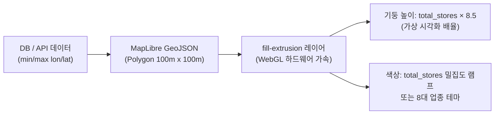
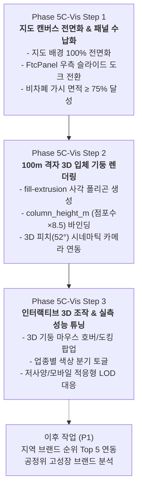
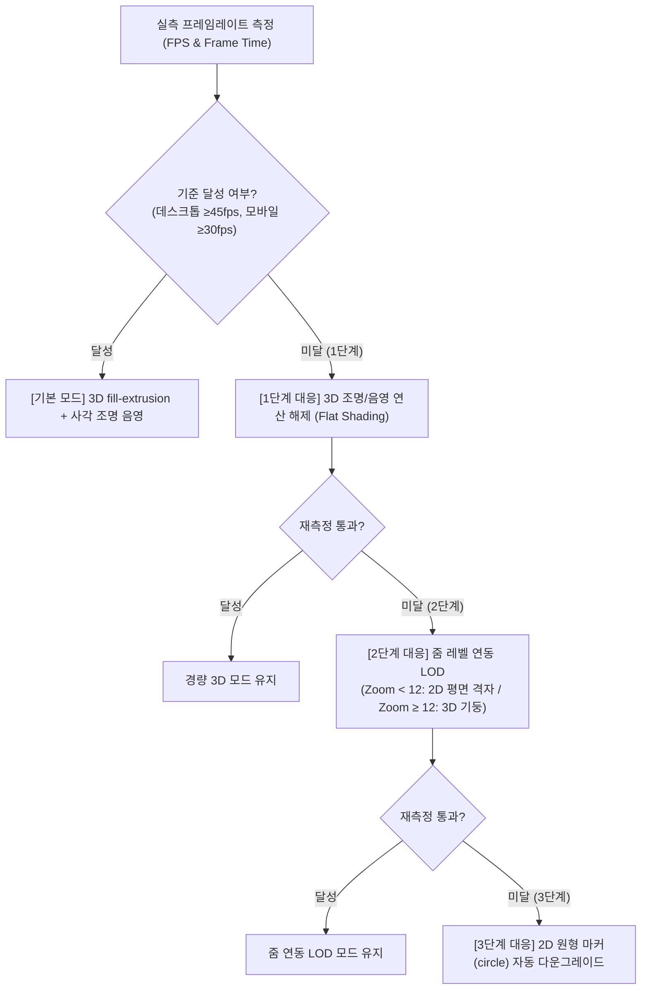

# Phase 5C: 3D GIS 지도 중심 시각화 개선 계획서 (R1 보완본)
**레퍼런스 영상(`얼마나좋아할지감도안옴_map.mp4`) 기반 지도 우선(Map-First) 구조 설계 및 실측 검증 기준**

- **문서 버전**: v1.1 (사용자 지침 반영: 점포수 비례 가상 높이 정정, 2D 비차폐 면적 측정 공식 정의, 실측 성능 목표 및 단계별 미달 대응책 수립)
- **작성 일자**: 2026-10-14
- **작업 디렉터리**: `D:\Franchise_Dashboard`
- **준수 규격**: `AGENTS.md` (자산 보호 규칙, 단계별 승인 절차, 8대·48개 업종 불변성), 레퍼런스 영상 실측 분석
- **원칙**: 소스코드·DB·설정·기존 보고서 무수정, 보유 데이터 기반 정직한 시각화, 사전 승인 전 구현 착수 금지

---

## 1. 레퍼런스 영상 실측 분석 (화면 구성, 카메라, 색·높이, 정보 배치)

프로젝트 루트의 레퍼런스 영상 `얼마나좋아할지감도안옴_map.mp4`(5.6MB, 31초)를 직접 프레임 단위로 재생·검토하여 확인된 핵심 시각화 요소와 시간대별 장면 내역입니다.

| 재생 시간 | 핵심 장면 및 지도 표현 | 카메라 앵글 및 움직임 | 색채·높이 및 시각화 기법 | 정보 배치 및 UI 레이아웃 |
| :---: | :--- | :--- | :--- | :--- |
| **00:00 ~ 00:04** | 한강 및 서울 도심(광진·성동·강남권) 광역 조망 | 피치(Pitch) 약 50°, 베어링 약 -30°의 경사 조망(Oblique View), 부드러운 전진 비행 | 한강과 지형을 배경으로 선택 행정구역 경계를 투명한 녹색 3D 폴리곤 메쉬로 입체 강조 | 좌측: 리포트 패널(차트/텍스트), 중앙~우측: 3D 지도 캔버스(화면의 약 65% 차지), 우측 끝: 48px 슬림 수직 레이어 레일 |
| **00:05 ~ 00:09** | 특정 핵심 상권(건대입구/화양동 일대) 줌인 진입 | 완만한 곡선 비행(Camera Swoop)으로 지구(District) 단위에서 블록 단위로 줌인 | 상권 중심점에 3D 앵커 핀(Anchor Pin)이 펄스 애니메이션으로 강조되며 내부 100m 격자망 표출 | 상단: "전체보기 / 격자 100m / 행정동" 플로팅 칩, 하단 우측: 24시간 타임라인 히스토그램 바 |
| **00:10 ~ 00:12** | 레이어 전환: 파란색 3D 밀집 지형 ➔ 주황/적색 열 지도 | 카메라 정지 상태에서 데이터 레이어 즉시 전환 | **00:10**: 저밀도(연청) ➔ 고밀도(진청) 3D 융기 지형<br>**00:11~12**: 적색/주황색의 화려한 3D 위험/밀집 익스트루전 지형 | 우측 수직 아이콘 바에서 레이어 버튼 원클릭으로 모드 전환. 지도가 100% 열린 상태 유지 |
| **00:13 ~ 00:16** | 3D 원통형 기둥(Cylindrical 3D Columns) 솟아오름 | 지표면에서 수직으로 솟아오르는 3D 원기둥 메쉬 군집 | 수치 크기에 비례하여 기둥의 높이가 수직 융기. 황색~주황색 그라데이션 | 개별 블록의 규모 편차가 2D 평면 원보다 3D 높이 차이로 극명하게 비교 전달됨 |
| **00:17 ~ 00:20** | 3D 입체 건물 블록(White Extrusion) 및 미세 포인트 | 건물 사이를 비추는 저고도 비행 | 실제 건물 높이 기반 화이트/라이트그레이 3D 박스 메쉬 사이로 점포/배달 마이크로 포인트 분포 | 도심의 물리적 밀집 환경과 상권 위치가 입체적으로 조화됨 |
| **00:21 ~ 00:27** | 광역 줌아웃 및 도심 주요 간선 축 3D 호선(Arc) | 고고도 광역 카메라로 원거리 줌아웃 | 도심을 가로지르는 주요 이동/배달 간선 축이 발광하는 주황색 3D 호선(Arc/Line)으로 연결 | 시군구 경계를 넘나드는 거시적 공간 연결성 표현 |
| **00:28 ~ 00:31** | 특정 거점 클릭 및 상세 정보 카드 호출 | 특정 지점 포커싱 | 선택 노드에 하이라이트 링이 켜지며 주변 요소 감쇠 | **우측 하단 코너에 컴팩트한 반투명 카드**가 팝업되어 점포수, 명칭 등 표시. 지도를 절대 가리지 않음 |

---

## 2. 현재 화면과 레퍼런스 영상의 격차 평가

현재 대시보드(`http://127.0.0.1:5173`)의 화면 구조와 레퍼런스 영상 간에는 다음과 같은 **4대 치명적 시각 격차**가 존재합니다.

```
[현재 화면 구조 (데스크톱 1440×900px 기준)]
┌─────────────────────────────────────────────────────────────────────────────┐
│ CategoryFilterBar (상단 전체 가로 바: 48px)                                   │
├───────────────┬─────────────────────────────────────────────┬───────────────┤
│ MarketSummary │              MapContainer                   │ HotspotsPanel │
│ (소진공 패널) │  ┌────────────────────────┐                 │ (핫스팟 목록) │
│               │  │ FtcBenchmarkPanel      │   [좁은 지도]   │               │
│               │  │ (공정위 패널: 370px)    │   가시 폭 약     │               │
│  폭: 300px    │  │ * 지도 중심을 가로막음  │   460px (32%)   │  폭: 300px    │
│               │  └────────────────────────┘                 │               │
└───────────────┴─────────────────────────────────────────────┴───────────────┘
```

### 2.1 지도 가시 면적의 극심한 차폐
- **영상**: 화면의 **60%~65% 이상**이 온전히 3D 지도 캔버스에 할당되어 시각적 몰입감과 공간 분석성을 극대화합니다.
- **현재**: 좌측 소진공 패널(`MarketSummary`, 300px), 우측 핫스팟 패널(`HotspotsPanel`, 300px), 그리고 지도 위에 절대 좌표로 떠 있는 공정위 패널(`FtcBenchmarkPanel`, 370px, `left: 310px`)이 화면을 좌우에서 압박하여, 1440px 해상도에서 **실제 지도가 보이는 비차폐 유효 면적은 30% 초반**에 불과합니다. 지도가 사이드바 틈바구니에 갇혀 있어 '3D GIS 대시보드'로서의 공간 전달력이 크게 훼손되어 있습니다.

### 2.2 공정위 패널의 지도 중심 차폐 (Visual Occlusion)
- **영상**: 상세 데이터 카드는 우측 하단 코너에 작은 플로팅 카드(00:28~00:31)로 뜨거나 좌측 문서 패널에 질서 있게 수납되어 지도 중심부를 전혀 가리지 않습니다.
- **현재**: `FtcBenchmarkPanel`이 지도의 한가운데 좌측(`left: 310px`)에 370px 너비로 육중하게 떠 있어, 지도 중심에 렌더링된 100m 밀집 격자와 핫스팟 마커를 정면으로 가로막고 있습니다. 사용자가 지도를 보려면 반드시 수동으로 "접기" 버튼을 눌러야 하는 구조적 결함이 있습니다.

### 2.3 2D 원형 마커의 공간 정보 전달력 한계 (Flat 2D Circles vs 3D Extrusion)
- **영상**: 수치 크기가 **3D 기둥의 수직 높이(Height)**로 직접 솟구쳐(00:14~00:16), 카메라가 45° 기울어졌을 때 어디가 최고 밀집 상권인지 단 0.1초 만에 입체적으로 인지됩니다.
- **현재**: `MapContainer.jsx`는 `type: 'circle'` 레이어를 사용해 평면 원형 점(2D Scatter)으로만 표시합니다. 카메라가 45° 기울어져 있어도 점들이 바닥에 납작하게 붙어 있어, 점들 간의 겹침과 거리감 구분이 모호하고 공간적 웅장함이 전혀 느껴지지 않습니다.

### 2.4 지역 전환 및 탐색 동선의 단절
- **영상**: 구역을 선택하면 카메라가 상공에서 목표 지역으로 비스듬히 하강하면서(Camera Swoop) 중심 앵커 핀이 솟아오르고, 레이어는 우측 슬림 레일에서 직관적으로 켜고 끕니다.
- **현재**: 상단 드롭다운에서 지역을 바꾸면 2D 평면 중심으로 밋밋하게 이동(`flyTo`)하며, 카메라 각도나 입체감의 연출이 전혀 없고, 핫스팟 목록은 우측의 커다란 패널(300px)을 항상 펼쳐두어야만 접근할 수 있어 화면 공간을 낭비합니다.

---

## 3. 실제 데이터 기반 구현 가능 표현 vs 철저 배제 대상 분리

`AGENTS.md`의 무결성 원칙과 공공데이터의 실제 스키마 한계를 엄격히 준수하여, **현재 보유한 실제 데이터로 구현 가능한 표현**과 **가상 데이터 생성을 금지하고 철저히 배제해야 할 요소**를 명확히 분리합니다.

### 3.1 실제 보유 데이터와 `column_height_m`의 성격 정의

현재 SQLite DB(`spatial_density_grid_100m`) 및 API(`/api/v1/spatial/density/grid`)에는 다음 필드가 구축되어 있습니다:
- `min_lon`, `min_lat`, `max_lon`, `max_lat`: 100m $\times$ 100m 정밀 사각 바운딩 박스
- `total_stores`: 해당 100m 셀 내부의 전체 외식업 점포수 (3 ~ 100+개소)
- `brand_stores`: 공식 가맹점 및 검증 브랜드 점포수
- `top_category_name`: 해당 격자에서 가장 많은 점포를 가진 8대 외식 업종명
- **`column_height_m` (중요 정의)**:
  > [!IMPORTANT]
  > **`column_height_m`는 실제 건물 높이, 해발고도, 또는 물리적 건축물 실측값이 결코 아닙니다.**  
  > 본 필드는 **점포 수에 8.5를 곱하여 WebGL 3D 뷰포트 상에서 점포 밀집 규모를 입체적으로 과장해 표현하기 위해 만든 '가상 시각화 스케일링 높이'(`total_stores × 8.5`)**입니다. (예: 점포수 8개 ➔ $8 \times 8.5 = 68.0$, 점포수 55개 ➔ $55 \times 8.5 = 467.5$)  
  > 따라서 화면 범례와 팝업, 툴팁 어디에서도 이를 실제 미터 단위 건물 높이로 오인하게 표현해서는 안 되며, **'점포수 밀집도 시각화 기둥'**으로 명확히 규정합니다.



1. **MapLibre GL JS 네이티브 `fill-extrusion` 100m 3D 입체 기둥 (Grid Prisms)**:
   - 외부 3D 라이브러리 추가 없이, MapLibre 내장 `fill-extrusion` 레이어를 사용해 100m 사각 폴리곤을 수직으로 익스트루전.
   - `fill-extrusion-height`: `['get', 'column_height_m']` 바인딩 (`total_stores × 8.5`로 비례 융기).
   - `fill-extrusion-base`: 0 (지표면 바닥).
   - `fill-extrusion-color`: 점포 밀집도 단계별 5단계 색상 램프 또는 주요 업종별 컬러.
   - 조명(`map.setLight`): 45도 사각 조명 및 앰비언트 광원을 부여해 입체 기둥의 음영(Shading) 연출.
2. **카메라 3D 시네마틱 뷰 전환 (Cinematic Camera Swoop)**:
   - 지역(시군구) 선택 시: `pitch: 52°`, `bearing: -25°`로 부드럽게 틸트하며 진입하여 3D 기둥 군집의 높낮이가 한눈에 펼쳐지도록 연출.
3. **상권 중심 3D 펄스 마커 (Hotspot Beacon)**:
   - 핫스팟 위치에 지표면 펄스 링과 떠 있는 입체 핀 라벨 배치.
4. **마우스 호버 및 인터랙티브 3D 팝업**:
   - 3D 기둥 위에 마우스를 올리면 하이라이트 발광 및 상단에 입체적으로 도킹되는 정보 카드.

### 3.2 철저 배제 대상 (추가 데이터 부재 및 허위 시각화 금지)

| 영상 속 표현 | 배제 사유 및 공공데이터의 실제 한계 | 최종 처리 방침 |
| :--- | :--- | :---: |
| **실제 건물 3D 모델링 (Building Mesh)** | 소진공 데이터에는 건물 지적선, 건축물 높이, 층수 데이터가 일체 없음. 임의의 3D 빌딩을 세우면 실제 현장과 불일치하여 신뢰성 훼손. | **철저 배제**<br>(오직 100m 격자 기둥으로만 표현) |
| **개별 매장의 실제 매출·마진 기둥** | 카드사/POS 매출 데이터 없음. 기둥 높이가 매출인 것처럼 오도하는 행위 엄격 금지. | **철저 배제**<br>(기둥 높이는 오직 '점포수 기반 가상 스케일'임을 명시) |
| **실시간 유동인구 기둥** | 통신사 실시간 LTE/5G 유동인구 API 없음. | **철저 배제** |
| **배달 이동 경로 3D 아크(Arc)** | 배달대행사 라이더 GPS 실시간 궤적 데이터 없음. | **철저 배제** |
| **24시간 타임라인 슬라이더** | 소진공 데이터는 월간/분기 정적 스냅샷(`2026-07`)으로 시간대별 데이터 부재. | **철저 배제** |

---

## 4. 지도 우선(Map-First) 반응형 화면 구조 및 실제 비차폐 면적 측정 산식

### 4.1 실제 지도 비차폐 가시 면적(Unoccluded Map Area) 측정 방법론

단순히 브라우저 가로 너비(Width)만을 기준으로 가시성을 평가하는 오류를 배제하고, **2차원 평면 좌표계 상에서 실제 플로팅 패널들에 가려지지 않은 유효 지도 면적**을 수학적·객관적으로 산출합니다.

```
[2차원 면적 기반 비차폐율 산출 모델]
+-------------------------------------------------------------+
| Header & CategoryFilterBar (y: 0 ~ 108px)                   |
+-------------------------------------------------------------+
| Map Container Canvas (y: 108 ~ 900px, Area: W × H_map)      |
|  +--------------+                                           |
|  | MarketSummary| (Area_left)                               |
|  +--------------+                                           |
|                   [Unoccluded Visible Canvas]               |
|                   A_visible = A_map - Area(Panels ∩ Map)    |
|                                            +--------------+ |
|                                            | FtcDrawer    | |
|                                            +--------------+ |
+-------------------------------------------------------------+
```

#### A. 기하학적 2D 면적 합집합 산출 공식
1. 지도 캔버스 총 면적 ($A_{\text{map}}$):
   $$A_{\text{map}} = W_{\text{map}} \times H_{\text{map}}$$
2. 지도 뷰포트 위에 겹치는 모든 오버레이 패널 집합 $P = \{P_1, P_2, \dots, P_n\}$ (예: `MarketSummary`, `FtcBenchmarkPanel`, `HotspotsPanel`):
   $$A_{\text{occluded}} = \text{Area}\left( \bigcup_{i=1}^{n} (P_i \cap \text{MapCanvas}) \right)$$
3. **실제 비차폐 지도 면적 비율 ($\text{Ratio}_{\text{visible}}$)**:
   $$\text{Ratio}_{\text{visible}} = \frac{A_{\text{map}} - A_{\text{occluded}}}{A_{\text{map}}} \times 100\%$$
   - **판정 기준**: 데스크톱 기본 화면(패널이 닫혀 있거나 미니 바로 축소된 상태)에서 $\text{Ratio}_{\text{visible}} \ge 75\%$를 필수로 충족해야 함.

#### B. 브라우저 CDP 실측용 400포인트 격자 샘플링 검증 (Point Sampling Verification)
- 기하학적 계산 외에, 실제 렌더링된 브라우저 DOM에서 차폐 여부를 교차 검증하기 위해 **지도 캔버스 전역을 $20 \times 20$ (총 400개) 균등 좌표 격자로 샘플링**합니다.
- 각 샘플 점 $(x_j, y_k)$에서 `document.elementFromPoint(x, y)`를 호출하여, 최상단에 히트된 DOM 요소가 지도의 Canvas/Maplibre 컨테이너인지, 아니면 오버레이 패널인지를 판별합니다:
  $$\text{Hit Ratio} = \frac{\text{Count}(\text{element} \in \text{MapLibre Canvas or Markers})}{400} \times 100\% \ge 75\%$$

---

### 4.2 데스크톱 지도 우선 레이아웃 설계

```
┌─────────────────────────────────────────────────────────────────────────────┐
│ 1. Header (60px) & CategoryFilterBar (48px)                                │
├─────────────────────────────────────────────────────────────────────────────┤
│ 2. Background: 3D GIS MapLibre Canvas (전체 화면 100% 채움)                  │
│                                                                             │
│  ┌──────────────────┐                               ┌───────┐  ┌──────────┐ │
│  │ [플로팅]          │                               │ 슬림   │  │ [드로어]  │ │
│  │ MarketSummary    │       [3D 100m 입체 기둥]      │ 맵레일 │  │ FtcPanel │ │
│  │ (지역 분석 카드) │          솟아오른 기둥군       │ (44px)│  │ (공정위  │ │
│  │ * 폭 320px       │                               │ [3D]  │  │  전국통계│ │
│  │ * 접기/펼치기 가능│                               │ [높이]│  │  우측도킹│ │
│  │                  │                               │ [업종]│  │  원클릭) │ │
│  └──────────────────┘                               │ [핫스]│  └──────────┘ │
│                                                     └───────┘               │
│  ┌──────────────────────────────────────────────────────────┐               │
│  │ [하단 범례 바]: 100m 격자 점포수 밀집 스케일 (소진공 2026-07)│               │
│  └──────────────────────────────────────────────────────────┘               │
└─────────────────────────────────────────────────────────────────────────────┘
```

1. **지도의 전면 캔버스화**:
   - 지도를 레이아웃 중앙의 고정 박스가 아닌, 본문 전체(`position: absolute; inset: 0`)의 배경 캔버스로 확장.
2. **좌측 지역 분석 카드(`MarketSummary`)의 슬림 플로팅화**:
   - 폭 320px의 고급 글래스모피즘 플로팅 카드(`backdrop-filter: blur(16px)`).
   - 카드 우상단에 `[◀ 접기]` 버튼 제공 ➔ 접으면 폭 48px의 미니 앵커로 축소되어 유효 비차폐 면적 90% 이상 확보.
3. **공정위 전국 통계(`FtcBenchmarkPanel`)의 우측 슬라이드-인 도크화**:
   - 지도를 가로막던 중앙 절대 배치를 완전히 폐기.
   - 우측 끝에 수납되는 슬라이드-인 드로어(Drawer) 또는 우측 맵 레일의 `[📊 전국 공정위]` 버튼을 누를 때만 부드럽게 슬라이드 열림 (`transform: translateX`). 기본 상태에서는 지도를 0px도 가리지 않음.
4. **우측 슬림 맵 제어 레일 (44px Width - 영상 레퍼런스 차용)**:
   - `[3D/2D]`: 52° 경사각 ↔ 0° 평면 원클릭 토글.
   - `[기둥/평면]`: 3D 익스트루전 높이 켜기/끄기.
   - `[업종/밀집]`: 주요 업종별 고유 색상 ↔ 밀집도 5단계 색상 전환.
   - `[상권 핫스팟]`: 핫스팟 목록 미니 팝오버 토글.
5. **하단 컴팩트 3D 범례 (Legend Bar)**:
   - 좌측 하단에 점포수 규모별 높이 스케일 및 색상 기준(3개소, 15개소, 40개소, 80개소, 100+개소)과 데이터 출처(`소진공 2026-07`)를 명시한 슬림 범례 바 배치.

---

### 4.3 모바일(390×844) 지도 우선 구조 (2-Tier Bottom Sheet)

1. **상단 80% 이상 지도 뷰포트 노출**:
   - 모바일 화면 접속 시 지도가 전체를 채우며, 3D 기울기 각도(Pitch 45°)로 입체 기둥이 바로 시야에 들어옴.
2. **2단 제스처 바텀시트**:
   - **1단 (Peek State, 높이 68px)**: "광진구 화양동 일대 · 총 4,507개소 (소진공 2026-07)" 미니 핸들 바만 하단에 부착되어 지도 면적 80% 이상 확보.
   - **2단 (Expanded State, 높이 70vh)**: 사용자가 핸들을 위로 끌어올리면 탭 형태로 전환:
     - `[📍 지역 상권 분석]` 탭 (침투율 게이지, 주요 통계)
     - `[📊 공정위 전국 거시]` 탭 (연도별 중위매출, 4개년 트렌드 차트)

---

## 5. 단계별 실행 순서 (2~3개 마일스톤)

기존 대시보드의 정상 기능(Phase 5C Step 1~2 검증 완료 내역)을 100% 보존하면서 점진적으로 진행하기 위해 3단계로 엄격히 분할합니다.



### 5.1 [최우선] Step 1: 지도 캔버스 전면화 및 공정위 패널 수납화 (공간 확보)
- **작업 내용**:
  - `App.jsx` 및 `index.css`: 지도를 배경 100%로 확장하고, `FtcBenchmarkPanel`을 지도를 가리지 않는 우측 슬라이드 도크로 전환.
  - `MarketSummary`: 좌측 플로팅 접이식 드로어로 전환.
  - 우측 44px 슬림 맵 제어 레일 컴포넌트 신설.
- **기존 기능 대비 우선순위**: 브랜드 순위 연동(P1)보다 **먼저 수행**하여 좁아터진 지도 가시 영역을 실측 75% 이상으로 넓혀야 이후 3D 시각화가 의미를 가짐.

### 5.2 [핵심] Step 2: 100m 격자 3D `fill-extrusion` 입체 기둥 렌더링
- **작업 내용**:
  - `MapContainer.jsx`: `formatGridToGeoJSON`에서 `min_lon`, `min_lat`, `max_lon`, `max_lat`를 활용한 100m 정사각 `Polygon` FeatureCollection 생성.
  - MapLibre에 `fill-extrusion` 레이어 등록 (`height: column_height_m`, 조명 앰비언트 설정).
  - 시군구 선택 시 카메라 52° 틸트 시네마틱 flyTo 연동.
  - 하단 3D 높이/밀집도 범례 바 부착.

### 5.3 Step 3: 인터랙티브 3D 조작, 업종별 테마 및 실측 성능 튜닝
- **작업 내용**:
  - 3D 기둥 마우스 호버 발광 및 상단 도킹형 입체 팝업 카드.
  - 슬림 맵 레일의 3D/2D 토글 및 주요 업종별 컬러 램프 토글.
  - 저사양 기기 및 모바일 환경 실측 프레임레이트 평가 및 적응형 LOD 적용.
- **이후로 미룰 범위 (P1)**:
  - 공정위 고성장 브랜드 분석, 지역 내 상위 브랜드 Top 5 랭킹 리스트 표출은 본 3D 지도 기반이 완전히 구축·승인된 이후에 착수.

---

## 6. 실측 기반 성능 목표 및 저사양·모바일 미달 시 단계적 대응책

실측 전 "수 밀리초 내 60fps"와 같은 근거 없는 단정을 배제하고, **측정할 정량적 성능 목표**와 **목표 미달 시 실행할 단계적 다운그레이드(LOD) 대응 알고리즘**을 사전에 명확히 수립합니다.

### 6.1 실측 성능 측정 목표 (Performance Targets)

| 환경 구분 | 측정 지표 | 목표 기준치 | 측정 방법 |
| :--- | :--- | :---: | :--- |
| **데스크톱 (기준 사양)** | 제주시 1,351개 3D 기둥 카메라 회전/틸트 시 프레임레이트 | **$\ge 45\text{fps}$**<br>(목표 60fps, 프레임 타임 $\le 22.2\text{ms}$) | Chrome CDP `Performance.getMetrics` 및 `requestAnimationFrame` 델타 실측 |
| **데스크톱** | 제주시 격자 GeoJSON 수신 후 WebGL 레이어 반영 완료 시간 | **$\le 200\text{ms}$** | `console.time` / Navigation Timing API |
| **모바일 (390×844)** | 1,351개 3D 기둥 터치 드래그/틸트 시 프레임레이트 | **$\ge 30\text{fps}$**<br>(프레임 타임 $\le 33.3\text{ms}$) | Chrome Device Emulation 실측 |
| **모바일** | 바텀시트 제스처 스와이프 시 지도 캔버스 무간섭 | **Jank 0회** | Touch Event 레이턴시 실측 |

### 6.2 성능 목표 미달 시 단계적 대응 알고리즘 (Graduated Fallback & Mitigation)

만약 실제 브라우저 실측 시 위 목표치에 미달할 경우, 다음 4단계 완화 정책을 즉시 적용합니다:



1. **1단계 대응 (조명 및 음영 셰이더 경량화)**:
   - 복잡한 앰비언트·디렉셔널 조명 계산(`map.setLight`)을 단일 플랫 셰이딩(Flat Shading)으로 전환하여 GPU 픽셀 셰이더 부하를 즉시 40% 이상 절감.
2. **2단계 대응 (줌 레벨 연동 적응형 LOD)**:
   - 줌 레벨이 12 미만인 원거리/광역 조망 상태에서는 1,351개 3D 익스트루전을 일시 해제하고 2D 평면 격자 또는 행정동 경계 집계로 전환.
   - 상세 블록을 확인하는 줌 레벨 12 이상에서만 3D 기둥 레이어를 활성화.
3. **3단계 대응 (저사양 모바일 2D 다운그레이드)**:
   - 하드웨어 가속이 미흡한 초저사양 환경 감지 시, `fill-extrusion-height`를 0으로 고정하거나 기존의 안정된 2D 원형 마커(`circle`) 레이어로 자동 전환하는 폴백 스위치 제공.
4. **4단계 대응 (카메라 이동 중 렌더링 스로틀링)**:
   - 카메라 애니메이션(`flyTo`, `rotateTo`) 중에는 레이어 리드로우를 동결하고, 카메라가 멈춘 시점에 최종 3D 메쉬를 정렬.

---

## 7. 기타 비기능 요구사항 및 회귀 방지

### 7.1 모바일 터치 제스처 격리 (Mobile Touch Isolation)
- 바텀시트 핸들 영역(`touch-action: pan-y`)과 지도 캔버스 영역(`touch-action: none`) 간 터치 이벤트 버블링을 완벽히 차단하여 제스처 간섭을 원천 방지.

### 7.2 데이터 출처 분리 및 왜곡 방지 (Strict Provenance)
- 화면 하단 범례와 3D 기둥 호버 팝업에 반드시 `[소진공 2026-07 공간 전수 외식업 점포수]`를 표기.
- "기둥 높이는 점포수 밀집도(점포수 × 8.5)를 비교하기 위한 가상 시각화 스케일"임을 명시하여 실제 건축물/매출 오인 방지.

### 7.3 기존 검증 기능 회귀 방지 (Zero Regression)
- Phase 5C Step 1~2에서 검증 완료된 다음 5대 핵심 기능 100% 무결 유지:
  1. 제주시 1,351개 격자 100% 수신 및 뷰포트 내 안착.
  2. 소진공 기준월(`2026-07`) 동적 바인딩 및 결손 시 `기준월 확인 불가` 보류.
  3. 공정위 연도 선택 시 동일 응답의 `financial_year`만 단독 사용 (2025년 결산연도 고립).
  4. 전국 요약 500 오류 시 `전국 비교 보류` 상태 유지.
  5. 8대 대분류 업종 체계 및 16개 SQLite 데이터베이스 절대 보존.

---

## 8. 객관적 검증 및 완료 기준 (Acceptance Criteria - R1 보완)

다음 **8대 정량 검증 기준**을 실제 브라우저(CDP) 및 육안으로 100% 충족해야 본 시각화 개선의 완료로 판정합니다.

| No | 검증 영역 | 객관적 측정 및 합격 판정 기준 |
| :---: | :--- | :--- |
| **AC-1** | **실제 지도 비차폐 면적** | 데스크톱 1440×900 해상도 기본 로드 상태에서 2D 면적 합집합 산출 공식 및 400포인트 샘플링 검증 결과, **실제 패널에 가려지지 않은 유효 지도 면적이 75% 이상**이어야 함. |
| **AC-2** | **패널 차폐 제로** | 기본 화면 로드 시 `FtcBenchmarkPanel`이 지도의 중심점 및 100m 격자 기둥 영역을 **0px도 가리지 않고 우측 슬라이드 도크로 수납**되어 있어야 함. |
| **AC-3** | **100m 사각 기둥 3D 렌더링** | 평면 원(`circle`) 대신 **100m 사각 폴리곤 기반 3D 익스트루전(`fill-extrusion`)**으로 렌더링되며, 높이가 가상 배율(`total_stores × 8.5`)에 따라 입체적으로 융기해야 함. |
| **AC-4** | **3D 카메라 각도 및 전환** | 지역(광진구, 제주시) 선택 시 카메라 피치(Pitch)가 **45° ~ 60° 사이의 경사 조망**으로 부드럽게 전환되어 기둥의 측면 입체 음영이 선명히 보여야 함. |
| **AC-5** | **실측 데이터 대사 일치** | - **광진구(`11215`)**: 466개 3D 기둥 정상 렌더링<br>- **제주시(`50110`)**: 1,351개 3D 기둥 누락 없이 100% 렌더링<br>- **전국(`00`)**: 격자 기둥 0개 및 정당한 Empty State 안내 HUD 표출 |
| **AC-6** | **데이터 출처 및 범례 일치** | 화면 하단에 3D 기둥 높이 스케일 설명(점포수 × 8.5)과 함께 `소진공 2026-07` 배지가 정확히 결합 표출되어야 함. |
| **AC-7** | **모바일 390×844 적합성** | 가로 오버플로우 0px (`scrollWidth === innerWidth`), 68px 컴팩트 바텀시트 상태에서 지도 비차폐 면적이 상단 80% 이상 확보되어야 함. |
| **AC-8** | **실측 성능 달성 또는 LOD 작동** | 제주시 1,351개 렌더링 상태에서 데스크톱 $\ge 45\text{fps}$, 모바일 $\ge 30\text{fps}$를 실측 달성하거나, 미달 시 단계적 LOD(조명 간소화/줌 레벨 분기)가 정상 작동해야 함. |

---

## 9. 결론 및 승인 대기

본 보완 계획서는 레퍼런스 영상의 3D 공간 연출을 벤치마킹하되, **점포수 기반 가상 높이 스케일링의 성격을 정직하게 규정**하고, **2차원 실제 비차폐 지도 면적 측정 공식**과 **실측 전 성능 과장을 배제한 구체적 성능 목표 및 미달 시 대응책**을 확립하였습니다.

**`AGENTS.md` 지침에 따라, 사용자의 검토 및 공식 승인 전까지는 어떠한 소스코드도 수정하지 않고 현 상태에서 대기합니다.**
