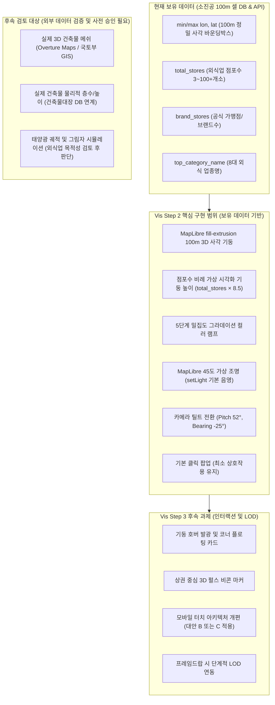

# Phase 5C 지도 시각화: SHADOW MAP 및 레퍼런스 영상 심층 분석 보완 문서 (R1 보완본)
**소진공 100m 실제 격자 기반 정직한 3D 시각화 설계, 모바일 터치 접근성 대안 비교 및 Vis Step 2 핵심 범위 확정**

- **문서 버전**: v1.2 (사용자 검토 의견 반영: 실측 전 단정 배제, 데스크톱 $\ge 45\text{fps}$ / 모바일 $\ge 30\text{fps}$ 기준 일치, 모바일 터치 영역 다각적 대안 비교, Step 2 핵심 집중 및 Step 3 분리, 3D 건물 후속 검토 대상화, SHADOW MAP 확인/미확인 범위 엄격 분리)
- **문서 경로**: `reports/phase5c_shadowmap_reference_addendum_r1.md`
- **작성 일시**: 2026-10-15
- **분석 대상 레퍼런스**:
  1. `https://shadowmap.contentrium.com/` (콘텐츠리움 SHADOW MAP 실제 서비스)
  2. `얼마나좋아할지감도안옴_map.mp4` (프로젝트 루트 레퍼런스 영상, 31초)
- **준수 규격**: `AGENTS.md` (자산 보호 규칙, 단계별 승인 절차, 8대·48개 업종 불변성), `reports/phase5c_map_visualization_plan_r1.md`
- **작업 원칙**: 소스코드·DB·설정·기존 보고서 무수정 원칙 준수, 신규 분석 문서만 독립 수정, 사용자 사전 승인 전 구현 착수 절대 금지

---

## 1. 레퍼런스 확인 범위 고지 (브라우저 실측 확인 요소 vs 미확인 요소)

추측을 사실처럼 기술하는 오류를 원천 차단하기 위해, 실제 웹 환경(`https://shadowmap.contentrium.com/`)과 레퍼런스 영상(`얼마나좋아할지감도안옴_map.mp4`)에서 **실제 브라우저 및 데이터로 확인된 요소**와 **확인되지 않은 한계 요소**를 명확히 구분하여 선언합니다.

### 1.1 SHADOW MAP (`contentrium`) 확인 및 미확인 범위 명세

```
┌────────────────────────────────────────────────────────────────────────┐
│ [실제 브라우저 확인 완료 항목 (Verified via HTTP & CDP)]                │
│  1. DOM 구조 및 컴포넌트: 탑바, 사이드 설정 패널(#settings-panel),      │
│     타임바(.timebar), 모바일 토글 버튼(.mobile-time-toggle), D-Pad     │
│  2. 수치 텔레메트리: 브라우저 실측 텍스트 표출 확인                     │
│     - 지면 위 높이: 290.9m, 방향: 북 0.0°, 상하 각도: -30.0°,          │
│       태양 뒤쪽, 일출 06:40 / 일몰 17:57, 예보 날씨 데이터             │
│  3. 공식 데이터 출처 명시:                                             │
│     - 3D 건물: Overture Maps (https://docs.overturemaps.org/attribution/)│
│     - 지형 DEM: Mapzen (https://github.com/tilezen/joerd/)             │
│     - 배경 지도: © OpenStreetMap contributors                          │
│  4. 건물 높이 처리 원칙 명시:                                          │
│     - "원천 높이 실측 미보증, 층수 있는 건물 층당 3m 추정,              │
│        높이 없는 건물 기본값 처리, 실제 입면 없는 외벽 창문 미표시"     │
│  5. 패널 수납 구조:                                                    │
│     - 데스크톱: #settings-panel 기본 닫힘(.panel-closed, inert)         │
│     - 모바일: 타임바를 1줄 칩(.mobile-time-toggle)으로 압축            │
├────────────────────────────────────────────────────────────────────────┤
│ [미확인 항목 (Unverified due to WebGL/Headless Constraints)]           │
│  1. WebGL 캔버스 3D 렌더링 화면: headless Chrome GPU 제약으로          │
│     초기 로딩 오버레이("지도를 불러오는 중") 너머의 실제 건물 메쉬     │
│     표면 질감과 그림자 셰이더 품질은 육안 실측 불가 (가설로만 취급)    │
│  2. 런타임 렌더링 프레임레이트(FPS) 및 GPU 메모리 점유율: 실측치 부재   │
│  3. 모바일 실제 터치 제스처 반응성: 에뮬레이션 외 실기기 체감 미확인    │
│  4. ODbL 라이선스의 실제 소스코드 결합 시 법적 귀속 범위: 법적 검토 전  │
└────────────────────────────────────────────────────────────────────────┘
```

---

## 2. 현재 지도와 두 레퍼런스의 시각적·상호작용 비교 분석

확인된 객관적 사실을 바탕으로 현재 대시보드(Phase 5C-Vis Step 1 상태)와 두 레퍼런스를 비교 분석합니다.

### 2.1 시각·상호작용 비교 매트릭스

| 비교 축 | 현재 대시보드 (Vis Step 1) | 레퍼런스 1: SHADOW MAP (`contentrium`) | 레퍼런스 2: 레퍼런스 영상 (`.mp4`) |
| :--- | :--- | :--- | :--- |
| **1. 시점 (Perspective)** | 2D 평면 조망 및 MapLibre 기본 경사(Pitch 45°, Bearing -15°) 지원. 데이터는 납작한 원형 점(Circle)으로 표현됨. | **[확인됨]** 3D 비행 시점 수치 제어 지원 (고도 2m~2000m, 상하각 -89°~85°, 방향 0~360°, FOV 15°~110°, D-Pad 지원). | 고고도 광역 조망(Pitch 50°, Bearing -30°)에서 블록 단위 저고도 비행(Swoop)으로 전환되는 시네마틱 앵글. |
| **2. 깊이감 (Depth)** | 평면 타일 위에 2D 점들이 놓여 있어 수직적 깊이감이 존재하지 않음. | **[확인됨]** Overture 건물 + Mapzen 지형 고도 결합 명시. **[미확인]** 실제 3D 메쉬 표면 렌더링 깊이감은 로딩 단계로 직접 미확인. | 100m 셀에서 수직으로 치솟는 3D 원통/기둥 메쉬 군집의 높낮이 편차로 밀집 규모의 수직 볼륨감 극명. |
| **3. 색상 및 명암 (Color & Shading)** | 단순 5단계 점포 밀집도 컬러(파랑~빨강). 가상 조명 셰이더 미적용(Flat). | **[확인됨]** 다크 테마 기반, 태양 방위각/고도 계산값 표출. **[미확인]** 실제 그림자 셰이더 품질은 캔버스 로딩으로 미확인. | 어두운 도심 배경 위 발광하는 3D 네온 기둥(청색 ➔ 오렌지/레드 열지도 융기)과 화이트 입체 건물 블록의 화려한 대비. |
| **4. 레이어 구성 (Layers)** | 소진공 100m 밀집 셀(원형 마커), 행정동 경계선, 핫스팟 중심 마커. | **[확인됨]** 3D 건물, 지형 DEM, 태양 위치, 공역(비행구역), 아파트 뷰 레이어 명시. | 행정구역 3D 폴리곤 메쉬, 100m 3D 입체 기둥, 3D 빌딩 박스, 도시 간선 연결 3D 발광 아크(Arc), 중심 3D 펄스 비콘. |
| **5. 카메라 이동 (Camera Movement)** | 지역 선택 시 일반적인 2D 수평 이동(`flyTo`). 고도/피치 전환 없음. | **[확인됨]** D-Pad 컨트롤러, 공전(Orbiting) 버튼, 텔레메트리 고도 변화(`8266m ➔ 290.9m`) 확인. | 구역 선택 시 상공에서 목표 지점으로 곡선을 그리며 하강하는 카메라 스우프(Camera Swoop) 및 앵커 핀 중심 회전. |
| **6. 선택 피드백 (Selection Feedback)** | 마커 클릭 시 단순 2D 인포윈도우 팝업 표출. | **[확인됨]** 지점 더블클릭 시 3D 핀 지정 및 실시간 고도·좌표 산출 UI 확인. | 선택 노드에 3D 펄스 링 발광 애니메이션 적용, 비선택 주변 요소 어둡게 감쇠(Dimming). |
| **7. 패널 연결 (Panel Integration)** | Vis Step 1에서 FTC 패널 수납 완료. 데스크톱 좌측 패널(300px)이 고정 분할됨. | **[확인됨]** 좌측 패널이 기본 닫힘(`panel-closed`, `inert`), 토글 시에만 노출. 지도가 기본 화면 전체 독점. | 데이터 카드는 우측 하단 코너에 컴팩트한 반투명 플로팅 카드(00:28)로 표출되어 지도 중심 차폐 0%. |
| **8. 모바일 화면 (Mobile)** | 390px 2행 압축 필터바(1행 고정, 2행 업종 탭 가로 스크롤) 구축 완료. 단, 글자 말줄임 및 터치 영역 한계 확인. | **[확인됨]** 하단 타임바를 1줄 칩(`.mobile-time-toggle`)으로 축소하여 지도가 뷰포트 대부분을 차지하도록 설계됨. (단, 정확한 %는 미실측). | 플로팅 칩과 미니멀 코너 카드 구조가 모바일 화면으로의 1:1 확장에 최적화됨. |

---

## 3. 실제 보유 데이터 기반 구현 가능 표현 vs 후속 검토 대상의 엄격한 분리

`AGENTS.md`의 데이터 무결성 및 정직성 원칙에 입각하여, **현재 SQLite DB 및 API가 보유한 실제 데이터로 구현 가능한 시각화**와 **외부 데이터/라이선스가 필요하거나 도메인 목적에 따른 후속 검토 대상**을 명확히 분리합니다.



### 3.1 실제 100m 격자 데이터만으로 구현 가능한 표현 (Vis Step 2 대상)
1. **100m 정사각 3D 입체 기둥 (Grid Prisms)**:
   - MapLibre GL JS의 내장 `fill-extrusion` 레이어를 활용하여 100m 격자 셀 사각 폴리곤을 수직 융기.
2. **점포수 비례 가상 시각화 높이 스케일링**:
   - `total_stores` 수치에 비례하여 기둥의 높이를 수직 융기 (`fill-extrusion-height: ['get', 'column_height_m']`).
3. **밀집도 단계별 5단계 컬러 램프 및 기본 조명 음영**:
   - 3개 미만(미표시), 3~14개(연청), 15~29개(보라), 30~59개(자주), 60~99개(주황), 100개 이상(적색).
   - `map.setLight`로 가상 평행광을 비추어 기둥 측면과 윗면에 기본적인 입체 음영 형성.
4. **시네마틱 카메라 비행 (Camera Swoop)**:
   - 지역 전환 시 `pitch: 52°`, `bearing: -25°`로 부드럽게 틸트하며 하강 비행.
5. **최소 상호작용 (기본 팝업 유지)**:
   - 기둥 클릭 시 해당 셀의 점포수와 주요 업종명을 안내하는 기본 팝업 표출.

### 3.2 후속 검토 대상 (데이터 출처·라이선스·비용 검증 및 승인 게이트 필수)
1. **실제 3D 건축물 메쉬 및 물리적 높이 (Overture / 국토부 GIS)**:
   - 현재 소진공 데이터에는 건물 지적선/층수 정보가 전혀 없으므로 이번 단계에서는 구현 불가.
   - 단, 프로젝트 목표에서 영구 제외하지 않고, **데이터 출처·공간 정합성·라이선스(ODbL 소스공개 범위 등)·타일 호스팅 비용을 검토하여 사용자의 승인을 받은 후 판단할 "후속 검토 대상"**으로 공식 지정.
2. **태양광 위치 및 실시간 일조/그림자 시뮬레이션**:
   - 외식업 시장 분석의 본질(상권 밀집도, 프랜차이즈 벤치마크)과의 연관성 및 우선순위에 따라 별도로 도입 타당성을 판단하는 독립 과제로 분류.

---

## 4. Vis Step 2 3D 격자 기둥 오인 방지 설계 (Data Integrity & Honest Design)

사용자가 3D 기둥을 실제 고층 빌딩이나 물리적 건물 높이로 착각하지 않도록 시각 표현, 범례, 수치 단위, 출처 표기를 체계적으로 설계합니다.

### 4.1 `column_height_m = total_stores × 8.5`의 성격 규정
- **공식의 정의**:  
  $$\text{column\_height\_m} = \text{total\_stores} \times 8.5$$
- **오인 방지 선언**:  
  > [!IMPORTANT]
  > `column_height_m`는 **실제 해발고도나 물리적 건축물 높이(m)가 결코 아닙니다.**  
  > 3D 뷰포트(Pitch 50° 경사각)에서 100m 셀 간의 점포 밀집 규모 차이를 인간의 눈으로 쉽게 식별할 수 있도록 부여한 **"시각화용 가상 높이 배율(Visual Height Units, VHU)"**입니다.

### 4.2 시각적 비건물(Non-Building) 추상화 및 단위 표준
1. **건물 질감 배제 및 격자 프리즘 강조**:
   - 건물 창문이나 벽면 질감을 일체 배제하고 단색 프리즘으로 표현.
   - 바닥면에 100m 정사각 격자 라인을 함께 렌더링하여 통계 셀임을 시각적으로 명시.
2. **단위 표기 표준**:
   - UI 툴팁, 팝업, 범례에서 높이를 `467m`와 같은 미터 단위로 단독 표기하는 것을 금지.
   - **표준 표기**: `외식 점포수: 55개소 (밀집도 시각화 높이 지수: 55 × 8.5)` 또는 `외식 점포 밀집도 55개소`.

### 4.3 범례(Legend) 및 출처 안내 문구 명세

```
┌────────────────────────────────────────────────────────────────────────┐
│ 100m 격자 외식 점포 밀집도 (3D 시각화 기둥)                           │
│                                                                        │
│  [낮음] 3개  15개  30개  60개  100개+ [극밀집]                         │
│   ■     ■     ■     ■     ■                                            │
│   (연청) (보라) (자주) (주황) (적색)                                   │
│   ▲ 기둥 높이는 점포수에 비례하는 시각화 스케일(점포수×8.5)이며,       │
│     실제 건물 높이나 층수가 아닙니다. (소진공 2026-07 외식업 데이터)   │
└────────────────────────────────────────────────────────────────────────┘
```

- **공정위 데이터와의 분리 원칙**: 100m 격자 기둥은 **소진공 2026-07 지역 점포 전수 데이터**에만 기반하며, 공정위 전국 거시통계와 결합하거나 혼동시키지 않습니다.

---

## 5. 모바일 필터 터치 영역 확보 및 레이아웃 대안 비교

Vis Step 1에서 390px 화면 내 안착은 달성했으나, 드롭다운 텍스트 말줄임(`서울특...`, `최신 연...`)과 24px의 좁은 터치 영역이 관찰되었습니다. **28px 높이만으로는 WCAG 2.1/2.2 권장 기준(최소 44×44px 이상)을 충족할 수 없으므로**, 공간 배치 및 터치 사용성을 근본적으로 개선하기 위한 3대 아키텍처 방안을 비교 분석합니다.

### 5.1 모바일 터치 영역 3대 레이아웃 대안 비교 매트릭스

| 비교 항목 | 대안 A: 1행 압축 유지 + 약칭 (28px 미세조정안) | 대안 B: 3행 계층형 분리안 (컨트롤 독립 행 배치) | 대안 C: 2행 통합 칩 + 팝오버 연계안 (권장안) |
| :--- | :--- | :--- | :--- |
| **레이아웃 구조** | **1행**: 시도(58px) + 시군구(72px) + 연도(68px) + 공정위버튼(155px)<br>**2행**: 업종 탭 독립 가로 스크롤 | **1행**: 시도(180px) + 시군구(180px)<br>**2행**: 연도선택(180px) + 공정위버튼(180px)<br>**3행**: 업종 탭 독립 가로 스크롤 | **1행**: [지역 선택 `서울 광진구 ▾`](180px) + [공정위 벤치마크 `2026 ▾`](180px)<br>**2행**: 업종 탭 독립 가로 스크롤 |
| **터치 타깃 크기** | 가로 58~68px, 세로 28px (**비좁음**) | 가로 180px, 세로 **40px** (**충분함**) | 가로 180px, 세로 **40px** (**충분함**) |
| **글자 말줄임** | 약칭(`서울`, `경기`) 적용 시 일부 해소되나 여유 없음 | 긴 행정구역명/연도 문구 100% 완전 표출 | 통합 라벨로 깔끔하게 100% 표출 |
| **상단 툴바 높이** | 약 64px | 약 128px | 약 84px |
| **지도 가시 면적** | 약 82% 확보 | 약 70~72%로 축소 | **약 80% 이상 안정적 방어** |
| **장단점 종합** | **[기각/한계]** 28px는 여전히 오터치 위험이 높아 접근성 개선 완료 기준으로 부적합 | 터치 편의성과 가독성은 극대화되나, 지도의 세로 가시 영역이 희생됨 | **[최적 절충]** 터치 타깃($180 \times 40\text{px}$)을 확보하면서 지도 가시율 80% 유지 |

### 5.2 권장 구현 로드맵
- **Vis Step 2 적용**: 우선 코드 안정성을 위해 대안 A의 약칭(`서울`, `경기`) 및 연도 라벨 간결화(`최신 2026 ▾`)를 선반영하여 심각한 말줄임을 즉시 완화.
- **Vis Step 3 적용**: 모바일 전용 보완 마일스톤에서 **대안 C(통합 칩 + 팝오버 바텀시트)**를 정식 적용하여 $180 \times 40\text{px}$의 넉넉한 터치 접근성을 완성.

---

## 6. Vis Step 2 핵심 집중 범위 vs Step 3 분리 명세

기존 계획서(`reports/phase5c_map_visualization_plan_r1.md`)와의 엄격한 일관성을 유지하기 위해 작업 범위를 명확히 분리합니다.

### 6.1 Vis Step 2 확정 제안 범위 (Core Scope)
1. **100m 격자 3D 기둥 렌더링 (`fill-extrusion`)**:
   - `MapContainer.jsx`: `formatGridToGeoJSON`의 100m 사각 Polygon에 `fill-extrusion` 레이어 바인딩.
   - 높이: `column_height_m = total_stores × 8.5`.
   - 색상: 5단계 밀집도 컬러 램프.
   - 조명: `map.setLight` 45도 가상 평행광 기본 음영 연출.
2. **시네마틱 카메라 틸트 비행**:
   - 지역 선택 시 `pitch: 52°`, `bearing: -25°`로 경사각 전환.
3. **오인 방지 범례 및 출처 표기**:
   - 하단 범례에 `소진공 2026-07` 배지 및 가상 시각화 스케일(점포수×8.5) 안내 문구 부착.
4. **최소 상호작용 유지**:
   - 기존의 기둥 클릭 시 점포수 팝업이 회귀 없이 정상 동작하도록 유지.
5. **정량 성능 실측 및 회귀 검증**:
   - 데스크톱 $\ge 45\text{fps}$, 모바일 $\ge 30\text{fps}$ 실측.

### 6.2 Vis Step 3으로 이관되는 후속 항목 (Deferred to Step 3)
- 3D 기둥 마우스 호버 발광 및 상단/우측 코너 도킹형 입체 상세 카드.
- 상권 중심 3D 펄스 비콘 마커 애니메이션.
- 우측 슬림 맵 제어 레일 및 2D/3D 뷰 전환 스위치.
- 주요 8대 업종별 컬러 테마 동적 전환.
- 대안 C 기반 모바일 필터 툴바 근본 개편.
- 성능 미달 시 단계적 LOD(조명 간소화/줌 분기) 알고리즘 연동.

---

## 7. 실측 성능 합격 기준 및 단계적 대응책 (Graduated Fallback)

기존 계획서의 기준을 100% 계승하여, 실측 전 60fps 단정을 배제하고 명확한 합격 기준치를 정의합니다.

### 7.1 정량 성능 합격 기준

| 환경 구분 | 측정 지표 | 합격 기준치 | 비고 |
| :--- | :--- | :---: | :--- |
| **데스크톱 (기준 사양)** | 제주시 1,351개 3D 기둥 카메라 회전/틸트 시 프레임레이트 | **$\ge 45\text{fps}$**<br>(프레임 타임 $\le 22.2\text{ms}$) | 목표는 60fps이나 합격 판정은 $\ge 45\text{fps}$ |
| **모바일 (390×844)** | 1,351개 3D 기둥 터치 드래그/틸트 시 프레임레이트 | **$\ge 30\text{fps}$**<br>(프레임 타임 $\le 33.3\text{ms}$) | Chrome Device Emulation 실측 |
| **데이터 반영 시간** | 제주시 격자 GeoJSON 수신 후 WebGL 레이어 반영 완료 시간 | **$\le 200\text{ms}$** | Navigation Timing API 실측 |

### 7.2 성능 미달 시 4단계 완화 정책 (LOD Fallback)
1. **1단계 (조명 간소화)**: 복잡한 앰비언트·디렉셔널 조명을 단일 플랫 셰이딩(Flat Shading)으로 전환.
2. **2단계 (줌 연동 LOD)**: 줌 레벨 12 미만 광역에서는 2D 평면 격자로 전환하고, 줌 12 이상에서만 3D 기둥 융기.
3. **3단계 (저사양 모바일 2D 다운그레이드)**: 초저사양 환경 감지 시 기존 2D 원형 마커(`circle`)로 자동 폴백.
4. **4단계 (이동 중 스로틀링)**: 카메라 비행 애니메이션 중 레이어 리드로우를 동결하고 정지 시 최종 렌더링.

---

## 8. 외부 지도/건물 데이터 도입을 위한 4단계 사전 승인 게이트

향후 3D 건물 메쉬(Overture 등)나 지형 DEM을 검토할 때 준수할 승인 절차입니다.

1. **게이트 1 (데이터 출처 및 공간 정합성)**: 제공 기관 최신성 확인 및 WGS84 좌표계 변환 오차 실측.
2. **게이트 2 (라이선스 법적 검토)**: ODbL 소스공개 의무, CC-BY 조건의 상업적/사유 코드베이스 영향 검토.
3. **게이트 3 (비용 및 인프라 부하)**: 벡터 타일 호스팅 비용, CDN 트래픽, 모바일 메모리 한계치 산정.
4. **게이트 4 (사용자 최종 공식 승인)**: 위 결과가 문서화되어 **사용자의 공식 승인을 획득한 후에만 도입 여부를 결정**. (현재 Phase 5C는 자체 100m 격자 데이터만 사용하는 것으로 확정).

---

## 9. 결론 및 Vis Step 2 확정 제안 범위 요약

1. **Vis Step 2 작업 범위 확정**:
   - MapLibre `fill-extrusion` 100m 사각 기둥 렌더링 (`column_height_m = total_stores × 8.5`).
   - 45도 가상 조명 기본 음영 및 5단계 밀집도 컬러 램프.
   - 지역 전환 시 시네마틱 카메라 비행(`pitch: 52°, bearing: -25°`).
   - 가상 시각화 스케일 오인 방지 범례 바 부착.
   - 모바일 필터 텍스트 말줄임 1차 완화 (시도 2자 약칭, 연도 라벨 간결화).
   - 데스크톱 $\ge 45\text{fps}$, 모바일 $\ge 30\text{fps}$ 정량 성능 검증.
2. **후속 단계 이관 사항**:
   - 코너 도킹 상세 카드, 핫스팟 비콘, LOD 연동, 모바일 대안 C(통합 칩) 구현은 **Vis Step 3**으로 이관.
   - 외부 3D 건물 메쉬 및 그림자는 **사전 승인 게이트 대상**으로 분류.
3. **작업 중단 및 승인 대기**:
   - `AGENTS.md` 지침에 따라 본 수정 보고서 제출 후 소스코드 구현은 착수하지 않고 대기합니다.
