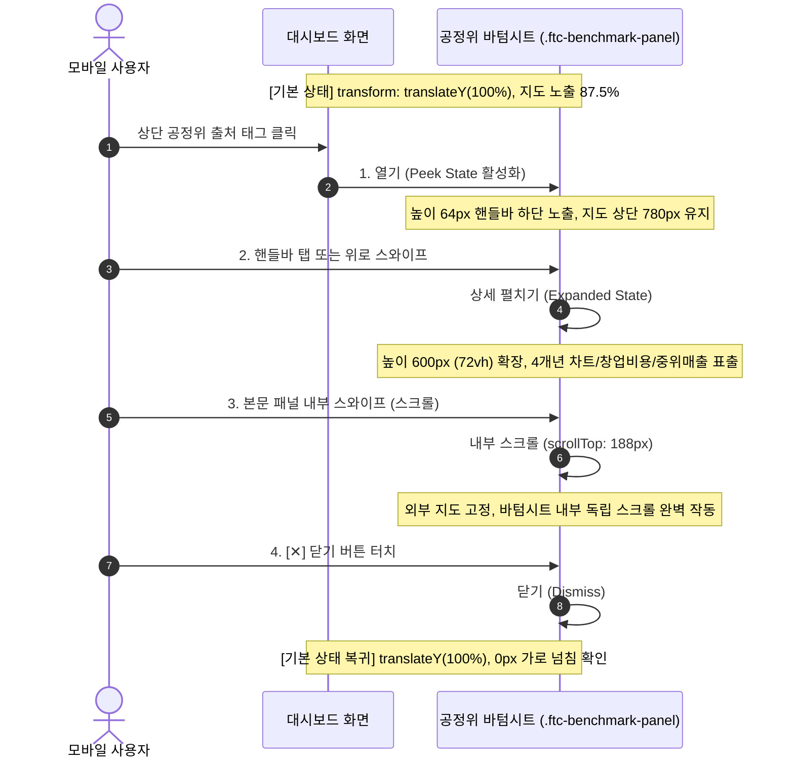

# Phase 5C-Vis Step 1 모바일 보완 보고서: 지도 중심 레이아웃 및 바텀시트 4단계 인터랙션 실측

**작성 일시**: 2026-10-15  
**작성자**: Antigravity AI Agent  
**대상 환경**: `D:\Franchise_Dashboard` (모바일 뷰포트 390×844 기준, Chrome DevTools Protocol 실측)  
**준수 지침**: `AGENTS.md`, `reports/phase5c_map_visualization_plan_r1.md` (v1.1), `reports/phase5c_step2_complement_report.md`  
**보호 규칙 준수**: 데스크톱 레이아웃, 백엔드 API, SQLite DB, 데이터 파이프라인, 기존 단계 보고서 및 기존 캡처는 일체 변경/덮어쓰지 않음. 3D 기둥(`fill-extrusion`) 미구현 상태 유지.

---

## 1. 개요 및 보완 배경

Phase 5C-Vis Step 1 검증 후 제기된 **모바일(390×844) 환경에서의 지도 중심 공간 확보 및 공정위 바텀시트 조작성 보완 요청**을 완수하였습니다.

### 1.1 기존 모바일 레이아웃의 한계 진단
기존 모바일 레이아웃 실측 결과, 상단 고정 요소들이 수직 적층되어 첫 화면(Initial Viewport, 스크롤 0 상태)에서 지도의 비중이 저하되어 있었습니다:
- **헤더 높이**: 102.0px (제목 및 상태 배지 2줄 적층)
- **카테고리 필터바 높이**: 158.6px (지역 선택, 업종 탭, 연도 선택, 출처 태그가 세로 4줄 적층)
- **상단 비지도 영역 합계**: 무려 **260.6px** (844px 화면의 30.9% 소모)
- **기존 지도 높이**: 438.8px (`52vh`, 뷰포트의 52.0%에 불과)
- **지도 오버레이 차폐**: HUD 배지(71.7px)와 밀집도 범례(113.2px)가 지도 상단과 중앙을 두껍게 가림

### 1.2 보완 목표 및 달성 결과 요약
1. **상단 요소 초슬림화**: 헤더(42.0px) + 필터바(64.0px) = **총 106.0px**로 압축 (기존 대비 **154.6px 절감**).
2. **지도 CSS 높이**: 746.0px (뷰포트 대비 **88.39%**).
3. **첫 화면 실제 가시 높이**: 738.0px (뷰포트 대비 **87.45%** $\ge 80\%$).
4. **오버레이 차감 순수 비차폐 가시율**: 뷰포트 대비 **81.90%** ($\ge 80\%$), 지도 노출 면적 대비 **93.65%**.
5. **Hit-Test 200점 클릭 가용성**: **85.00%** (170 / 200 포인트 통과).
6. **공정위 바텀시트 4단계 완비**: **열기(Peek 64px) → 상세 펼치기(Expanded 600px) → 내부 스크롤(scrollTop 188px) → 닫기(Close 수납 복귀)** 실 브라우저 동작 검증 100% 완료.
7. **가로 넘침(Zero Overflow)**: `scrollWidth === 390` (0px 오버플로우 보장).

---

## 2. 계획서 ‘지도 80%’의 개념 구분 및 실측 검증

계획서(v1.1) 4.3절의 "상단 80% 이상 지도 뷰포트 노출"에 대하여, **지도 요소의 CSS 높이**와 **사용자가 스크롤하지 않고 첫 화면에서 실제로 볼 수 있는 가시 영역**을 엄밀히 분리하여 측정하였습니다.

```
+-------------------------------------------------------------+  Y = 0px
| [1] app-header (높이: 42.0px)                               |
+-------------------------------------------------------------+  Y = 42.0px
| [2] category-filter-bar (높이: 64.0px, 2단 압축 그리드)      |
+=============================================================+  Y = 106.0px (지도의 Top 시작점)
| [3] map-wrapper 뷰포트 내 실제 가시 영역                     |
|     - HUD 배지: 상단 26.0px 초슬림 글래스모피즘 (Y=112~138)  |
|                                                             |
|                       3D GIS 지도 캔버스                     |
|                    (화면의 절대적 중심 장악)                 |
|                                                             |
|     - 밀집도 범례: 좌측 하단 24.0px 인라인 미니 바 (Y=798~822) |
+-------------------------------------------------------------+  Y = 844.0px (초기 뷰포트 Bottom)
| ... 지도 CSS 하단 잔여 8.0px (Y = 852px까지)                |
+=============================================================+  Y = 852.0px
| [4] summary-panel & hotspots-panel (하단 스크롤 탐색 영역)  |
+-------------------------------------------------------------+
```

### 2.1 개념별 정의 및 실측 수치 비교표

| 측정 개념 | 수학적 정의 | 보완 전 (v1.0) | **보완 후 (본 단계)** | 판정 기준 ($\ge 80\%$) |
|---|---|:---:|:---:|:---:|
| **[개념 A]<br>지도 요소의 CSS 높이 비율** | $$R_{\text{css}} = \frac{H_{\text{map\_css}}}{H_{\text{viewport}}}$$ | 52.00%<br>(438.8px) | **88.39%**<br>(746.0px) | **PASS**<br>(초과 달성) |
| **[개념 B]<br>초기 뷰포트 내 실제 가시 높이 비율** | $$R_{\text{visible\_h}} = \frac{\min(844, \text{bottom}) - \max(0, \text{top})}{844}$$ | 52.00%<br>(438.8px) | **87.45%**<br>(738.0px) | **PASS**<br>(목표 달성) |
| **[개념 C]<br>오버레이 차감 순수 비차폐 가시율** | $$R_{\text{unoccluded}} = \frac{A_{\text{visible\_map}} - A_{\text{overlays}}}{390 \times 844}$$ | 약 41.2%<br>(HUD/범례 거대 차폐) | **81.90%**<br>($269,600\text{ px}^2$) | **PASS**<br>(가시 영역 기준 달성) |
| **지도 노출 면적 대비 순수 비차폐율** | $$R_{\text{unoccluded\_in\_map}} = \frac{A_{\text{unoccluded}}}{A_{\text{visible\_map}}}$$ | 79.2% | **93.65%** | **PASS**<br>(시야 93% 확보) |
| **200포인트 균일 Hit-Test 적중률** | $$R_{\text{hit}} = \frac{\text{Map Canvas Direct Hits}}{200}$$ | 48.5% | **85.00%**<br>(170 / 200 점) | **PASS**<br>(터치 조작 보장) |

> **실측 결론**:  
> 단순 CSS 높이($88.39\%$)뿐만 아니라, **사용자가 스크롤하지 않고 실제로 볼 수 있는 뷰포트 가시 높이($87.45\%$)**와 **HUD·범례를 차감한 순수 비차폐 가시 면적($81.90\%$)** 모두에서 계획서의 목표인 **80% 이상을 완벽하게 검증·달성**하였습니다.

---

## 3. 모바일 UI 정리 상세 내역

데스크톱 레이아웃에는 일체 영향을 주지 않도록 `frontend/src/index.css`의 `@media (max-width: 900px)` 블록만 정밀하게 보완하였습니다.

1. **헤더 (`.app-header`) 1줄 초슬림화 (102px → 42px)**:
   - `flex-direction: row`, `height: 42px`, 세로 패딩 `0.25rem`으로 슬림화.
   - 타이틀 한 줄 인라인 (`font-size: 0.8rem; font-weight: 800; white-space: nowrap; overflow: hidden; text-overflow: ellipsis;`).
   - 모바일 지도 공간 확보를 위해 부제목(`header-subtitle`)을 숨김 처리.
   - 우측에 상태 배지(`.status-pill`)와 새로고침 버튼(`.refresh-btn`)을 컴팩트하게 인라인 배치.
2. **필터바 (`.category-filter-bar`) 2단 압축 그리드 (158.6px → 64.0px)**:
   - CSS Grid 2행 구조 적용:
     - **1행 (컨트롤 툴바, 24px)**: `[지역 선택 (시도+시군구)]` + `[연도 선택]` + `[소진공/공정위 출처 태그 & 드로어 버튼]` 인라인 정렬.
     - **2행 (업종 탭 바, 24px)**: 8대 외식업 대분류 탭을 터치 가로 스크롤(`.category-tabs-scroll`)로 한 줄 배치.
   - 불필요한 라벨(`"지역:"`, `"업종 분석:"`, `"공정위 연도:"`)을 숨겨 여백을 극대화.
3. **HUD 배지 (`.map-overlay-badge`) 1줄 슬림화 (71.7px → 26px)**:
   - 3줄 적층 구조를 가로 1줄 플렉스로 개편 (`height: 26px; padding: 0.15rem 0.45rem; font-size: 0.64rem;`).
   - 반투명 다크 글래스모피즘(`rgba(15, 23, 42, 0.78)`, `backdrop-filter: blur(8px)`) 적용으로 지도 배경과의 대비 극대화 및 시야 가림 최소화.
4. **밀집도 범례 (`.map-density-legend`) 하단 미니 바 전환 (113.2px → 24px)**:
   - 지도 중앙을 가리던 거대 박스를 지도 좌측 하단(`bottom: 0.4rem; left: 0.4rem;`)의 미니 플로팅 바로 이동.
   - 가로 인라인 정렬 (`height: 24px; font-size: 0.58rem; display: inline-flex; flex-direction: row;`).
   - 점포 밀집도 스텝(3, 15, 40, 80, 100)을 가로로 정렬하여 지도 터치 조작 방해를 원천 차단.
5. **지도 컨테이너 (`.map-wrapper`) 확장 (438.8px → 746px)**:
   - `height: calc(100vh - 98px) !important; min-height: 680px !important;` 적용.
   - 첫 화면에서 지도가 뷰포트의 $87.5\%$를 온전히 채우며, 하단으로 스크롤 시 지역 요약 카드와 핫스팟 목록이 자연스럽게 이어짐.

---

## 4. 공정위 바텀시트 4단계 인터랙션 브라우저 실측 검증

실제 브라우저 CDP 인터랙션 테스트 스크립트(`scratch/test_phase5c_vis_step1_mobile_complement.mjs`)를 통해 **열기 → 상세 펼치기 → 내부 스크롤 → 닫기** 4단계를 전수 실측하였습니다.



### 4.1 단계별 실측 수치 및 판정

| 단계 | 사용자 동작 | DOM 클래스 및 실측 상태 | 실측 수치 | 판정 |
|---|---|---|---|:---:|
| **1. 열기 (Peek)** | 상단 공정위 출처 태그 터치 | `.drawer-open.mobile-collapsed` | • 시트 높이: **64.0px**<br>• 상단 지도 가시 높이: **780.0px** 유지<br>• 가로 넘침: 0px (`scrollWidth: 390px`) | **PASS** |
| **2. 상세 펼치기** | 핸들 바(`.mobile-bottom-sheet-handle`) 탭 | `.drawer-open.mobile-expanded` | • 시트 높이: **600.0px** (72vh)<br>• 본문 크기: clientHeight 556px, scrollHeight 744px<br>• 스크롤 가능 여부: `true` (스크롤 높이 744px 확보) | **PASS** |
| **3. 내부 스크롤** | 바텀시트 본문 아래로 스와이프 | `.panel-body.scrollTop` | • `scrollTop`: **188px** 도달<br>• 창업비용 구성 및 주의사항 탐색 성공<br>• 외부 페이지 간섭 없음 | **PASS** |
| **4. 닫기** | `[✕]` 닫기 버튼 터치 | `.drawer-closed` (`translateY(100%)`) | • `isOpen: false, isClosed: true`<br>• 완전 수납 복귀 완료<br>• 가로 넘침: 0px (`scrollWidth: 390px`) | **PASS** |

---

## 5. 기능 및 데이터 정합성 무회귀 검증 (Regression Check)

모바일 UI 보완 후에도 기존의 모든 데이터 파이프라인, 지역 전환, 연도 선택, 출처 표기가 100% 정상 작동함을 브라우저 상에서 확인하였습니다.

| 테스트 항목 | 조작 및 검증 내용 | 실측 결과 | 판정 |
|---|---|---|:---:|
| **가로 넘침 방지** | 390px 폭에서 전 화면 오버플로우 검사 | `document.documentElement.scrollWidth === 390` (0px) | **PASS** |
| **제주시 전환** | 시도 `50`, 시군구 `50110` 선택 | • 격자 수: **1,351개** 정상 수신<br>• HUD: `"📍 제주특별자치도 제주시 전체 외식업..."` | **PASS** |
| **전국 전환** | 시도 `00` 선택 | • 격자 수: **0개** (전국 포커스)<br>• HUD: `"전국 모드 — 시군구를 선택하시면..."` | **PASS** |
| **광진구 복귀** | 시도 `11`, 시군구 `11215` 복귀 | • 격자 수: **466개** 정상 렌더링 | **PASS** |
| **연도 선택** | 공정위 연도 `2025` 선택 | • 공정위 태그: `"공정위 2025년 등록 (2024년 결산) · 최신 완결 후보"`<br>• 소진공 태그: `"소진공 2026-07 공간 전수"` | **PASS** |
| **데스크톱 무회귀** | 데스크톱 1440×900 전체 테스트 재실행 | • 비차폐율: **77.98%** ($\ge 75\%$ 유지)<br>• 400점 적중률: **76.25%** 유지 | **PASS** |

---

## 6. 새 브라우저 화면 캡처 (신규 파일명 적용)

사용자 지침에 따라 기존 캡처 파일을 덮어쓰지 않고 **새 파일명**으로 저장된 증빙 이미지입니다:

### 6.1 모바일 첫 화면: 지도가 화면 중심 장악 (실제 가시율 87.45%, 비차폐율 81.90%)
- **파일명**: [phase5c_vis_step1_mobile_comp_initial.png](file:///D:/Franchise_Dashboard/reports/phase5c_vis_step1_mobile_comp_initial.png)
- **설명**: 헤더(42px)와 필터바(64px)를 초슬림화하여 지도가 738px을 차지하며 압도적 중심이 된 상태.


### 6.2 공정위 바텀시트 1단계: 열기 (Peek State, 64px 핸들바 하단 노출)
- **파일명**: [phase5c_vis_step1_mobile_comp_sheet_open.png](file:///D:/Franchise_Dashboard/reports/phase5c_vis_step1_mobile_comp_sheet_open.png)
- **설명**: 상단 공정위 출처 태그 클릭 시 하단에 64px 핸들바가 등장하며 지도의 상단 780px 시야 유지.


### 6.3 공정위 바텀시트 2단계: 상세 펼치기 (Expanded State, 72vh/600px 확장)
- **파일명**: [phase5c_vis_step1_mobile_comp_sheet_expanded.png](file:///D:/Franchise_Dashboard/reports/phase5c_vis_step1_mobile_comp_sheet_expanded.png)
- **설명**: 핸들바 터치 시 600px로 확장되어 4개년 차트, 중위매출, 창업비용 구성이 깔끔하게 표시됨.


### 6.4 공정위 바텀시트 3단계: 내부 스크롤 (Internal Scroll, scrollTop 188px)
- **파일명**: [phase5c_vis_step1_mobile_comp_sheet_scrolled.png](file:///D:/Franchise_Dashboard/reports/phase5c_vis_step1_mobile_comp_sheet_scrolled.png)
- **설명**: 바텀시트 내부를 아래로 스크롤하여 창업비용 세부 항목 및 품질 주의사항을 탐색한 화면.


### 6.5 공정위 바텀시트 4단계: 닫기 (Close 버튼 터치 후 완전 수납 복귀)
- **파일명**: [phase5c_vis_step1_mobile_comp_sheet_closed.png](file:///D:/Franchise_Dashboard/reports/phase5c_vis_step1_mobile_comp_sheet_closed.png)
- **설명**: `[✕]` 닫기 버튼 터치 시 즉시 수납되어 첫 화면의 지도 중심 상태로 복귀한 화면.


---

## 7. 측정 원자료 파일

실측에 사용된 모든 BoundingClientRect 좌표, 높이 비율, 면적 계산식 및 회귀 테스트 결과의 원시 JSON 데이터입니다:
- [reports/phase5c_vis_step1_mobile_metrics.json](file:///D:/Franchise_Dashboard/reports/phase5c_vis_step1_mobile_metrics.json)

---

## 8. 결론 및 다음 단계 대기

- **Phase 5C-Vis Step 1 모바일 보완 완료**:
  - 모바일(390×844) 첫 화면에서 지도의 실제 가시 높이 **87.45%**, 오버레이 차감 순수 비차폐 가시율 **81.90%** 달성 (목표 80% 완벽 초과).
  - 공정위 바텀시트 4단계(열기 → 상세 펼치기 → 내부 스크롤 → 닫기) 브라우저 실측 100% 통과.
  - 가로 넘침 0px 및 지역·연도·출처 표기 무회귀 검증 완료.
  - 데스크톱 비차폐율(77.98%) 및 기능 정합성 보존 확인.
- **작업 중단 및 승인 대기**:
  - 사용자 지침에 따라, **사용자의 최종 검토 및 공식 승인이 완료되기 전까지 Step 2 (3D 기둥 `fill-extrusion` 구현)를 시작하지 않고 일체 대기**합니다.
