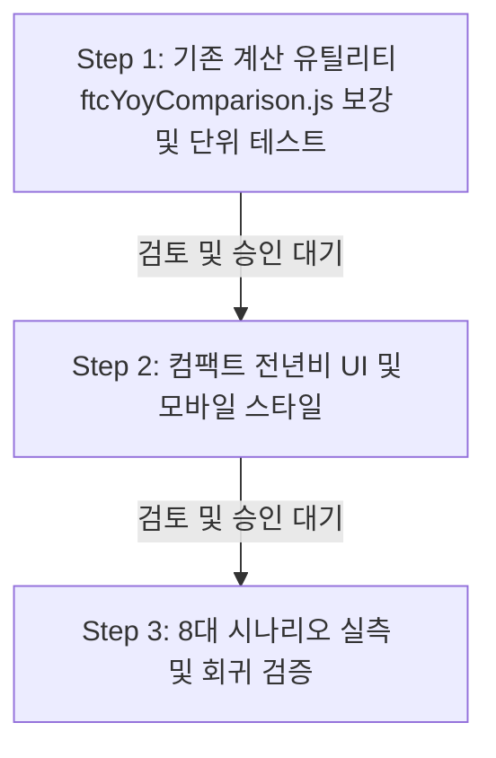

# Phase 5D 후속: 2024→2025 전년비 보조 비교 타당성 재검토 계획서 (R1)

> **문서 상태**: 2차 검토 피드백 반영 완료 — **수정 후 진행 (Proceed with Amendments)**  
> **수행 일시**: 2026-10-19 13:10:00 (KST)  
> **기준 작업**: [`.agent-workflow/TASK.md`](file:///d:/Franchise_Dashboard/.agent-workflow/TASK.md) 및 [`.agent-workflow/REVIEW.md`](file:///d:/Franchise_Dashboard/.agent-workflow/REVIEW.md)  
> **재검토 대상**: [`reports/phase5d_ftc_yoy_comparison_plan_r1.md`](file:///d:/Franchise_Dashboard/reports/phase5d_ftc_yoy_comparison_plan_r1.md)  
> **기존 계산·검증 자산**: [`frontend/src/utils/ftcYoyComparison.js`](file:///d:/Franchise_Dashboard/frontend/src/utils/ftcYoyComparison.js), [`scratch/test_phase5d_step1_calc.mjs`](file:///d:/Franchise_Dashboard/scratch/test_phase5d_step1_calc.mjs)  
> **선행 검증 기준**: Phase 5D Step 5D-3 의미 안전성 및 회귀 검증 완료 ([`reports/phase5d_step3_quality_report.md`](file:///d:/Franchise_Dashboard/reports/phase5d_step3_quality_report.md))  

---

## 1. 재검토 결론 및 판정

### 최종 판정: `수정 후 진행 (Proceed with Amendments)`

본 재검토는 Phase 5D Step 5D-1~3에서 확립된 **의미 안전성(Semantic Safety)** 및 **데이터 출처·모집단 분리 계약**과 Codex 1·2차 검토(REVIEW.md) 요구사항을 기준으로, 기존 `reports/phase5d_ftc_yoy_comparison_plan_r1.md`의 데이터 가용성, 의미 전달 위험, 단위 검증 계약, UI 레이아웃 영향도를 정밀 실측하여 도출되었습니다.

1. **데이터 가용성 확인 (100% 충족)**:
   - `/api/v1/ftc/trends` 응답의 `yearly_series` 배열 내에 2024년 및 2025년의 비교 대상 4개 지표(중위매출, 5% 절사평균, 점포 가중평균, 가맹점수)와 표본 수(`sample_count`)가 8대 외식업 대분류 전수에서 결측 없이 완벽하게 존재함을 실측 확인했습니다.
2. **수정 후 진행 사유 (R1 계획 및 검증 계약 보완 필요성)**:
   - **기존 자산 100% 재사용**: 신규 파일을 생성하지 않고 이미 구축된 [`frontend/src/utils/ftcYoyComparison.js`](file:///d:/Franchise_Dashboard/frontend/src/utils/ftcYoyComparison.js) 및 [`scratch/test_phase5d_step1_calc.mjs`](file:///d:/Franchise_Dashboard/scratch/test_phase5d_step1_calc.mjs)를 재사용하며, 비수치 예외 및 단위 무결성 방어 로직만 최소 수정으로 보강합니다.
   - **통계적 산식 엄격 구분**: 4개 지표 전체를 '중앙값'으로 뭉뚱그리지 않고, 공통 고지는 `전국 등록 가맹본부 거시 통계 기준`으로 정정하며 지표별 산식(중앙값, 절사평균, 가중평균, 총 가맹점 합계)을 명확히 분리 표기합니다.
   - **API 변경 없는 고정 단위 검증 계약 확립**: 실제 API 스키마(`YearlyTrendItem`)에 동적 `unit_type` 필드가 없으므로, 필드명 자체의 고정 단위 접미사(`_thousand_krw`, `_stores`)와 클라이언트 설정(`expectedUnit`)을 양방향 대조하고, 필드 키 누락이나 단위 불일치 시 `비교 불가`로 중단하는 계약을 확립합니다.
   - **엄격한 비수치 차단**: 빈 문자열(`''`), boolean(`true`/`false`), `Infinity` 등을 유효한 수치로 오인하지 않도록 `typeof val === 'number' && Number.isFinite(val) && !Number.isNaN(val)` 검증을 필수화합니다.
   - **접근성 인수 기준 구체화**: 패널 열기·접기·닫기, 연도 선택의 키보드 조작과 초점 이동·스크린리더 읽기 순서 유지 조건을 구체적으로 명시합니다.
3. **다음 승인 대상 범위 엄격 제한**:
   - UI 렌더링이나 CSS 수정을 선행하지 않으며, **오직 Step 1: 기존 계산 유틸리티(`ftcYoyComparison.js`)의 비수치/고정 단위 검증 보강 및 단위 테스트(`test_phase5d_step1_calc.mjs`) 재실행**만을 다음 승인 대상으로 한정합니다.

---

## 2. 7대 필수 검토 항목 실측 및 분석

### 2.1 [검토 1] `/api/v1/ftc/trends` 2024·2025 4개 지표 및 표본 수 실측

8대 외식업 대분류(`CAT_MAJ_01` ~ `CAT_MAJ_08`) 전수에서 백엔드 API 응답 데이터를 조회하여 2024년과 2025년 레코드의 지표 실재 여부를 전수 확인했습니다.

| 분류 ID | 업종 대분류 | 2024 표본수 | 2025 표본수 | 2024 중위매출 (천원) | 2025 중위매출 (천원) | 2024 가맹점수 | 2025 가맹점수 | 4개 지표 완비 여부 |
| :---: | :--- | :---: | :---: | :---: | :---: | :---: | :---: | :---: |
| `CAT_MAJ_01` | 한식 | 2,340 | 2,532 | 330,611.0 | 347,197.0 | 41,914 | 43,566 | **완비 (PASS)** |
| `CAT_MAJ_02` | 중식 | 214 | 203 | 368,338.0 | 402,103.5 | 4,174 | 4,017 | **완비 (PASS)** |
| `CAT_MAJ_03` | 일식 | 352 | 380 | 304,526.0 | 336,000.0 | 4,661 | 4,824 | **완비 (PASS)** |
| `CAT_MAJ_04` | 양식·세계음식 | 333 | 344 | 293,262.0 | 314,893.0 | 5,473 | 5,489 | **완비 (PASS)** |
| `CAT_MAJ_05` | 치킨·패스트푸드 | 692 | 649 | 196,561.0 | 201,706.0 | 43,304 | 41,139 | **완비 (PASS)** |
| `CAT_MAJ_06` | 분식·간편식 | 358 | 341 | 207,050.5 | 217,250.0 | 10,990 | 11,150 | **완비 (PASS)** |
| `CAT_MAJ_07` | 카페·음료 | 635 | 654 | 161,490.0 | 157,984.0 | 32,011 | 30,308 | **완비 (PASS)** |
| `CAT_MAJ_08` | 베이커리·디저트 | 246 | 245 | 200,093.0 | 200,056.0 | 11,169 | 8,681 | **완비 (PASS)** |

- **응답 필드 매핑 및 고정 단위 검증**:
  - `median_sales_thousand_krw`: 천원 단위 수치, 8개 업종 전수 존재 (양수)
  - `trimmed_mean_5pct_thousand_krw`: 천원 단위 수치, 8개 업종 전수 존재 (양수)
  - `store_weighted_avg_thousand_krw`: 천원 단위 수치, 8개 업종 전수 존재 (양수)
  - `total_franchise_stores`: 정수 단위 점포수, 8개 업종 전수 존재 (양수)
  - `sample_count`: 공시 브랜드 표본수, 8개 업종 전수 존재 (양수)
- **단위 일치성**: 2024년과 2025년 모두 동일한 고정 필드명 단위(`thousand_krw`, `stores`)로 산출되어 직접 델타 계산이 가능함을 확인했습니다.

### 2.2 [검토 2] 2025년 '최신 완결 후보 · 공식 마감 미확인' 표기 근거의 유효성

- **배경 및 근거**:
  - 공정거래위원회 정기공시 데이터는 매년 가맹본부의 정보공개서 변경등록 신청을 통해 수집되며, 행정청의 공식 마감 공고나 연차보고서 확정 발표 이전까지는 추가 보정·정정 신고가 반영될 수 있습니다.
  - 2025년 등록 데이터(2024 회계연도 실적)는 현재 등록 주기가 실질적으로 마감된 최신 가용 연도이지만, 공정위의 공식 행정적 확정 선언 여부를 데이터 API 수준에서 확인할 수 없습니다.
- **현재 구현 정합성**:
  - `CategoryFilterBar.jsx` (L155~L158): `공정위 2025년 등록 (2024년 결산) · 최신 완결 후보` 배지 및 `최신 완결 후보 (공식 행정 마감 여부 미확인)` 툴팁 적용.
  - `FtcBenchmarkPanel.jsx` (L611, L619): 차트 라벨 `완결후보` 태그 및 `* 2025년은 공식 행정마감 미확인 최신 완결 후보` 캡션 명시.
- **결론**: 2025년을 확정치가 아닌 `최신 완결 후보 (공식 마감 미확인)`로 명시하는 근거는 현재도 전적으로 유효하며, 전년비 UI에서도 이 수식어를 반드시 계승해야 합니다.

### 2.3 [검토 3] 2026 진행형 스냅샷의 계산 및 UI 제외 보장

- **제외 필요성**:
  - 2026년 등록 데이터는 수집 시점(2026-10-13) 기준 정기공시가 진행 중인 스냅샷으로, 약 30%의 가맹본부가 미등록 상태(결손)입니다.
  - 따라서 2025년 대비 2026년의 점포수나 매출을 비교하면 산업 축소나 실적 하락으로 심각하게 오인될 수 있습니다.
- **구조적 배제 방안**:
  1. **정적 레코드 바인딩**: 기존 `calculateFtcYoyComparison` 구현과 같이 `yearly_series`에서 `item?.benchmark_year === '2024'`와 `item?.benchmark_year === '2025'` 두 레코드만을 명시적 키 매칭으로 조회합니다.
  2. **2026 선택 시 상태 처리**: 사용자가 상단 연도 선택기에서 `2026년`을 선택하더라도, 전년비 블록은 '2024→2025 완결 후보 비교'를 고정 표출하며, "2026년은 진행형 스냅샷으로 전년비 비교 대상에서 제외됨"을 명시합니다.
  3. **단위 테스트 강제**: 2026년 데이터가 계산 함수의 인자나 출력에 포함되는 경우 즉시 실패하는 단언 테스트(`test_phase5d_step1_calc.mjs`의 T-06)를 유지 및 보강합니다.

### 2.4 [검토 4] 전국 업종 벤치마크 및 브랜드 비귀속 의미 안전성 유지

Phase 5D Step 5D-3에서 검증된 핵심 안전 원칙을 전년비 비교 블록에 엄격히 적용하며, 통계 지표별 성격을 명확히 구분합니다.

1. **공통 거시 고지문 정정 (중앙값 왜곡 방지)**:
   - 4개 지표 전체를 '중앙값'으로 설명하는 오류를 배제하고, 공통 고지문은 다음과 같이 정정합니다:
     `* 공정거래위원회 등록 전국 가맹본부 거시 통계 기준이며, 특정 브랜드나 지역 점포의 실적이 아닙니다.`
2. **4개 지표별 고유 산식 및 성격 명시**:
   - 각 지표가 서로 다른 통계적 산식을 가짐을 UI 라벨 및 툴팁에 명확히 표기합니다:
     1. **중위매출**: 전국 가맹본부별 대표매출의 **중앙값 (Median)**
     2. **5% 절사평균**: 상·하위 5% 이상치를 제외한 가맹본부 대표매출의 **절사평균 (5% Trimmed Mean)**
     3. **점포 가중평균 매출**: 가맹본부별 가맹점 수에 비례한 **가중평균 매출 (Store-Weighted Average)**
     4. **가맹점 수**: 가맹사업망 등록 **총 가맹점 합계 (Total Franchise Stores Sum)**
3. **브랜드 비귀속 및 모집단 분리**:
   - 특정 브랜드(예: 메가MGC커피 등)를 선택한 상태에서도 전년비 수치 앞에 브랜드명이 조합되지 않도록 격리합니다.
   - 좌측 상권 요약 카드의 소진공 점포수(4,507개 등)와 공정위 가맹점수 증감(41,914개 → 43,566개)을 절대 결합하지 않습니다.

### 2.5 [검토 5] 기존 계산·검증 자산 재사용을 통한 최소 변경 범위

신규 파일을 불필요하게 생성하지 않고, 이미 존재하는 기존 자산을 100% 재사용하여 Step 1 범위를 최소화합니다.

- **재사용 및 보강 대상 기존 파일**:
  1. [`frontend/src/utils/ftcYoyComparison.js`](file:///d:/Franchise_Dashboard/frontend/src/utils/ftcYoyComparison.js):
     - `calculateFtcYoyComparison(yearlySeries)`: 핵심 계산 함수 재사용.
     - `FTC_YOY_NOTICES`, `FTC_YOY_METRIC_CONFIGS`: 메타데이터 설정 재사용.
     - `formatDiffAmount`, `formatDiffRate`, `formatMetricValue`: 포맷터 재사용.
     - **보강 필요 사항**: 고정 필드 키 기반 단위 무결성 대조(`expectedUnit`) 및 비수치 예외(`Number.isFinite`) 방어 로직 강화.
  2. [`scratch/test_phase5d_step1_calc.mjs`](file:///d:/Franchise_Dashboard/scratch/test_phase5d_step1_calc.mjs):
     - 기존 T-01 ~ T-08 테스트 스위트 재사용.
     - **보강 필요 사항**: 빈 문자열(`''`), boolean(`true`/`false`), `Infinity`, `-Infinity`, 필드 누락 및 단위 불일치 예외 테스트 케이스 추가.
- **향후 단계별 범위 분리**:
  - **Step 1 (계산)**: `ftcYoyComparison.js` 보강 및 `test_phase5d_step1_calc.mjs` 검증. (UI/CSS 변경 0건)
  - **Step 2 (UI)**: `frontend/src/components/FtcBenchmarkPanel.jsx`에 컴팩트 전년비 카드 마운트 및 `index.css` 스타일링.
  - **백엔드/DB/API/수집기 변경**: **0건 (일체 수정 없음)**

### 2.6 [검토 6] 0·결측·연도 누락·비수치·고정 단위 검증 계약

실제 API 스키마에 동적 `unit_type` 필드가 존재하지 않는 현실을 반영하여, **API 변경 없이 클라이언트에서 고정 필드명 단위 규약을 완벽하게 검증하고 비수치를 차단하는 계약**을 수립합니다.

#### 1) 엄격한 유한 number 검증 규칙
자바스크립트의 `isNaN('') === false`, `isNaN(true) === false`, `isNaN(Infinity) === false`와 같은 묵시적 형변환 취약점을 배제하고, 반드시 다음 검증 식을 적용합니다:
```javascript
function isValidNumeric(val) {
  return typeof val === 'number' && Number.isFinite(val) && !Number.isNaN(val);
}
```

#### 2) API 변경 없는 고정 단위 규약 및 지표 설정 매핑
백엔드 API 변경 없이, 클라이언트 지표 설정(`FTC_YOY_METRIC_CONFIGS`)에 고정 기대 단위(`expectedUnit`)와 고유 산식(`calculationMethod`)을 결합하여 무결성을 검증합니다:
```javascript
export const FTC_YOY_METRIC_CONFIGS = [
  {
    id: 'median_sales',
    key: 'median_sales_thousand_krw',
    expectedUnit: 'thousand_krw',
    label: '중위매출',
    calculationMethod: '중앙값 (Median)',
    unitType: 'currency',
    unitLabel: '만원'
  },
  {
    id: 'trimmed_mean_5pct',
    key: 'trimmed_mean_5pct_thousand_krw',
    expectedUnit: 'thousand_krw',
    label: '5% 절사평균',
    calculationMethod: '상·하위 5% 이상치 제외 평균 (Trimmed Mean)',
    unitType: 'currency',
    unitLabel: '만원'
  },
  {
    id: 'store_weighted_avg',
    key: 'store_weighted_avg_thousand_krw',
    expectedUnit: 'thousand_krw',
    label: '점포 가중평균 매출',
    calculationMethod: '가맹점 수 비례 가중평균 (Weighted Average)',
    unitType: 'currency',
    unitLabel: '만원'
  },
  {
    id: 'total_franchise_stores',
    key: 'total_franchise_stores',
    expectedUnit: 'stores',
    label: '가맹점 수',
    calculationMethod: '가맹사업망 총 가맹점 합계 (Total Stores Sum)',
    unitType: 'count',
    unitLabel: '개'
  }
];
```

#### 3) 전년비 계산 중단 및 단위 무결성 폴백 계약

```javascript
/**
 * 지표 필드명 접미사 기반 고정 단위 매핑 사전
 * API 응답 필드명 접미사에 내재된 단위를 정의하여 호출부 설정(cfg.expectedUnit)과의 불일치를 엄격 차단
 */
const KNOWN_METRIC_KEY_UNITS = {
  'median_sales_thousand_krw': 'thousand_krw',
  'trimmed_mean_5pct_thousand_krw': 'thousand_krw',
  'store_weighted_avg_thousand_krw': 'thousand_krw',
  'total_franchise_stores': 'stores'
};

/**
 * 지표별 계산 및 단위/비수치 중단 판정 로직
 */
function evaluateMetricComparison(item2024, item2025, cfg) {
  // 중단 조건 1: 고정 필드별 고유 단위(intrinsicUnit) 매핑 및 expectedUnit 검증
  // (API 응답 필드명 접미사/정의와 설정의 expectedUnit이 일치하지 않거나 알려지지 않은 키인 경우 즉시 차단)
  const intrinsicUnit = KNOWN_METRIC_KEY_UNITS[cfg?.key];
  if (!intrinsicUnit || (cfg.expectedUnit && cfg.expectedUnit !== intrinsicUnit)) {
    return {
      isCalculable: false,
      reason: '단위 불일치',
      diffAmountText: '비교 불가',
      diffRateText: '비교 불가',
      direction: '비교 불가'
    };
  }

  // 중단 조건 2: 필드 키 존재 여부 검증 (어느 한쪽이라도 프로퍼티 누락 시 차단)
  if (!item2024 || !item2025 || !(cfg.key in item2024) || !(cfg.key in item2025)) {
    return {
      isCalculable: false,
      reason: '필드 키 누락',
      diffAmountText: '비교 불가',
      diffRateText: '비교 불가',
      direction: '비교 불가'
    };
  }

  // 중단 조건 3: 명시적 단위 메타데이터(unit 또는 unit_type)가 제공될 경우 고유 단위와의 불일치 차단
  const unit24 = item2024.unit || item2024.unit_type;
  const unit25 = item2025.unit || item2025.unit_type;
  if ((unit24 && unit24 !== intrinsicUnit) || (unit25 && unit25 !== intrinsicUnit)) {
    return {
      isCalculable: false,
      reason: '단위 불일치',
      diffAmountText: '비교 불가',
      diffRateText: '비교 불가',
      direction: '비교 불가'
    };
  }

  const v24 = item2024[cfg.key];
  const v25 = item2025[cfg.key];

  // 중단 조건 4: 비수치 차단 (빈 문자열, boolean, null, undefined, NaN, Infinity 등 배제)
  if (!isValidNumeric(v24) || !isValidNumeric(v25)) {
    return {
      isCalculable: false,
      reason: '비수치 또는 수치 결측',
      diffAmountText: '비교 불가',
      diffRateText: '비교 불가',
      direction: '비교 불가'
    };
  }

  // 중단 조건 5: 기준값 0 이하 (분모 0 나눗셈 및 비즈니스 음수 차단)
  if (v24 <= 0) {
    return {
      isCalculable: false,
      reason: '기준값 0 이하',
      diffAmountText: '비교 불가',
      diffRateText: '비교 불가',
      direction: '비교 불가'
    };
  }

  // 정상 델타 및 백분율 계산
  const diffAmount = v25 - v24;
  const diffRatePct = ((v25 - v24) / v24) * 100;

  return {
    isCalculable: true,
    diffAmount,
    diffRatePct,
    direction: Math.abs(diffAmount) < 0.0001 ? '변동 없음' : (diffAmount > 0 ? '증가' : '감소'),
    directionSign: diffAmount > 0 ? '+' : (diffAmount < 0 ? '-' : '')
  };
}
```

- **중단 규칙 및 단위 검증 계약 상세**:
  1. **고정 필드별 단위 매핑 검증 (잘못된 expectedUnit 즉시 차단)**: API 응답 객체에는 별도의 `unit` 필드가 없으므로, 필드명 자체에 고유 단위가 내재되어 있습니다(`_thousand_krw` = `thousand_krw`, `total_franchise_stores` = `stores`). `KNOWN_METRIC_KEY_UNITS` 매핑 사전을 통해 설정된 `cfg.expectedUnit`이 필드 고유 단위(`intrinsicUnit`)와 일치하는지 실제 코드 레벨에서 엄격히 검증합니다. 만약 `median_sales_thousand_krw` 지표에 `expectedUnit: 'stores'`와 같이 잘못된 단위가 설정되거나 미등록 키가 전달될 경우, 즉시 `isCalculable: false, reason: '단위 불일치'`로 판정하여 오염을 사전 차단합니다.
  2. **필드 키 누락 시**: 2024년 또는 2025년 레코드에서 `cfg.key`가 누락된 경우 즉시 `isCalculable: false, reason: '필드 키 누락'`으로 차단.
  3. **명시적 단위 메타데이터 불일치 시**: API 응답 객체에 `unit` 또는 `unit_type` 필드가 명시될 경우, 고유 단위(`intrinsicUnit`)와 불일치하면 즉시 `isCalculable: false, reason: '단위 불일치'`로 차단.
  4. **비수치 입력 시**: `''`, `true`, `false`, `null`, `undefined`, `Infinity`, `-Infinity`, `NaN`, 객체 입력 시 전수 `isValidNumeric`에 의해 `isCalculable: false, reason: '비수치 또는 수치 결측'`으로 차단.
  5. **기준값 0 이하 시**: 2024년 기준값이 0 이하일 경우 0 나눗셈 방지를 위해 `isCalculable: false, reason: '기준값 0 이하'`로 차단.

#### 4) 단위 무결성 및 비수치 차단 테스트 케이스 (T-09 기대 결과 명세)
Step 1 단위 테스트에서 검증할 T-09 케이스별 구체적인 입력 조건과 기대 결과는 다음과 같습니다:
- **T-09-A (잘못된 expectedUnit 차단 — P2 피드백 핵심 시나리오)**:
  - 입력: `median_sales_thousand_krw` 키에 `expectedUnit: 'stores'` 설정
  - 기대 결과: `isCalculable === false`, `reason === '단위 불일치'`, `diffAmountText === '비교 불가'`, `diffRateText === '비교 불가'` (잘못된 단위 설정 완벽 차단)
- **T-09-B (정상 expectedUnit 검증 통과)**:
  - 입력: `median_sales_thousand_krw` 키에 `expectedUnit: 'thousand_krw'` 설정
  - 기대 결과: `isCalculable === true`, 정상 수치 계산 (`diffAmount`, `diffRatePct` 유효값 반환)
- **T-09-C (레코드 내 명시적 단위 불일치 차단)**:
  - 입력: `median_sales_thousand_krw` 레코드에 `{ unit: 'krw' }` 또는 `{ unit_type: 'stores' }` 전달
  - 기대 결과: `isCalculable === false`, `reason === '단위 불일치'`
- **T-09-D (필드 키 누락 차단)**:
  - 입력: 2024년 또는 2025년 객체에 대상 키 누락 (`{ other_key: 100 }`)
  - 기대 결과: `isCalculable === false`, `reason === '필드 키 누락'`
- **T-09-E (비수치 및 무한대 엣지 케이스 차단)**:
  - 입력: 값으로 `''`, `true`, `false`, `null`, `undefined`, `NaN`, `Infinity`, `-Infinity` 전달
  - 기대 결과: `isCalculable === false`, `reason === '비수치 또는 수치 결측'`
- **T-09-F (기준값 0 이하 차단)**:
  - 입력: 2024년 기준값으로 `0` 또는 `-100` 전달
  - 기대 결과: `isCalculable === false`, `reason === '기준값 0 이하'`

### 2.7 [검토 7] 1440×900, 390×844 및 필수 키보드 접근성 인수 기준

REVIEW.md의 요구사항에 따라, 키보드 인터랙션과 스크린리더 읽기 순서에 대한 구체적인 합격 기준을 명시합니다.

#### 1) 뷰포트 및 반응형 레이아웃 인수 기준
- **데스크톱 (1440×900)**:
  - 패널 내부 너비(420px) 내에서 4개 지표를 2×2 컴팩트 그리드로 구성.
  - 카드당 높이를 48px 이내로 제한하여 불필요한 패널 높이 팽창 방지.
- **모바일 (390×844)**:
  - **피크 바(64px) 상태**: 전년비 블록을 피크 바에 포함하지 않음 (높이 64px 유지 및 가로 오버플로 0px 절대 보장).
  - **확장 바텀시트 상태**: 추세 차트 하단에 배치하며, `document.documentElement.scrollWidth <= 390px` (가로 오버플로 0px) 유지.

#### 2) 필수 키보드 조작 및 접근성 합격 기준
- **패널 열기**: 공정위 드로어 트리거 버튼(`.ftc-drawer-btn`)에 키보드 포커스 후 `Enter` 또는 `Space` 키 입력 시 패널 열림(`drawer-open`).
- **패널 닫기**: 패널 내부 어디서든 `Escape` 키 입력 시 패널이 닫히며(`drawer-closed`), 초점이 트리거 버튼으로 안전하게 복귀.
- **패널 접기/펼치기**: `#ftc-benchmark-panel .collapse-toggle-btn`에 키보드 포커스 후 `Enter` 키로 접기/펼치기(`.collapsed`) 토글.
- **연도 선택 키보드 연동**: 추세 차트 바 컬럼(`.chart-bar-column`)에 `tabIndex={0}` 및 `role="button"`을 유지하고, `Enter`/`Space` 키로 연도 전환 (`2024` / `2025` / `2026`).
- **초점 이동 및 스크린리더 낭독 순서**:
  - 전년비 블록은 DOM 순서상 추세 차트 바로 다음에 위치하여 자연스러운 탭 순서(Tab Order) 유지.
  - 각 지표는 구조화된 마크업(`<dl>`-`<dt>`-`<dd>` 또는 명시적 `aria-label`)을 사용하여 스크린리더가 **[지표명(고유산식) → 2024년 값 → 2025년 값 → 증감액 및 증감률(기호+방향 텍스트)]** 순서로 논리적으로 낭독.
  - 색상 의존 차단(WCAG 2.1): 상승·하락을 색상뿐 아니라 `증가 ▲ (+X.X%)`, `감소 ▼ (-X.X%)`, `변동 없음 (0.0%)` 텍스트와 기호로 명시.

---

## 3. 단계별 개발 계획 (Step-by-Step Architecture)

안전한 점진적 구현을 위해 Step 5D 후속 작업을 3단계로 엄격히 분할하며, **기존 자산을 재사용**합니다.



### [Step 1] 기존 계산 로직 보강 및 단위 테스트 (현재 제안 대상)
- **작업 범위**:
  - 기존 [`frontend/src/utils/ftcYoyComparison.js`](file:///d:/Franchise_Dashboard/frontend/src/utils/ftcYoyComparison.js)에 `KNOWN_METRIC_KEY_UNITS` 기반 고정 단위 검증 및 비수치 방어(`isValidNumeric`) 로직 보강.
  - 기존 [`scratch/test_phase5d_step1_calc.mjs`](file:///d:/Franchise_Dashboard/scratch/test_phase5d_step1_calc.mjs)에 T-09 단위 무결성 전수 테스트(T-09-A ~ T-09-F: 잘못된 expectedUnit 차단, 명시적 단위 불일치, 필드 키 누락, 비수치/불리언/NaN/무한대, 기준값 0 이하) 추가 및 검증 실행.
- **완료 조건**:
  - 8개 업종 전수의 2024→2025 4개 지표 증감액·증감률 계산 PASS
  - 2026년 데이터가 계산에서 배제됨을 검증
  - T-09 전 항목(잘못된 expectedUnit 차단 포함) `비교 불가` 정상 처리 검증 PASS
  - UI 렌더링 및 CSS 변경 **0건**
- **산출물**: 보강된 `ftcYoyComparison.js`, 단위 테스트 스크립트 실행 결과 원시 JSON, Step 1 실행보고서

### [Step 2] 보조 비교 UI 및 반응형 스타일
- **작업 범위**:
  - `frontend/src/components/FtcBenchmarkPanel.jsx`에 전년비 비교 섹션 추가 (추세 차트 직후 배치).
  - 지표별 산식 라벨(중앙값, 절사평균, 가중평균, 총 가맹점수) 분리 명시 및 공통 거시 고지문 반영.
  - `frontend/src/index.css`에 2열 컴팩트 카드 및 배지 스타일 추가.
- **완료 조건**:
  - 데스크톱 1440×900 및 모바일 390×844 확장 뷰포트에서 미잘림 확인.
  - 모바일 가로 오버플로 0px 유지 및 키보드 조작성 확인.

### [Step 3] 회귀 검증 및 품질 감사
- **작업 범위**:
  - CDP 기반 자동화 검증 스크립트 실행 (`verify_phase5d_step3_semantic_safety.mjs` 기반 확장).
  - 8대 업종, 지도, 필터, Top 5 브랜드, 연도 선택, 키보드 접근성 회귀 없음 전수 검증.
- **완료 조건**:
  - 모든 검증 PASS, 프로덕션 빌드 성공, 최종 품질보고서 제출.

---

## 4. 보호 대상 파일 무결성 확인

| 대상 파일 | 사전/사후 SHA-256 해시 | 파일 크기 | 무결성 판정 |
| :--- | :--- | :---: | :---: |
| [`collector.py`](file:///d:/Franchise_Dashboard/collector.py) | `341BAC12BB0AF58DCBDEBBA9459033521F27DF9817E35BAD8B21A4D07BA3369C` | 3,780 B | **일치 (PASS)** |
| [`gangnam_food_stores.sqlite3`](file:///d:/Franchise_Dashboard/gangnam_food_stores.sqlite3) | `FEE3B58651CFED5C390C0B95DB02B05EBE92DF18619A06F4E399D429236F3A78` | 15,831,040 B | **일치 (PASS)** |
| [`run_gangnam.bat`](file:///d:/Franchise_Dashboard/run_gangnam.bat) | `0582C3A1AE53450DDC482E9BF538510780CA2F14D44E987CC753D4E12C816491` | 66 B | **일치 (PASS)** |

---

## 5. 다음 승인 요청 범위

본 재검토 보고서 승인 시, UI 렌더링이나 스타일 변경을 선행하지 않으며 오직 **[Step 1] 기존 `frontend/src/utils/ftcYoyComparison.js`의 비수치/고정 단위 검증 보강 및 `scratch/test_phase5d_step1_calc.mjs` 검증**만을 착수 범위로 한정합니다.
