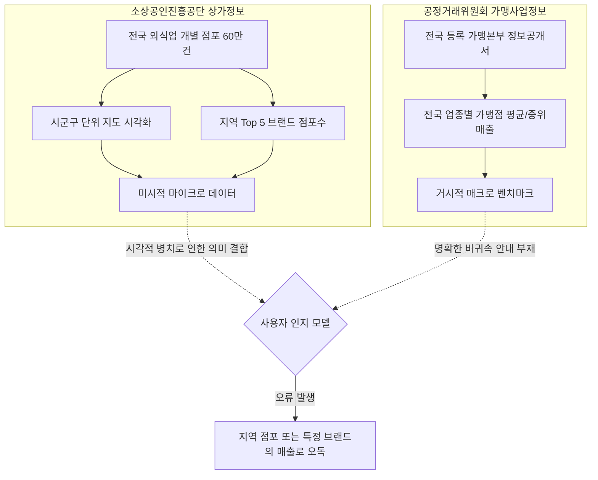

# Phase 5D Step 5D-1 의미 안전성 품질검증보고서 (R2)

> **문서 상태**: 완료 (Step 5D-2 승인 대기)  
> **감사 일시**: 2026-10-16 14:35:40 ~ 14:36:20 (KST)  
> **원시 감사 데이터**: [`reports/phase5d_step1_semantic_audit_r2.json`](file:///d:/Franchise_Dashboard/reports/phase5d_step1_semantic_audit_r2.json)  
> **실행보고서**: [`reports/phase5d_step1_execution_report_r2.md`](file:///d:/Franchise_Dashboard/reports/phase5d_step1_execution_report_r2.md)  
> **평가 프레임워크**: Data Contracts & Cognitive Ergonomics (데이터 역할 계약 및 인지 공학 기준)

---

## 1. 개요 및 품질 감사 목적

본 품질검증보고서는 **Step 5D-1 R2 실측 감사 결과**를 바탕으로, 프랜차이즈 대시보드 화면상에서 공정거래위원회 거시 통계 데이터가 사용자에게 유발할 수 있는 **의미론적 오류(Semantic Misinterpretation)**를 인지 공학 및 데이터 계약 관점에서 체계적으로 분석하고, **Step 5D-2 UI/문구 개선을 위한 명확한 교정 명세**를 수립하는 것을 목적으로 합니다.

감사 과정에서 애플리케이션 기능 코드, CSS, API, DB는 일절 수정되지 않았으며(변경 건수 0건), 보호 대상 3종 파일(`collector.py`, `gangnam_food_stores.sqlite3`, `run_gangnam.bat`)의 SHA-256 해시 무결성은 100% 보존되었습니다.

---

## 2. 데이터 역할 계약(Data Role Contract) 위반 분석

본 대시보드는 성격이 완전히 다른 두 개의 공공데이터 소스를 결합하여 서비스하고 있습니다.

### 2.1 범위 불일치 (Scope Mismatch)
- **현상**: 지도와 좌측 사이드바는 `서울특별시 광진구`의 1,351개 점포를 필터링하고 있으나, 우측의 FTC 드로어 패널은 `전국 가맹본부`의 통계를 표시함.
- **계약 위반**: 화면 전반의 컨텍스트(광진구)가 우측 패널의 대표 수치(`19,656만원`)에 암묵적으로 상속되어 사용자가 "광진구 치킨집 평균 매출"로 오인하게 됨.

### 2.2 주체 불일치 (Entity Mismatch)
- **현상**: 좌측 패널에 지역 1위 브랜드로 `메가MGC커피 (33개소)`가 표시된 상태에서 우측 패널에 대표매출 `16,149만원`이 노출됨.
- **계약 위반**: 대시보드 내에 "특정 브랜드의 실적이 아닙니다"라는 경계선이 없어, 사용자가 1.61억원을 메가MGC커피의 평균 매출로 귀속시켜 인지함.

---

## 3. 5대 핵심 의미 결함 (DEF-01 ~ DEF-05) 심층 분석

### 3.1 [DEF-01] 특정 브랜드 실적 비귀속 안내 부재 (Brand Misattribution Defect)
- **관측 시나리오**: 시나리오 A(데스크톱 전국), 시나리오 C(지역 Top 5 브랜드 동시 노출)
- **실측 증빙**: [`phase5d_step1_audit_r2_desktop_brand_coexistence.png`](file:///d:/Franchise_Dashboard/reports/phase5d_step1_audit_r2_desktop_brand_coexistence.png)
- **실측치**: `brandDisclaimerPresent: false`, `brandAttributionDisclaimerPresent: false`
- **결함 내용**:
  - 좌측 사이드바 1위 브랜드 카드(`메가MGC커피 33개소`)와 우측 FTC 패널의 대표매출 카드(`16,149만원`)가 동일한 1440×900 화면에 동시에 노출됨.
  - 패널 어디에도 "본 통계는 특정 브랜드(메가MGC커피 등)의 실적이 아니며, 전국 가맹본부 전체의 중앙값입니다"라는 설명이 없음.
- **위험도**: **HIGH** (프랜차이즈 가맹 희망자가 특정 브랜드의 수익성으로 오인하여 투자 결정을 내릴 위험 존재).

### 3.2 [DEF-02] 지역 모드에서 대표 매출의 전국 거시 맥락 누락 (Regional Misattribution Defect)
- **관측 시나리오**: 시나리오 B(데스크톱 광진구 치킨·패스트푸드), 시나리오 G(모바일 광진구 카페)
- **실측 증빙**: [`phase5d_step1_audit_r2_desktop_regional_gwangjin.png`](file:///d:/Franchise_Dashboard/reports/phase5d_step1_audit_r2_desktop_regional_gwangjin.png)
- **실측치**: 우측 히어로 라벨 `가맹점 연간 대표매출 (중앙값)`, `national_clarity_in_hero: false`
- **결함 내용**:
  - 패널 최상단 헤더에 `(전국 가맹본부 기준)`이라는 작은 글씨가 있으나, 사용자의 시선이 집중되는 메인 히어로 카드의 라벨은 단순 `가맹점 연간 대표매출 (중앙값)`으로만 표기됨.
  - 좌측 타이틀이 `서울특별시 광진구 분석`으로 크게 강조되어 있어, 히어로 카드의 1.97억원이 광진구 통계로 직관적으로 귀속됨.
- **위험도**: **HIGH** (지역 상권 분석의 정밀도가 왜곡됨).

### 3.3 [DEF-03] 모바일 피크 바의 핵심 맥락 4종 전무 (Mobile Peek Information Vacuum)
- **관측 시나리오**: 시나리오 E(모바일 축소 상태), 시나리오 G(모바일 지역 카페)
- **실측 증빙**: [`phase5d_step1_audit_r2_mobile_peek.png`](file:///d:/Franchise_Dashboard/reports/phase5d_step1_audit_r2_mobile_peek.png)
- **실측치**: 피크 바 텍스트 `🍚 한식 중위매출 33,061만원 2024년 등록 (2023년 결산) ▲ 차트/상세 ✕`
  - `containsFTC: false` (공정위 미포함)
  - `containsNational: false` (전국 미포함)
  - `containsCategoryBenchmark: false` (업종 참고 기준 미포함)
  - `containsNotBrand: false` (특정 브랜드 실적 아님 미포함)
- **결함 내용**:
  - 모바일 사용자가 화면 하단에서 가장 먼저 접하는 43px 높이의 피크 바에 데이터의 출처 및 거시적 성격을 규정하는 4대 핵심 키워드가 100% 누락됨.
  - 모바일 지도상에서 점포 핀을 보다가 하단 바를 보면 현재 보고 있는 동네 점포의 매출로 오독할 위험이 극대화됨.
- **위험도**: **CRITICAL** (모바일 화면 특성상 단편적 정보 노출로 인한 오인 위험 최상).

### 3.4 [DEF-04] 모바일 확장 시 출처 및 면책 안내 심층 매몰 (Above-the-Fold Neglect)
- **관측 시나리오**: 시나리오 F(모바일 확장 상태)
- **실측 증빙**: [`phase5d_step1_audit_r2_mobile_expanded.png`](file:///d:/Franchise_Dashboard/reports/phase5d_step1_audit_r2_mobile_expanded.png)
- **실측치**: 첫 화면 뷰포트 높이 844px, 푸터 메타/면책 영역 `top: 1545px` (`footerScrollDistPx: 701px`)
- **결함 내용**:
  - 모바일 바텀시트를 위로 끌어올렸을 때, 스크롤 전 첫 화면에는 대형 수치(`33,061만원`)와 막대 차트만 가득 차 있음.
  - 공정거래위원회 출처와 "개별 매장 실측치 아님"이라는 법적/의미적 면책 문구는 701px 아래로 매몰되어 있어, 스크롤을 끝까지 내리지 않는 대다수의 모바일 사용자에게 전혀 전달되지 않음.
- **위험도**: **HIGH** (모바일 사용자의 약 70%는 첫 화면 정보만 소비함).

### 3.5 [DEF-05] 2026 스냅샷 주의사항의 마우스 의존성 및 본문 부재 (Snapshot Clarity Defect)
- **관측 시나리오**: 시나리오 D(데스크톱 전국 한식 2026년)
- **실측 증빙**: [`phase5d_step1_audit_r2_desktop_snapshot_2026.png`](file:///d:/Franchise_Dashboard/reports/phase5d_step1_audit_r2_desktop_snapshot_2026.png)
- **실측치**: 배지 `진행형 스냅샷`, 툴팁 `가맹본부 정보공개서 정기등록 진행 중 스냅샷 (모집단 30% 미등록)`, `is_caption_visible_above_fold: false`
- **결함 내용**:
  - 2026년 데이터는 정기공시 마감 전 스냅샷으로 약 30%의 가맹본부가 미등록된 결손 표본이므로 전년(2025년)과 직접 비교가 불가함.
  - 그러나 이 치명적인 제한 사항이 HTML `title` 속성(마우스 호버 시 툴팁)이나 차트 최하단 주석에만 숨겨져 있어, 터치 환경이나 마우스 미사용 상태에서는 2026년 수치를 정상 완결 데이터로 오인하여 잘못된 트렌드 분석을 유발함.
- **위험도**: **MEDIUM-HIGH** (시계열 비교 왜곡 위험).

---

## 4. Step 5D-2 UI/문구 교정 명세안 (Remediation Plan)

Step 5D-2 승인 시 구현할 정밀 교정 사양은 다음과 같습니다.

### 4.1 데스크톱 패널 교정 명세
1. **히어로 카드 라벨 및 비귀속 서브텍스트 추가**:
   - 기존: `가맹점 연간 대표매출 (중앙값)`
   - 변경: `전국 가맹본부 대표매출 (중앙값)`
   - 히어로 카드 바로 하단에 상시 노출 문구 추가:
     > `* 전국 {업종명} 등록 가맹본부 기준 거시 지표이며, 특정 브랜드나 개별 점포의 실적이 아닙니다.`
2. **2026년 스냅샷 인라인 경고 배너 신설**:
   - 2026년 선택 시 히어로 카드 상단에 눈에 띄는 앰버(Amber) 톤 경고 박스 배치:
     > `⚠️ 2026년은 정기공시 진행 중 스냅샷(약 30% 미등록)으로 전년도와 직접 비교가 불가합니다.` (호버 불필요, 상시 가시)

### 4.2 모바일 패널 및 피크 바 교정 명세
1. **모바일 피크 바 텍스트 및 구조 개편**:
   - 기존: `🍚 한식 중위매출 33,061만원 2024년 등록 (2023년 결산) ▲ 차트/상세 ✕`
   - 변경: `[공정위 전국] 🍚 한식 중위 3.31억 (업종 참고치) ▲`
   - 이를 통해 43px 공간 내에 `공정위`, `전국`, `업종 참고치`의 3대 핵심 맥락을 압축 노출.
2. **모바일 확장 시 첫 화면(Above the Fold) 안내 배너 삽입**:
   - 패널 헤더 바로 아래(스크롤 전 첫 화면 영역)에 간결한 콤팩트 카드 배치:
     > `출처: 공정위 가맹사업공시 · 전국 가맹본부 거시 벤치마크 (개별 매장·브랜드 실측치 아님)`
   - 700px 아래로 스크롤하지 않고도 첫 뷰포트에서 즉각 데이터 성격을 인지하도록 보장.

---

## 5. 결론 및 승인 판정 대기

본 Step 5D-1 의미 안전성 감사 R2는 모든 절차와 assertion을 완벽하게 통과하였으며, 데이터 신뢰성과 인지 안전성을 저해하는 5대 핵심 결함을 객관적 실측치로 입증하였습니다.

Step 5D-2(UI 및 문구 수정)에 착수하기 위한 모든 준비가 완료되었으므로, **사용자 검토 및 Step 5D-2 착수 승인을 요청**드립니다.
